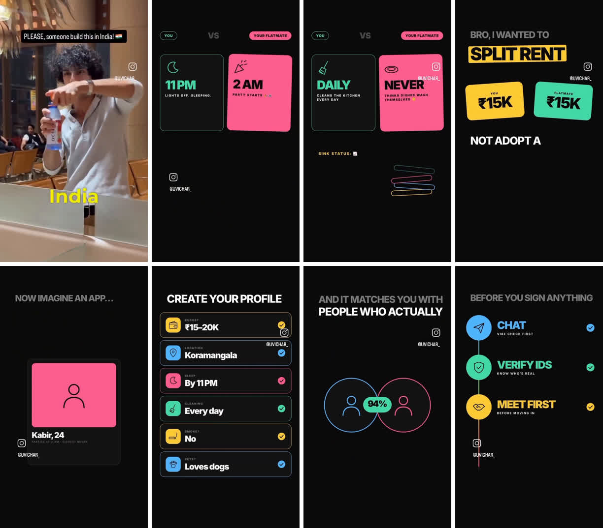
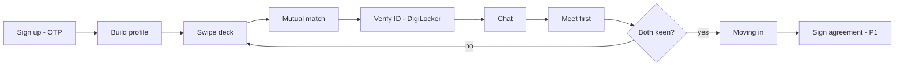

# Flatrimony — Product Spec (v0.3)

Nov 11, 2026 · @Aryan Garg

## 1. Source: what the reel asks for

The reel (Instagram, creator handle on screen: @uvichar\_, 66 s) pitches "Tinder for flatmates" for India: match on lifestyle, not just rent. Everything below traces back to these points; anything I added beyond the reel is marked **\[added\]**.

| # | Point in the reel | On-screen visual | What it becomes in the product |
| --- | --- | --- | --- |
| 1 | Finding a flatmate is harder than finding a partner | "PLEASE, someone build this in India!" | Core positioning and tagline |
| 2 | On a dating app you can stop talking; with a flatmate you've signed an 11-month rent agreement | Rent agreement card | High cost of a bad match → trust and "meet first" before commitment |
| 3 | You sleep at 11 PM, flatmate parties at 2 AM | "You vs your flatmate": 11 PM vs 2 AM | Sleep schedule as a matching attribute |
| 4 | You clean daily, flatmate thinks dishes wash themselves | Daily vs Never, "sink status" | Cleanliness as a matching attribute |
| 5 | "I wanted to split rent, not adopt a grown child" | Split rent: ₹15K + ₹15K | Budget / rent share as a hard filter |
| 6 | Imagine an app: basically Tinder for flatmates | Swipe card "Kabir, 24" | Swipe-style discovery deck |
| 7 | Profile: budget, preferred location, sleep schedule, cleaning habits, smoking, pets | Profile: ₹15–20K, Koramangala, By 11 PM, Every day, No smoking, Loves dogs | Onboarding questionnaire (the minimum set) |
| 8 | Matches you with people who actually live like you | Two avatars, "94%" | Compatibility score shown as a percentage |
| 9 | Chat, verify identities, meet before moving in | "Before you sign anything": Chat (vibe check first), Verify IDs (know who's real), Meet first (before moving in) | In-app chat, ID verification, meet-up scheduling |
| 10 | Earns from verified listings and optional matching services | (voice-over only) | Paid listings + premium matching |
| 11 | Three months researching an iPhone, one WhatsApp call to pick a flatmate | B-roll | Marketing hook: structured vetting vs a casual call |
| 12 | "What's the worst flatmate you've experienced?" | Call to action | Community / story content for growth **\[added interpretation\]** |

Key frames from the reel, left to right: the ask; sleep clash (11 PM vs 2 AM); cleaning clash (daily vs never); split rent; the swipe card; the profile fields; the 94% match; "before you sign anything".



## 2. Problem, users, and a reality check

The problem is real, but "Tinder for flatmates" is not a new idea in India. A copy of what the reel describes would enter a market where the core features already exist. The product needs a sharper edge than match percentages.

**Problem statement.** Young renters in Indian metros pick a person to share an 11-month agreement and a security deposit with after one WhatsApp call. Today's platforms are built around listings (rooms, flats). Very few check whether two people can actually live together.

**Primary users**

- **Seeker without a flat**: needs a room in an existing flat, or a co-signer to rent a new flat together.
- **Room owner / current tenant**: has a flat and an empty room, and wants a compatible person to fill it (this is the supply side).
- **Pair-up seekers** **\[added\]**: two or more people with no flat yet who want to match first, then search together.

Starting persona: working professionals aged 22–32 who move to Bengaluru, Pune, Hyderabad or Gurugram for a job. The reel's own example is Koramangala at ₹15–20K per person.

**Who already does this** (the claims are from each company's own pages and are not independently verified)

| Player | What overlaps with the reel | Model | Note |
| --- | --- | --- | --- |
| [FlatMate.in](https://www.flatx.co/blog/flatmate-in-vs-flatx) | Compatibility match %, chat that hides your number | Free to browse, paid to contact; about ₹499/month per [NoBroker's blog](https://www.nobroker.in/blog/paying-guest-app/) | Listed in 40+ cities, plus rent agreements and furniture |
| [FlatX](https://www.flatx.co/blog/flatmate-in-vs-flatx) | Lifestyle matching (food, smoking, pets, schedule, budget), OTP and ID checks, private chat | Free trial, then a Pro plan | Bengaluru only for now; the closest copy of the reel |
| [NoBroker](https://www.nobroker.in/forum/what-is-the-difference-between-the-nobroker-tenant-plans/) | Flatmate listings inside a large rental marketplace | Tenant plans, Freedom ₹1,649 to MoneyBack ₹5,999 + GST | Wins on inventory, not on compatibility |
| [Flatchat](https://app.dealroom.co/companies/flatchat) (history) | Chat-first flatmate matching, Bengaluru, 2013 | Seed-funded by CommonFloor | Shut down after Quikr acquired CommonFloor; a warning about building on an acquirer's roadmap |

**My honest read (challenge these)**

1. **Match % is table stakes, not a moat.** Two competitors already show one. A score built only on self-reported answers also misleads: almost everyone says they "clean every day".
2. **Users churn when the product works.** A good match means the user leaves for 11 months. Dating apps have the same problem, but users come back much sooner. Revenue has to come from the moment of need, not from monthly subscriptions.
3. **Cold start is local.** A match only matters within one area and one budget band. 10,000 users across India is worse than 800 in Koramangala and HSR Layout.
4. **The real wedge is trust after the match.** The reel's best line is "before you sign anything". Build there: verified identity and employer, references from past flatmates, a written house agreement, and a fair way to split rent and deposits. This is what FlatMate.in and FlatX don't lead with.

**Suggested positioning \[added\]:** "Know how they live before you sign." Compatibility gets people in the door; past-flatmate references and a shared house agreement are why they trust it. Brand line under the name Flatrimony: "Rishta pakka, rent split." (section 4.3).

### 2.1 Decisions made with the founder (11 Nov 2026)

These answers override anything earlier in this doc that disagrees with them.

| Topic | Decision | Consequence for the build |
| --- | --- | --- |
| Stage | Solo product first; seek VC funding if traction comes | Keep costs low, but build clean enough to hand to a team |
| Launch area | All of Delhi NCR | Match on commute time, not city name (Gurugram–Noida is about 50 km) |
| Users | Professionals, students, women-first and relocating people, each as a category the user picks | Category changes onboarding questions, filters and safety defaults (section 3.8) |
| Platform | Android + web together | React Native (Expo) + Next.js, shared TypeScript code |
| Pre-move-in features | Video walkthrough, broker detection, landlord rules + true cost, commute matching | All in the spec; build order in section 6.3 |
| After-move-in features | Flatmate Passport + references, move-in photo log + deposit record, replacement finder, chores + UPI bill split | All in the spec; build order in section 6.3 |
| ID check timing | Required before the first chat message; browsing is open | Verification gate sits between "match" and "chat" |
| ID method | DigiLocker, through a paid provider at launch | No company needed to start; cost per check |
| Reviews | One general system: habit confirmations + private references, no star ratings, double-blind | See section 3.9 |
| Women-only category | Women-only visibility, live location during visits, SOS, gender confirmed by ID | All P0 for that category |
| Discovery | Swipe and list/map, user toggles | Both views share one ranking |
| Languages | English + Hindi at launch | All strings in translation files from day one |
| Visual style | Playful but light | Bright accents on a light base (section 4.1) |
| Name | Flatrimony (flat + matrimony); name checks pending | Brand, voice and checks in section 4.3 |
| Seeker pricing | Free core after verification + paid Move Pass | Section 6.1 |
| Lister pricing | Free verified listing + paid boost | Section 6.1 |
| Landlords | Not on the platform; flatmates only | Keeps brokers out; the listing must come from a resident tenant |
| Budget | Under ₹5,000/month at launch; cheap-first design | Cached commute zones, free routing engine, short compressed videos |
| Security | Full engineering section | Section 7 |

## 3. Feature spec

The MVP is the reel's flow end to end: profile → match → chat → verify → meet. Priorities: **P0** = launch blocker, **P1** = within 2 months of launch, **P2** = later.

### 3.1 Onboarding and profile

| Field | Type | Source | Priority |
| --- | --- | --- | --- |
| Phone number (OTP login) | Required | \[added\] | P0 |
| Intent: "I have a room" / "I need a room" / "Find a flatmate, then a flat" | Single choice | \[added\] | P0 |
| Name, age, gender, photos (1–6) | Required | Reel ("Kabir, 24") | P0 |
| Budget (rent share, ₹ range per month) | Range slider | Reel (₹15–20K) | P0 |
| Preferred locations (up to 3 areas, plus commute point) | Map / multi-select | Reel (Koramangala) | P0 |
| Move-in date and lease length | Date + months | \[added\] | P0 |
| Sleep schedule (usual bedtime, wake time) | Time picker | Reel (by 11 PM) | P0 |
| Cleaning habits (daily / few times a week / weekly / rarely) | Single choice | Reel (every day) | P0 |
| Smoking (no / outside only / yes) | Single choice | Reel | P0 |
| Pets (have / love / OK / no) | Single choice | Reel (loves dogs) | P0 |
| Food: veg / non-veg / eggetarian; cooking at home | Single choice | \[added\], a common Indian deal-breaker | P0 |
| Drinking, guests overnight, parties at home | Single choice each | \[added\], extends the reel's 2 AM party point | P1 |
| Work pattern (office / hybrid / WFH / night shift) | Single choice | \[added\] | P1 |
| Gender preference for flatmates | Single choice | \[added\], expected in India | P0 |
| Bio and prompts ("My flatmate pet peeve is…") | Text | \[added\] | P1 |
| Room details for room owners: rent, deposit, photos, furnishing | Listing form | Reel ("verified listings") | P0 |

Each lifestyle field has an **"importance"** toggle: deal-breaker / matters / don't care. This feeds the score in section 5.

### 3.2 Discovery and matching

- **P0** Swipe deck of profile cards showing photo, name, age, match %, budget, area, and the top 3 shared habits (the reel's "Kabir, 24" card).
- **P0** Like / pass; a match happens when both like each other.
- **P0** Hard filters before scoring: budget overlap, location, move-in window, gender preference, any field marked deal-breaker.
- **P0** A match breakdown: "94% — same bedtime, both non-smokers, you clean daily and they clean weekly."
- **P1** List and map views for people who don't like swiping (this matters for web).
- **P1** "Super like" or a note sent with a like (paid add-on).

### 3.3 Chat ("vibe check first")

- **P0** One-to-one chat after a match; phone numbers stay hidden until both choose to share.
- **P0** Report and block; message limits for new accounts to slow spam.
- **P1** Icebreaker prompts and a short "house rules" quiz both people answer in the chat.
- **P1** Group chat for 3+ people sharing one flat.

### 3.4 Verification ("know who's real")

- **P0** Phone OTP; a selfie liveness check matched to the profile photos.
- **P0** DigiLocker identity check through a licensed provider, required before sending the first message. Store only the result (verified name, age, gender, DigiLocker ID reference), never the document; show a "Verified" badge.
- **P1** Work email or college email check ("works at a verified company").
- **P1** Listing verification: proof of tenancy or ownership for room owners (this is the "verified listings" revenue line from the reel).
- **P0** Flatmate Passport, habit confirmations and private references: see section 3.9.

### 3.5 Meet first ("before moving in")

- **P0** Propose a meet-up or flat visit from the chat: date, time, place.
- **P1** A safety option to share meet-up details with a trusted contact.
- **P1** After the meeting, both people answer "Still interested?" privately; it moves the match to "Moving in".

### 3.6 After the match \[added\]

- **P1** House agreement template: quiet hours, cleaning rota, guests, bills, deposit share. Both people sign it in the app.
- **P2** Rent and bill splitting with UPI reminders.
- **P2** Rent agreement drafting through a partner.

### 3.7 Platform

- **P0** Notifications: new match, message, meet-up reminder.
- **P0** Admin panel: moderation queue, reports, verification review, listing approval.
- **P1** Community stories feed ("worst flatmate" stories from the reel's call to action) for growth and SEO on web.

### 3.8 User categories

The user picks a category at sign-up and can change it later. Everyone shares one pool, but the category changes defaults.

| Category | Extra onboarding | Default filters | Safety defaults | Specific features |
| --- | --- | --- | --- | --- |
| Professional | Office location, work mode, shift timing | Commute ≤ 45 min | Standard | Work-email badge, commute matching |
| Student | College, course end date | Near campus, lower budget band | Standard | College-email badge, shorter leases |
| Women-only | None extra | Only women whose gender is confirmed by ID | Women-only visibility, live location on visits, SOS | Hidden from all men, including in search and links |
| Relocating | Current city, move date, new office | Commute to new office | Standard | Live video tour, "remote-ready" listing filter |

### 3.9 Flatmate Passport and reviews

The Passport is a user's portable, verified renter record. It is what makes this product different from listing apps.

- **Contents:** DigiLocker-verified name, age and gender; optional work or college email; past stays on the app; habit confirmations; private references.
- **Who can review:** only two verified users who both confirmed they lived together through the app, for at least 30 days.
- **How:** after move-out, or every 6 months, each person confirms or disputes the other's habit tags ("tidy", "quiet after 11 PM", "pays on time", "respects guests rule") and can write a private reference.
- **Double-blind:** neither sees the other's input until both submit, or 14 days pass. This stops revenge reviews.
- **No stars:** profiles show counts like "Tidy — confirmed by 3 past flatmates". References are shown only to a match the user has accepted.
- **Disputes:** a user can flag a confirmation; moderators review it. Abusive text is removed.

### 3.10 Unique features: gaps we fill

| # | Problem | Feature | Category | Phase |
| --- | --- | --- | --- | --- |
| 1 | Fake and outdated room listings | Video walkthrough recorded in the app's camera (no uploads from the gallery); listings expire unless reconfirmed every 7 days | Before move-in | v1.0 |
| 2 | Brokers posing as flatmates | Same photo (perceptual hash), phone, device or payment details across accounts → flag; "Broker-free" promise | Trust | v1.0 |
| 3 | Landlord rules discovered late | Required fields: bachelors allowed, food rules, guests, pets, gender; used as hard filters | Before move-in | v1.0 |
| 4 | Hidden costs | "True monthly cost" per person: rent, maintenance, electricity estimate, Wi-Fi, maid/cook, deposit, plus one-time costs | Before move-in | v1.0 |
| 5 | Long NCR commutes | Commute-time matching to office or college, by car, metro or two-wheeler | Before move-in | v1.0 |
| 6 | Can't visit from another city | Scheduled live video tour inside the chat | Before move-in | v1.1 |
| 7 | People exaggerate their habits | Scenario questions instead of self-ratings; later confirmed by past flatmates | Matching | v1.0 |
| 8 | No portable trust | Flatmate Passport (3.9) | Trust | v1.0 (basic), v1.1 (references) |
| 9 | Address and number exposed too early | Exact address and phone hidden until both agree; screenshots blocked on profiles and chat on Android | Privacy | v1.0 |
| 10 | Women's safety | Women-only category with ID-confirmed gender, live location, SOS | Safety | v1.0 |
| 11 | Deposit fights at move-out | Move-in photo log with timestamp and location, signed by all flatmates; deposit share recorded | After move-in | v1.1 |
| 12 | A flatmate leaves mid-lease | Replacement finder: the leaving person lists the room; the staying flatmates approve candidates together | After move-in | v1.1 |
| 13 | Everyday friction | Chore rota, bill split with UPI payment links, anonymous nudges | After move-in | v1.2 |
| 14 | Unsafe first meetings \[added\] | Suggested public meeting spots near the flat; meeting check-in | Safety | v1.1 |
| 15 | Moving in is a one-off, so users leave \[added\] | After-move-in tools (11–13) keep the app useful during the lease and feed the Passport | Retention | v1.1–v1.2 |

## 4. User flow and screens

The main flow is profile, match, ID check, chat, meet. The ID check comes before chat (founder decision in 2.1). Moving in is the outcome the product is measured on.



If either person says no after meeting, both go back to the deck. Only a pair that says yes reaches "Moving in"; the shared agreement comes in P1.

### Screens (same set on mobile and web)

| # | Screen | Main content | Mobile vs web | Priority |
| --- | --- | --- | --- | --- |
| 1 | Welcome + OTP login | Tagline, phone number, OTP | Same | P0 |
| 2 | Intent picker | Have a room / need a room / pair up first | Same | P0 |
| 3 | Profile builder (5–6 steps) | Basics, budget, areas, sleep, cleaning, smoking, pets, food, importance toggles | Web: one long form with progress bar | P0 |
| 4 | Room listing form | Rent, deposit, photos, furnishing, area | Same | P0 |
| 5 | Discover | Swipe cards with match %, top 3 shared habits | Web: grid or list + filters side panel | P0 |
| 6 | Profile detail | Photos, all habits, match breakdown, verified badges, room details | Same | P0 |
| 7 | It's a match | "It's a Rishta!": both photos, score, "Say hi" | Same | P0 |
| 8 | Matches + chat list | Matches with status (chatting / met / moving in) | Web: two-pane inbox | P0 |
| 9 | Chat | Messages, share number toggle, propose meet-up, report | Same | P0 |
| 10 | Verification centre | Selfie, ID, work email, listing proof; status of each | Same | P0 (selfie + ID) |
| 11 | Meet-up planner | Date, time, place, share with trusted contact | Same | P0 / P1 |
| 12 | Settings | Edit profile, pause profile, privacy, delete account | Same | P0 |
| 13 | House agreement | Quiet hours, cleaning rota, guests, bills, sign | Same | P1 |
| 14 | Admin panel | Reports, verification review, listing approval, user bans | Web only | P0 |

The reel's own screens are good visual references: the "You vs your flatmate" cards, the checklist-style profile, the overlapping-circles 94% match, and the "Before you sign anything" timeline.

### 4.1 Design system: playful but light

- **Base:** white and warm off-white backgrounds; dark mode later.
- **Accents:** borrow the reel's energy as accents only: pink for likes and matches, green for verified and confirmed, yellow for warnings and pending. Every colour must pass WCAG AA contrast for text.
- **Type:** one modern sans-serif with a matching Devanagari family so Hindi looks native, not bolted on (decided: Plus Jakarta Sans + Noto Sans Devanagari; see `06-ui-ux-design-standards.md` §3.2).
- **Components:** habit chips, "You vs them" comparison cards (straight from the reel), verification badges, match ring with %, step timeline (Chat → Verify → Meet).
- **Motion:** short, 150–250 ms; swipe physics on mobile; respect the phone's reduce-motion setting.
- **Trust cues in the UI:** every profile card shows its verification state; anything unverified is visibly marked, never hidden.

### 4.2 Easy flow rules

1. Sign-up to first swipe in under 3 minutes: phone OTP, category, budget, area or office, 5 habit questions. Everything else can wait.
2. Ask for DigiLocker only when the user tries to send a first message, and explain why in one line.
3. Never more than one decision per screen in onboarding.
4. Every list and deck has an empty state that tells the user what to do next.
5. Hindi and English switchable from the first screen.

### 4.3 Name and brand: Flatrimony

**Flatrimony** = flat + matrimony. It borrows India's matchmaking culture (biodata, rishta, "pehli mulaqat") for choosing someone to share an 11-month agreement with, the same joke the reel opens on.

**Tagline options** (pick one to test):

- *Rishta pakka, rent split.*
- *Shaadi nahi, flat share.*
- *Find the one — for the next 11 months.*

**Matchmaking words in the app.** Use them on fun moments only; trust, safety and payment screens stay in plain words.

| Plain term | Flatrimony term | Where |
| --- | --- | --- |
| Profile | Flat Biodata | Profile screen, share card |
| It's a match | It's a Rishta! | Match celebration screen |
| Meet-up | Pehli Mulaqat | Meet-up planner |
| Match breakdown | Rishta report | Why you matched (top habits + biggest gap) |
| Moving in | Rishta pakka | Status after both confirm |
| Flatmate Passport | Flatmate Passport (unchanged) | Trust screens: keep it serious |

**Brand voice:** warm, cheeky and desi in marketing and celebrations; clear and calm wherever money, identity or safety is involved. Never joke on report, SOS, verification or payment screens.

**Risk to manage:** "matrimony" can make people think this is a dating or marriage app.

- The first screen, store listing and every ad say "flatmates, not dating".
- List it under House & Home (or Lifestyle) on the Play Store, not Dating.
- No romance features; community rules ban using the app for dating, and such reports are actioned.

**Brand assets to make:** wordmark, app icon (a house with a wedding-card motif), the "It's a Rishta!" match screen, and a reel-style launch video.

**Clear the name before building the brand:**

- [ ] Search the Indian trademark registry (ipindia.gov.in) for Flatrimony and close variants; the relevant classes are likely 9 (app), 36 (rental services), 42 (software) and 45 (social introductions). Confirm with a trademark agent.
- [ ] File the trademark once clear (this protects you before you raise money).
- [ ] Check the Play Store and App Store for the same or similar names.
- [ ] Buy flatrimony.in and flatrimony.com if available.
- [ ] Reserve @flatrimony on Instagram, X, LinkedIn and YouTube.

I did not run these checks; the name is chosen subject to them.

## 5. Matching, data model, and tech

Start with a simple, explainable weighted score. Don't use ML at launch: there is no outcome data yet, and users need to see why they got 94%.

### 5.1 Matching score (v1)

1. **Hard filters** remove anyone who fails: budget ranges don't overlap, no shared area, move-in dates more than 30 days apart, gender preference, or any deal-breaker field that conflicts.
2. **Per-attribute similarity** gives each remaining field a score from 0 to 1. Example: bedtime 1.0 within 30 min, 0.5 within 90 min, 0 beyond that. Cleaning is scored by distance on its 4-step scale.
3. **Weights** come from both users' importance toggles: matters = 2, don't care = 0.5. When the two disagree, use the higher weight.
4. **Score** = weighted average × 100, rounded. Show the top 3 agreements and the biggest gap on the card.
5. **Ranking** of the deck = score, plus a small boost for verified, recently active profiles, and for profiles that have not been shown much yet (so new users get seen).

```latex
\text{match} = 100 \times \frac{\sum_i w_i \, s_i}{\sum_i w_i}
```

v2 **\[added\]**: once you have data on who moved in together and stayed, learn the weights from those outcomes.

### 5.2 Core data model

| Entity | Key fields |
| --- | --- |
| User | id, phone, name, dob, gender, photos\[\], verification\_status, created\_at |
| Preferences | user\_id, budget\_min/max, areas\[\], move\_in\_date, lease\_months, gender\_pref |
| Lifestyle | user\_id, bedtime, wake\_time, cleaning, smoking, pets, food, drinking, guests, work\_mode; each with an importance value |
| Listing | id, owner\_id, area, geo point, rent, deposit, furnishing, photos\[\], verified\_at |
| Swipe | from\_user, to\_user, action (like/pass/super), created\_at |
| Match | id, user\_a, user\_b, score, breakdown (json), status (chatting / met / moving\_in / closed) |
| Message | id, match\_id, sender\_id, body, created\_at, read\_at |
| Meetup | id, match\_id, time, place, status, safety\_contact |
| Verification | user\_id, type (selfie/ID/work email/listing), provider\_ref, status |
| Report | reporter\_id, reported\_id, reason, status |
| House agreement \[P1\] | match\_id, terms (json), signed\_by\[\] |

New entities for the features added in v0.2:

| Entity | Key fields |
| --- | --- |
| Category profile | user\_id, category (professional / student / women\_only / relocating), office or college geo point, travel mode |
| Commute zone | user\_id, travel mode, max minutes, polygon (cached, recomputed when the office changes) |
| Listing rules | listing\_id, bachelors\_allowed, food\_rule, guests\_rule, pets\_rule, gender\_rule |
| Listing costs | listing\_id, rent, maintenance, electricity estimate, wifi, help, deposit, one-time costs |
| Walkthrough video | listing\_id, storage key, recorded\_at, device attestation, duration, last\_confirmed\_at |
| Media hash | media\_id, perceptual hash (for duplicate and broker detection) |
| Stay | id, listing\_id, members\[\], start\_date, end\_date, confirmed\_by\[\] |
| Habit confirmation | stay\_id, from\_user, to\_user, tag, confirmed (yes/no), submitted\_at, revealed\_at |
| Reference | stay\_id, from\_user, to\_user, text, moderation status |
| Move-in log | stay\_id, photos\[\] with timestamp and location, signed\_by\[\], deposit shares |
| Replacement request | stay\_id, leaving\_user, room details, approvals\[\] |
| Chore / bill | stay\_id, title, assignee or split, amount, due date, UPI link, status |
| Safety session | user\_id, type (visit / SOS), contacts\[\], expires\_at (location points deleted after expiry) |

The hard filters in 5.1 also include landlord rules, the commute limit, and the women-only category.

### 5.3 Suggested stack for one developer building web + mobile

| Layer | Choice | Why | Cost at launch |
| --- | --- | --- | --- |
| Mobile | React Native with Expo | One codebase for Android (and iOS later) | Free |
| Web | Next.js | Shares TypeScript types and logic; server rendering for SEO area pages | Free tier hosting (Vercel or Cloudflare) |
| Backend + auth + database | Supabase (Postgres + PostGIS, auth, storage, realtime) | Fewest moving parts for one developer; row-level security built in | Free tier, then about $25/month Pro |
| Chat | Supabase Realtime | Already in the stack; no per-user chat fees | Included |
| ID verification | DigiLocker through a provider such as Cashfree | No company registration needed to start | Per check; confirm the provider's price |
| Commute | Self-hosted open-source routing (OSRM or Valhalla) on OpenStreetMap data; commute zones cached per user | Avoids per-request map API costs; Google Routes only for a final check if needed | Small VM (about ₹500–1,500/month) |
| Maps display | MapLibre with free OpenStreetMap tiles; Google Places only for address search | Keeps map loads free | Free / free tier |
| Video walkthroughs | 60–90 s max, compressed on the phone to 720p, stored in object storage with no egress fees (Cloudflare R2) | Video is the biggest storage cost | Free tier up to 10 GB, then low |
| Image hashing (broker detection) | Perceptual hash computed in a background job | Finds the same photos across listings | Free |
| Notifications | Firebase Cloud Messaging | Free on both platforms | Free |
| Payments | Razorpay (UPI) for Move Pass and boosts; UPI deep links for bill split | Standard in India | Per transaction |
| Translations | i18next with English and Hindi files | Hindi from day one | Free |
| Monitoring | Sentry free tier + uptime checks | Catch crashes early | Free |

The prices are typical public rates I'm assuming, not quotes; confirm each before you commit.

Compliance: India's Digital Personal Data Protection Act (DPDP) applies to ID and personal data. Collect only what you need, get clear consent, and allow account deletion. Check current rules with a lawyer before launch; I'm not giving legal advice.

## 6. Business, metrics, roadmap, and open questions

Charge at the moment of need, not monthly: people pay when they are moving, then leave for about 11 months.

### 6.1 Revenue

| Stream | Who pays | What's free | What's paid | Phase |
| --- | --- | --- | --- | --- |
| Move Pass | Seekers | Browsing, matching, chat after verification, Passport | 30-day pass: see who liked you, unlimited likes, notes with likes, priority in the deck, rewind | v1.1 |
| Listing boost | Residents listing a room | Verified listing with video walkthrough | Boost to the top of matching seekers' decks for 7 days | v1.1 |
| Verification cost | Platform at launch | DigiLocker check for every user | Consider a small fee only if fraud or costs rise | v1.0 |
| Partner services \[added\] | Partners | — | Rent agreement drafting, movers, furniture rental | v2 |

Prices are to be tested; nothing is fixed. No landlords are on the platform, so there is no landlord revenue.

For reference, NoBroker's tenant plans run from ₹1,649 to ₹5,999 + GST, and FlatMate.in is about ₹499 a month (sources in section 2). That sets what Indian renters are used to paying.

### 6.2 Metrics

- **North star:** verified pairs who move in together (both confirm in the app).
- Activation: profile complete and at least one verification done.
- Liquidity per area: matches per active user per week in each launch area.
- Match → chat → meet-up → moving-in conversion.
- Trust: reports per 1,000 chats, share of verified users.
- Outcome **\[added\]**: still living together after 3 months (asked by a check-in).

### 6.3 Roadmap

| Phase | Scope | Exit gate |
| --- | --- | --- |
| 0. Validate (2–3 weeks) | Landing page in English and Hindi; waitlist with category, budget, office area; post in NCR flat-hunting groups | A sign-up target you set, from several NCR hubs |
| v1.0 Launch | Onboarding with categories, scenario questions, swipe + list, commute matching, DigiLocker before chat, chat with hidden numbers, women-only safety set, video walkthrough listings, landlord rules + true cost, broker detection, basic Passport, admin panel, security section 7 | First verified pairs move in |
| v1.1 Trust after the match | Habit confirmations + references, move-in photo log + deposit record, replacement finder, live video tours, meet-up spots + check-in, Move Pass and boosts | Pairs still together after 3 months; first paying users |
| v1.2 Living together | Chore rota, UPI bill split, anonymous nudges, iOS app | Weekly active use during the lease |
| v2 Scale | More cities, partner services, learned matching weights, fund-raising | Repeatable growth per city |

I'm not putting week counts on these: v1.0 alone is several months for one developer, and the speed depends on your hours.

Every phase stays inside the under-₹5,000/month budget until there are paying users.

### 6.4 Risks

- **Empty app on day one.** Mitigation: launch in one area; recruit room owners first; seed from WhatsApp, Telegram and Facebook flat groups.
- **Fake profiles, brokers posing as flatmates, scams.** Mitigation: ID check before chat, limits on new accounts, a ban on brokers in the terms.
- **Safety, especially for women.** Mitigation: women-only option, verified-only filter, meet-up sharing, quick reporting.
- **Self-reported habits are inflated.** Mitigation: scenario questions ("The sink has 5 dishes. What happens?") rather than "How clean are you?", and references later.
- **Bigger players copy the feature.** Mitigation: the trust layer and outcome data are harder to copy than a swipe deck.

### 6.5 Open questions for you

- [ ] Clear the name Flatrimony: trademark search and filing, Play Store, domains and Instagram handle (checklist in 4.3).
- [ ] Choose the DigiLocker provider and confirm its price per check.
- [ ] Set the validation target for phase 0.
- [ ] Decide the Move Pass and boost prices to test.
- [ ] Get a lawyer to review the terms, privacy policy and DPDP consent flow before launch.
- [ ] Decide when to register a company (needed for direct DigiLocker access and for raising money).

## 7. Security and privacy engineering

No app can be made unbreakable. The goal is that one mistake never exposes everything: layered defences, minimal stored data, and fast detection. This section lists the controls to build in from v1.0.

### 7.1 What we protect, and from whom

| Asset | Main threats | Key control |
| --- | --- | --- |
| Identity data (name, age, gender from DigiLocker) | Data breach, insider access | Store only the verified result, never the document; encrypt sensitive columns |
| Phone numbers and exact addresses | Scraping, stalking, harassment | Hidden until both users consent; never in API responses before that |
| Chats and meet-up details | Account takeover, leaks | Row-level security; short-lived sessions; device binding |
| Live location and SOS | Misuse, tracking after the visit | Shared only with chosen contacts, auto-expires, never stored after it ends |
| Listing photos and videos | Reuse by brokers and scammers | Private storage, signed URLs that expire, watermark with user ID |
| Payments | Fraud, fake payment confirmations | Razorpay handles card/UPI data; verify webhooks by signature on the server |
| Women-only spaces | Men bypassing the filter | Gender from DigiLocker only, enforced on the server, never by the app's UI alone |

### 7.2 Accounts and authentication

- Phone OTP login with rate limits per number, per device and per IP; block OTP pumping (SMS cost fraud).
- Short-lived access tokens (about 15 min) with rotating refresh tokens; sign out all devices on demand.
- Bind a session to the device; re-check with OTP on a new device and before changing phone number.
- Optional app lock (PIN or biometric) for the app itself.
- Admin accounts: separate login, hardware-key or app-based 2FA, IP allow-list, every action logged.

### 7.3 Data and storage

- TLS everywhere; HSTS on the web app; certificate pinning in the mobile app.
- Postgres row-level security on every table, so a user can only read rows they're allowed to, even if the API has a bug. Test these rules automatically.
- Encrypt sensitive columns (phone, DigiLocker reference) with keys kept outside the database.
- Exact location stored only for the flat, shown as a rough area (about 500 m) until both sides consent.
- Strip photo metadata (EXIF GPS) on upload.
- Keep data in India (DigiLocker's terms also expect servers in India); pick an India region for the database and storage.
- Retention: delete chats 12 months after a match closes unless the user keeps them; delete all data within 30 days of account deletion.

### 7.4 API and app hardening

- Check every request on the server: who is asking and whether they own the record. This is the most common hole in apps like this (OWASP API Top 10: broken object-level authorization).
- Validate every input with a schema (for example Zod); use parameterised queries only.
- Rate limits on search, swipes, likes and messages, to stop scraping of profiles.
- No sequential IDs in URLs; use UUIDs.
- Web: strict Content Security Policy, secure cookies, CSRF protection.
- Android: block screenshots on profile and chat screens (FLAG\_SECURE), detect rooted devices and tampered builds (Play Integrity API), obfuscate the release build, keep no secrets in the app.
- Secrets in a managed secret store; never in the repository; rotate them.
- Dependency scanning and secret scanning in CI (GitHub Dependabot and secret scanning).

### 7.5 Fraud and abuse

- Broker detection: perceptual image hashes, phone and device fingerprints, payment details, and message patterns ("brokerage", "visit charges").
- New-account limits: few messages per day until the account is older and has replies.
- Scam keywords in chat ("advance token", "pay to reserve") trigger an in-app warning: never pay before visiting.
- One-tap report and block on every profile, chat and listing; reports reviewed within 24 hours; urgent safety reports first.
- Ban by device and DigiLocker identity, not just phone number, so banned users can't come back.

### 7.6 Monitoring and response

- Log security events (logins, failed OTPs, admin actions, data exports) to a store the app can't edit.
- Alerts on spikes in OTP requests, reports or scraping patterns.
- Write an incident plan: who decides, how users are told, and the CERT-In reporting duty for cyber incidents in India (check the current deadline with a lawyer).

### 7.7 Before launch

- [ ] Threat-model review of every new feature that touches location, identity or money.
- [ ] Automated tests for row-level security rules.
- [ ] Run OWASP ZAP against the web app and API.
- [ ] Review against the OWASP Mobile Application Security checklist (MASVS).
- [ ] Independent penetration test before raising money or passing 10,000 users.
- [ ] Privacy policy and consent screens that meet DPDP, reviewed by a lawyer.
- [ ] A public page for reporting security bugs (responsible disclosure).

This section is engineering guidance, not legal advice; the DPDP and CERT-In duties should be confirmed with a lawyer.
