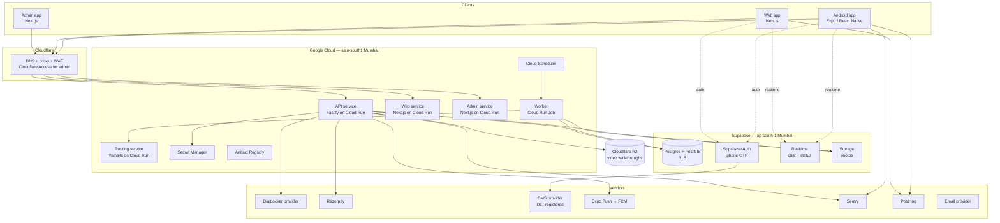

# Flatrimony — Technical Stack, Architecture and Delivery (SDLC + CI/CD) Document

| Field | Value |
| --- | --- |
| Document version | 1.0 |
| Date | 12 Nov 2026 |
| Owner | Aryan Garg |
| Applies to | v1.0 → v1.2 |
| Related | `02-prd.md`, `04-database-design.md`, `05-api-design.md`, `06-ui-ux-design-standards.md`, `07-project-progress.md` |

> **For the implementing agent.** This document is the source of truth for *how* Flatrimony is built, tested, shipped and operated. Follow the repository layout, naming, pipelines and conventions exactly unless an ADR (Architecture Decision Record) changes them. Where this document says "verify", check the vendor's current documentation before relying on the value.

---

## Table of contents

1. Architecture overview
2. Technology choices (with reasons)
3. Repository layout (monorepo)
4. Environments and cloud resources
5. Configuration and secrets
6. Software development lifecycle (start to finish)
7. Branching, commits, pull requests and code review
8. Testing strategy
9. CI pipeline (every pull request)
10. CD pipelines (staging, production, mobile)
11. Database migrations in the pipeline
12. Release management, versioning and rollback
13. Observability: logging, metrics, tracing, alerting
14. Security engineering in the delivery process
15. Performance engineering
16. Backups and disaster recovery
17. Cost plan (launch budget under ₹5,000/month)
18. Architecture Decision Records (initial set)
19. Day-one setup checklist

---

## 1. Architecture overview



**Key principles**

1. **One region, in India.** All data lives in Mumbai (Supabase `ap-south-1`, Google Cloud `asia-south1`). Supabase lists South Asia (Mumbai) `ap-south-1` as an available project region, and Google Cloud Run lists Mumbai (`asia-south1`) among its regions.
2. **Thin clients, authoritative API.** Clients read realtime updates directly from Supabase (RLS-protected), but **all writes go through the API**, which enforces business rules, rate limits, moderation checks and audit logging.
3. **Defence in depth.** API authorisation checks + Postgres Row Level Security + private schema for sensitive tables + Cloudflare edge protection.
4. **Scale to zero.** Every compute component on Cloud Run scales to zero when idle; the database is the only always-on paid component.
5. **One language.** TypeScript everywhere (mobile, web, admin, API, worker), with shared Zod schemas.

### 1.1 Request flow examples

**Swipe right that creates a match**

1. App calls `POST /v1/swipes` with the Supabase access token.
2. API verifies the JWT, loads the caller, checks the daily like limit and block list.
3. API inserts the swipe; if a reciprocal `like` exists, it creates a `match` in the same transaction and computes the Rishta report.
4. API sends push notifications via Expo Push and returns `{ matched: true, matchId }`.
5. Both clients receive the new match through Supabase Realtime (RLS lets each user see only their matches).

**Uploading a listing video walkthrough**

1. App records 30–90 s with the in-app camera, compresses to 720p on device, computes SHA-256.
2. App requests `POST /v1/listings/{id}/media/upload-url` (kind `walkthrough_video`); API returns a presigned R2 PUT URL valid for 10 minutes.
3. App uploads directly to R2, then calls `POST /v1/listings/{id}/media` with the object key, hash, duration and a Play Integrity token.
4. API verifies integrity and metadata, writes `listing_media`, enqueues a `media.process` job.
5. Worker (next scheduled run) extracts a frame, computes perceptual hashes, runs duplicate and broker checks, and updates the listing's review state.

## 2. Technology choices

### 2.1 Summary table

| Layer | Choice | Version policy | Why |
| --- | --- | --- | --- |
| Language | TypeScript (strict) | Latest stable | One language across all apps; shared types. |
| Package manager | pnpm workspaces | Latest stable | Fast, disk-efficient, strict dependency graph. |
| Monorepo build | Turborepo | Latest stable | Task caching, affected-only builds in CI. |
| Mobile | React Native with Expo (managed workflow + config plugins), Expo Router | Latest Expo SDK at project start; upgrade each SDK within 3 months | Android first, iOS later from the same code; EAS Build/Update/Submit. |
| Mobile UI motion | react-native-reanimated, react-native-gesture-handler | Bundled with Expo SDK | 60 fps swipe deck on the UI thread. |
| Mobile camera | expo-camera (Expo SDK; config plugin, no microphone) | SDK version | In-app walkthrough recording at 720p, 2 Mbit/s, no sound (the compression happens at capture, no separate transcode); no gallery picker for walkthroughs. Chosen over react-native-vision-camera in T3.7: the Expo module covers recording with a duration/size cap and needs no extra native setup; revisit if frame processing is ever needed. |
| Mobile storage | expo-secure-store (tokens), react-native-mmkv (cache) | — | Secure token storage; fast cache. |
| Web | Next.js (App Router), React Server Components | Latest stable | SEO for area pages; shared code with admin. |
| Web styling | Tailwind CSS + shadcn/ui (Radix primitives) | Latest stable | Accessible primitives; design tokens map to Tailwind theme. |
| Mobile styling | NativeWind (Tailwind for React Native) + shared tokens | Latest stable | Same token names on web and mobile. |
| Data fetching | TanStack Query | Latest stable | Caching, retries, optimistic updates, offline persistence. |
| Client state | Zustand | Latest stable | Small, simple. |
| Forms | React Hook Form + Zod resolver | Latest stable | Same Zod schemas as the API. |
| i18n | i18next (`react-i18next`) on mobile, `next-intl` on web; shared JSON message files | — | English + Hindi from day one. |
| Maps | MapLibre (GL JS on web, MapLibre React Native) with OpenStreetMap-based tiles | — | No per-load map fees. Google Places only for address autocomplete. |
| API | Fastify + `fastify-type-provider-zod` + `@fastify/swagger` (OpenAPI 3.1) | Node.js active LTS | Fast, typed, schema-first; OpenAPI generated from Zod. |
| DB access | Kysely (type-safe SQL builder) with types generated by `kysely-codegen` | Latest stable | Full SQL power (PostGIS), type safety, no ORM magic. |
| Database | Supabase Postgres + PostGIS + pgcrypto + pg_trgm | Supabase-managed Postgres | Managed Postgres with auth, storage, realtime. |
| Auth | Supabase Auth (phone OTP) with Send SMS hook to a DLT-registered Indian SMS provider | — | Managed sessions, JWTs, refresh rotation. |
| Realtime | Supabase Realtime (Postgres changes + broadcast) | — | Chat delivery and status changes without our own websocket server. |
| Object storage | Supabase Storage (photos, move-in log photos) · Cloudflare R2 (videos) | — | Image transformations for photos; zero egress fees for video. |
| Background jobs | Postgres job table (`private.jobs`, `SELECT … FOR UPDATE SKIP LOCKED`) processed by a Cloud Run Job triggered by Cloud Scheduler | — | No Redis; scales to zero. |
| Routing / commute | Valhalla (isochrones) container on Cloud Run with NCR OpenStreetMap extract baked in | Pin image version | Free commute zones; called by the worker (`commute.compute`) and the API (`POST /commute/preview`). |
| Push | Expo Push Notifications (FCM underneath) | — | One API for Android and later iOS. |
| Payments | Razorpay (web; Android subject to Play billing policy) | — | UPI, cards; Indian standard. |
| ID verification | DigiLocker via a licensed provider (e.g., Cashfree) | — | No company registration needed to start. |
| Email | Transactional email provider (e.g., Resend or Amazon SES) | — | Work/college email verification links. |
| Errors | Sentry (mobile, web, API) | — | Crash and error tracking, release health. |
| Product analytics | PostHog | — | Funnels, feature flags if needed; pseudonymous IDs only. |
| Logs/metrics | Google Cloud Logging + Cloud Monitoring; Supabase logs | — | Built in; alerting policies. |
| CI/CD | GitHub Actions + Workload Identity Federation to GCP; EAS for mobile | — | No long-lived cloud keys. |
| Edge | Cloudflare DNS, proxy, WAF managed rules, Cloudflare Access (admin) | Free plan | Free DDoS protection; zero-trust admin access. |
| Containers | Docker, Google Artifact Registry | — | Standard. |
| IaC | Terraform for GCP and Cloudflare resources | Latest stable | Repeatable environments. |

### 2.2 Why not alternatives (short)

| Alternative | Reason not chosen now |
| --- | --- |
| Flutter | Two languages (Dart + TS); less code sharing with web/API. |
| Firebase (Firestore) | Relational data, geo queries and RLS fit Postgres better; reviews and matching are relational. |
| Self-hosted Postgres on a VM | Backups, upgrades and security patches become the founder's job. |
| Vercel for web | Hobby plan is for non-commercial use; Pro costs more than Cloud Run at our scale. Revisit if SSR performance needs it. |
| Redis/BullMQ for jobs | Extra paid component; Postgres queue is enough at launch volumes. |
| Google Maps for map tiles | Per-load billing; MapLibre + OSM tiles are free or very low cost. |

## 3. Repository layout (monorepo)

```text
flatrimony/
├─ apps/
│  ├─ mobile/            # Expo app (Android first, iOS v1.2)
│  │  ├─ app/            # Expo Router routes (tabs, stacks)
│  │  ├─ src/features/   # feature folders: onboarding, discover, chat, listings, safety, stay, passport
│  │  ├─ src/components/ # app-specific components
│  │  ├─ app.config.ts   # env-driven config
│  │  └─ eas.json        # build profiles: development, preview, staging, production
│  ├─ web/               # Next.js public web app (seekers + listings + SEO pages)
│  ├─ admin/             # Next.js admin/moderation app
│  ├─ api/               # Fastify REST API
│  │  ├─ src/modules/    # one folder per domain: auth, me, verification, listings, discover,
│  │  │                  # swipes, matches, messages, meetups, safety, stays, passport,
│  │  │                  # payments, notifications, reports, admin, webhooks
│  │  ├─ src/plugins/    # auth, rate-limit, idempotency, error-handler, request-id, cors
│  │  ├─ src/lib/        # db (kysely), storage, push, digilocker, razorpay, crypto
│  │  └─ test/           # integration tests
│  ├─ worker/            # Cloud Run Job: job runner + scheduled tasks
│  └─ routing/           # Valhalla Dockerfile + tile build scripts (NCR extract)
├─ packages/
│  ├─ shared/            # Zod schemas, enums, API types, error codes, constants
│  ├─ matching/          # pure TS: filters, scoring, Rishta report (100% unit tested)
│  ├─ api-client/        # typed client generated from OpenAPI (used by mobile, web, admin)
│  ├─ design-tokens/     # tokens JSON → Tailwind theme + RN theme
│  ├─ i18n/              # en.json, hi.json, helpers (formatINR, formatDate)
│  ├─ ui-web/            # shared web components (shadcn-based)
│  ├─ config/            # eslint, tsconfig, prettier, vitest presets
│  └─ db-types/          # generated Kysely + Supabase types
├─ supabase/
│  ├─ config.toml
│  ├─ migrations/        # timestamped SQL migrations (source of truth for schema)
│  ├─ seed.sql           # areas, habit tags, scenario questions, dev users
│  └─ tests/             # pgTAP tests for RLS and constraints
├─ infra/
│  └─ terraform/         # gcp/, cloudflare/ — modules + envs/staging, envs/prod
├─ docs/                 # these documents + adr/ + runbooks/
├─ .github/
│  ├─ workflows/         # ci.yml, deploy-staging.yml, deploy-prod.yml, mobile.yml, nightly.yml
│  ├─ ISSUE_TEMPLATE/
│  └─ pull_request_template.md
├─ turbo.json
├─ pnpm-workspace.yaml
└─ package.json
```

**Module boundaries (enforced by ESLint `no-restricted-imports`)**

- `apps/*` may import `packages/*`; packages never import apps.
- `packages/matching` has no I/O; it receives plain objects and returns scores.
- API modules talk to each other only through exported service functions, not each other's repositories.

## 4. Environments and cloud resources

### 4.1 Environments

| Environment | Purpose | Supabase | Google Cloud project | Domains (once `flatrimony.in` is cleared) | Mobile channel |
| --- | --- | --- | --- | --- | --- |
| local | Developer machine | `supabase start` (Docker) | none (API runs locally) | localhost | Expo dev client |
| preview | Per-PR web previews | staging project | `flatrimony-staging` (tagged Cloud Run revisions with no traffic) | `pr-<n>---web-…run.app` | EAS Update branch `pr-<n>` |
| staging | Integration, QA, demo | `flatrimony-staging` (Mumbai) | `flatrimony-staging` | `staging.flatrimony.in`, `api.staging.flatrimony.in` | EAS channel `staging` |
| production | Live users | `flatrimony-prod` (Mumbai, paid plan) | `flatrimony-prod` | `flatrimony.in`, `api.flatrimony.in`, `admin.flatrimony.in` | EAS channel `production` |

> Supabase free-tier projects pause after a period of inactivity; production must be on a paid plan. Staging can start on the free tier.

### 4.2 Google Cloud resources (per environment, managed by Terraform)

| Resource | Name | Notes |
| --- | --- | --- |
| Artifact Registry repo | `flatrimony` (Docker) | Images: `api`, `web`, `admin`, `worker`, `routing` |
| Cloud Run service | `api` | min instances 0 (staging) / 0–1 (prod, decide by latency); max 10; concurrency 80; 1 vCPU, 512 MiB |
| Cloud Run service | `web` | min 0; max 5; 1 vCPU, 512 MiB |
| Cloud Run service | `admin` | min 0; max 2; ingress restricted to Cloudflare |
| Cloud Run service | `routing` | min 0; max 2; 2 vCPU, 4 GiB; no public invoker, called by the worker (`commute.compute`) and the API (`POST /commute/preview`) with Google ID tokens; ingress "all" until the callers have Direct VPC egress, then internal only |
| Cloud Run job | `worker` | 1 vCPU, 1 GiB; task timeout 10 min |
| Cloud Scheduler | `worker-tick` (every 5 min), `worker-daily` (02:30 IST) | Triggers the worker job |
| Secret Manager | one secret per key (section 5) | Mounted as env vars into Cloud Run |
| Service accounts | `api-sa`, `worker-sa`, `web-sa`, `deployer-sa` | Least privilege |
| Workload Identity Federation | pool `github`, provider `github-actions` | Lets GitHub Actions deploy without JSON keys; restricted to this repository and protected branches/tags |
| Monitoring | uptime checks, alert policies | See section 13 |
| Budget alerts | 50% / 80% / 100% of monthly budget | Email + push to founder |

Google's Cloud Run pricing page lists a monthly free tier that includes the first 180,000 vCPU-seconds, 360,000 GiB-seconds and 2 million requests for request-based billing. A third-party guide notes that `asia-south1` is a Tier 1 region, so the full allowance applies there, while outbound data to users in India is billed at standard network rates. Verify current figures before budgeting.

### 4.3 Custom domains on Cloud Run

Cloud Run custom domain options differ by region. Decide in **ADR-007**:

1. Cloudflare proxy in front of Cloud Run using a supported mapping method, or
2. Firebase Hosting rewrites to Cloud Run (free tier), or
3. Global external Application Load Balancer with serverless NEGs (adds a fixed monthly cost but gives Cloud Armor and IAP).

Until decided, staging uses the default `run.app` URLs.

## 5. Configuration and secrets

### 5.1 Rules

1. No secret in Git, in the mobile bundle, or in `NEXT_PUBLIC_*` variables. The only keys allowed in clients are the Supabase **anon** key, Sentry DSN, PostHog project key, and the API base URL.
2. Secrets live in Google Secret Manager (runtime) and GitHub Environments (CI). Local development uses `.env.local` files that are git-ignored; `.env.example` lists every variable without values.
3. Every config value is validated at startup with a Zod schema; the process exits if a required value is missing.
4. Rotate secrets on a schedule (90 days) and immediately after any suspected leak.

### 5.2 Environment variables (API and worker)

| Variable | Secret? | Description |
| --- | --- | --- |
| `NODE_ENV` | No | `production` / `development` / `test` |
| `APP_ENV` | No | `local` / `staging` / `production` |
| `PORT` | No | Provided by Cloud Run |
| `DATABASE_URL` | Yes | Supabase pooler connection string (transaction mode) for the API |
| `DATABASE_URL_DIRECT` | Yes | Direct connection for migrations and long transactions (worker) |
| `SUPABASE_URL` | No | Project URL |
| `SUPABASE_JWT_ISSUER` / `SUPABASE_JWKS_URL` | No | To verify access tokens (prefer asymmetric JWT signing keys if enabled; else `SUPABASE_JWT_SECRET`) |
| `SUPABASE_SERVICE_ROLE_KEY` | Yes | Only for Storage admin operations; never sent to clients |
| `FIELD_ENCRYPTION_KEY` | Yes | 32-byte key for application-level encryption (AES-256-GCM), as `v1:<base64>`; required outside local (the DigiLocker verified name, T3.1). Local development without it uses a throwaway key |
| `HASH_PEPPER` | Yes | Pepper for HMAC-SHA-256 of phone numbers and identity identifiers |
| `R2_ACCOUNT_ID`, `R2_ACCESS_KEY_ID`, `R2_SECRET_ACCESS_KEY`, `R2_BUCKET` | Yes | Video storage |
| `DIGILOCKER_PROVIDER` | No | `mock` (default; refused in production) until the provider is chosen (T0.7, OQ-02). The mock serves a test consent page at `/dev/digilocker/:ref` |
| `DIGILOCKER_WEBHOOK_SECRETS` | Yes | Standard Webhooks secret(s) the provider signs `POST /webhooks/digilocker` with, `v1,whsec_<base64>`; required outside local |
| `PUBLIC_API_URL` | No | The API's public base URL, for links it hands to clients (the mock consent page); required outside local, default `http://localhost:8080` locally |
| `DIGILOCKER_MOCK_CONSENT_PAGE` | No | `true` serves the mock consent page outside local development (anyone can then verify as any identity: test data and one API instance only); off by default |
| `DIGILOCKER_PROVIDER_CLIENT_ID`, `DIGILOCKER_PROVIDER_SECRET` | Yes | ID verification |
| `RAZORPAY_KEY_ID` | No | Public key id |
| `RAZORPAY_KEY_SECRET`, `RAZORPAY_WEBHOOK_SECRET` | Yes | Payments |
| `EXPO_ACCESS_TOKEN` | Yes | Push notifications (enhanced security) |
| `EMAIL_API_KEY` | Yes | Transactional email (work/college email links, T3.3) |
| `EMAIL_PROVIDER` | No | `mock` (default; keeps messages in memory, `POST /dev/email-outbox/latest` locally); production refuses `mock` until a vendor is chosen |
| `WEB_APP_URL` | No | The web app's origin; work/college email links open its `/{locale}/verify-email` page. Required outside local (https in production), default `http://localhost:3000` locally |
| `PLAY_INTEGRITY_*` | Yes | Verify Play Integrity tokens |
| `ROUTING_URL` | No | URL of the routing service (API and worker); without it commute zones are the radius approximation |
| `PLACES_PROVIDER` | No | `mock` (default: searches the seeded NCR areas; local and CI) or `google`; production refuses `mock` |
| `GOOGLE_PLACES_API_KEY` | With `google` | Google Places API (New) key, server-side only (Secret Manager); restrict it to the Places API |
| `SENTRY_DSN` | No | Error tracking |
| `POSTHOG_KEY` | No | Server-side events (optional) |
| `CORS_ALLOWED_ORIGINS` | No | Comma-separated |
| `WEB_PROXY_SECRET` | Yes | Shared by the API and the web app's server (≥ 32 characters). Web users' API calls go through the web server (tokens stay in HttpOnly cookies, docs/05 §2); with this secret the API rate-limits them by the client IP the web server forwards instead of the web server's own |

**Web app (`apps/web`, Next.js) — read at runtime on the server, never baked into the bundle:**

| Variable | Secret? | Description |
| --- | --- | --- |
| `APP_ENV` | No | `local` turns off the `Secure` flag on the session cookies (plain-http localhost); anything else keeps it on |
| `API_URL` | No | The API, called by the browser (OTP guard) and by the web server (everything else) |
| `SUPABASE_URL` / `SUPABASE_ANON_KEY` | No | Supabase Auth for the browser's OTP request and verification (the anon key is public by design) |
| `WEB_PROXY_SECRET` | Yes | As for the API (same value) |
| `TRUST_PROXY_HOPS` | No | Proxies in front of the web server whose `X-Forwarded-For` entry is trusted (Cloud Run: 1); the client IP sent to the API comes from that entry only |
| `RATE_LIMIT_*` | No | Tunable limits |

## 6. Software development lifecycle (start to finish)

This is the end-to-end workflow every feature follows, from idea to production and back to learning.

```mermaid
flowchart LR
  I[1. Idea / feedback] --> R[2. Requirement\nPRD FR-ID]
  R --> D[3. Design\nUI + API + DB + ADR]
  D --> T[4. Ticket\nDefinition of Ready]
  T --> B[5. Branch + build\nlocal dev + tests]
  B --> P[6. Pull request\nCI checks + review]
  P --> M[7. Merge to main]
  M --> S[8. Auto-deploy staging\nmigrations + smoke tests]
  S --> Q[9. QA on staging\nmobile internal build]
  Q --> RL[10. Release tag\nmanual approval]
  RL --> PR[11. Production deploy\ncanary → 100%]
  PR --> O[12. Observe\nmetrics + errors + feedback]
  O --> I
```



### Step 1 — Idea and feedback intake

- Sources: user feedback, support tickets, analytics, moderation trends, founder ideas.
- Log every idea as a GitHub Issue with the `idea` label. Do not start work on ideas directly.

### Step 2 — Requirement

- Promote an idea to a requirement by adding or updating an entry in `02-prd.md` with an `FR-` ID, priority and acceptance criteria.
- Small bug fixes skip this step but must reference the requirement they restore.

### Step 3 — Design

- **UI:** screens and states designed against `06-ui-ux-design-standards.md` (Figma or code prototypes). Every screen needs loading, empty, error and success states.
- **API:** add or change endpoints in `05-api-design.md` and the Zod schemas in `packages/shared` first (contract-first).
- **DB:** add a migration plan in `04-database-design.md` style (tables, indexes, RLS, backfill).
- **ADR:** any decision that is costly to reverse gets an ADR in `docs/adr/NNNN-title.md` (context, decision, consequences, alternatives).

### Step 4 — Ticket (Definition of Ready)

A ticket is ready when it has:

- [ ] linked FR-ID(s) and acceptance criteria;
- [ ] UI states defined (or "no UI");
- [ ] API contract defined (or "no API change");
- [ ] DB changes identified (or "none");
- [ ] test plan (unit / integration / e2e cases listed);
- [ ] analytics events listed (or "none");
- [ ] estimate in story points (1, 2, 3, 5, 8; split anything bigger).

Ticket IDs use the format `FLT-<number>` (GitHub Issue number). Tickets live on a GitHub Projects board with columns: Backlog → Ready → In progress → In review → On staging → Done.

### Step 5 — Branch and build locally

```bash
git switch main && git pull
git switch -c feat/FLT-123-swipe-deck
pnpm install
pnpm supabase start            # local Postgres, Auth, Storage, Realtime
pnpm db:reset                  # apply migrations + seed
pnpm dev                       # turbo: api, web, admin, mobile (Expo)
pnpm test --filter=...[origin/main]   # affected tests
```

- Write tests with the code (unit first for logic; integration for endpoints).
- Keep the change small: a pull request should be reviewable in under 30 minutes (aim for < 400 changed lines excluding generated files).

### Step 6 — Pull request

- Open early as a draft; mark ready when CI is green.
- PR title follows Conventional Commits (`feat(discover): add swipe deck prefetch`).
- Fill in the PR template (section 7.3). CI runs (section 9). A reviewer (human or review agent) approves.

### Step 7 — Merge

- Squash-merge only. The squash message keeps the Conventional Commit title and lists `Refs: FLT-123, FR-DISC-01`.
- Delete the branch after merge.

### Step 8 — Automatic staging deploy

- Merging to `main` triggers `deploy-staging.yml`: migrations → build images → deploy API, worker, routing (if changed), web, admin → smoke tests → EAS Update to the `staging` channel.

### Step 9 — QA on staging

- Run the manual QA checklist for the changed feature on the staging Android build and web.
- Move the ticket to "On staging". Bugs found here are fixed with new PRs (never hotfix directly on staging).

### Step 10 — Release

- When a set of changes is ready, create a release with Changesets (or manually bump) and push a tag `vX.Y.Z`.
- `deploy-prod.yml` waits for **manual approval** in the GitHub `production` environment.

### Step 11 — Production deploy

- Migrations (expand-only) → deploy new Cloud Run revisions with **no traffic** → smoke tests against the tagged revision URL → shift 10% traffic → watch error rate and latency for 15 minutes → shift 100%.
- Mobile: JS-only changes ship via EAS Update to the `production` channel with a staged rollout; native changes require a new store build and Play staged rollout (section 10.4).

### Step 12 — Observe and learn

- Check the release dashboard (errors, latency, crash-free sessions, key funnel events) at +1 h and +24 h.
- Close the tickets, update `07-project-progress.md`, write release notes, and feed learnings back into Step 1.

## 7. Branching, commits, pull requests and code review

### 7.1 Branching model: trunk-based development

- `main` is always deployable and protected: no direct pushes, required status checks, required review, linear history.
- Short-lived branches (≤ 3 days): `feat/`, `fix/`, `chore/`, `docs/`, `refactor/`, `test/`, `perf/`, `hotfix/` + `FLT-<n>-<slug>`.
- Incomplete features merge behind **feature flags** (remote config table, see DB doc) rather than living on long branches.

### 7.2 Commit conventions

- Conventional Commits: `type(scope): summary` — types `feat`, `fix`, `perf`, `refactor`, `test`, `docs`, `chore`, `build`, `ci`, `revert`.
- Scopes match module names: `auth`, `bio`, `verification`, `listings`, `discover`, `matching`, `chat`, `meetups`, `safety`, `stays`, `passport`, `payments`, `admin`, `infra`, `db`, `ui`, `i18n`.
- Enforced by `commitlint` + `husky` (commit-msg hook) and `lint-staged` (pre-commit: format + lint changed files).

### 7.3 Pull request template (`.github/pull_request_template.md`)

```markdown
## What and why
<!-- One paragraph. Link FR-IDs and FLT ticket. -->
Refs: FLT-___ · FR-___

## How
<!-- Key implementation notes, trade-offs. -->

## Screenshots / recordings
<!-- Mobile + web, light theme, English + Hindi for UI changes. -->

## Checklist
- [ ] Tests added/updated (unit / integration / e2e as relevant)
- [ ] API contract updated in packages/shared and docs/05-api-design.md
- [ ] Migration is backward compatible (expand → migrate → contract)
- [ ] RLS policies added/updated + pgTAP tests
- [ ] Loading, empty, error states handled
- [ ] Strings added to en.json and hi.json
- [ ] Analytics events added (no personal data)
- [ ] Accessibility: labels, contrast, touch targets
- [ ] Security: authz checks on every new endpoint, input validation, no secrets
- [ ] Docs updated (PRD / API / DB / progress)
```

### 7.4 Code review guidelines

Reviewers check, in this order:

1. **Correctness** against acceptance criteria.
2. **Security**: object-level authorisation, input validation, rate limits, no data leaks in responses or logs, women-only visibility rules.
3. **Data**: migration safety, indexes for new queries, RLS.
4. **Tests**: meaningful assertions, edge cases, no flaky timing.
5. **Readability and consistency** with this document.
6. **Performance**: N+1 queries, payload size, re-renders on mobile.

## 8. Testing strategy

### 8.1 Test pyramid

| Level | Tool | What | Runs |
| --- | --- | --- | --- |
| Static | TypeScript, ESLint, Prettier | Types, lint rules, formatting | Pre-commit + every PR |
| Unit | Vitest | Pure logic: `packages/matching`, validators, formatters, reducers | Every PR (affected) |
| Component | React Native Testing Library, React Testing Library | Components and hooks | Every PR (affected) |
| Database | pgTAP via `supabase test db` | RLS policies, constraints, triggers, functions | Every PR touching `supabase/` and nightly |
| API integration | Vitest + Fastify `inject` against local Supabase (Docker in CI) | Each endpoint: auth, authz, validation, happy path, error codes | Every PR (affected) |
| Contract | OpenAPI diff (`oasdiff`) | Breaking API changes blocked unless versioned | Every PR touching API |
| Web E2E | Playwright | Critical web journeys | Every PR to `main` (smoke) + nightly (full) |
| Mobile E2E | Maestro flows on an Android emulator | Onboarding, swipe-to-match, chat, listing creation | Nightly + before release |
| Load | k6 | Deck, swipes, messages at 5× expected peak | Before each major release |
| Security | Semgrep, gitleaks, dependency audit, OWASP ZAP baseline | SAST, secrets, vulnerable dependencies, DAST | Every PR (Semgrep, gitleaks, audit); nightly (ZAP on staging) |
| Accessibility | axe (Playwright), manual TalkBack checks | WCAG issues | Every PR (web smoke) + before release |

### 8.2 Critical user journeys (must have E2E coverage)

The web journeys run on every pull request. The Android (Maestro) journeys run nightly, by hand at checkpoints (after every two or three major sub-phases and before a milestone is marked done) and on pull requests that change the flows; they no longer run on every app change while the app is being built (founder decision 2026-11-28; `.github/workflows/mobile-e2e.yml`).

1. Sign up with OTP → onboarding → Discover.
2. Create a listing with photos and an in-app video → listing active.
3. Swipe right on both sides → match → DigiLocker (mocked in staging) → first message.
4. Propose and accept a Pehli Mulaqat → both answer "Still interested?" → Rishta pakka.
5. Report and block a user → hidden from each other.
6. Women-only: a male-verified account never sees a women-only profile (API-level test too).
7. Delete account → data removed on schedule.

### 8.3 Test data

- `supabase/seed.sql` seeds NCR areas, habit tags, scenario questions and 50 synthetic users with realistic distributions. Never use real people's data in any non-production environment.
- External providers (DigiLocker, Razorpay, SMS) are mocked locally and in CI; staging uses provider sandboxes where available.

## 9. CI pipeline (every pull request)

`.github/workflows/ci.yml` (illustrative; adapt versions at implementation time):

```yaml
name: ci
on:
  pull_request:
  push:
    branches: [main]

concurrency:
  group: ci-${{ github.ref }}
  cancel-in-progress: true

permissions:
  contents: read

jobs:
  setup-and-static:
    runs-on: ubuntu-latest
    steps:
      - uses: actions/checkout@v4
        with: { fetch-depth: 0 }
      - uses: pnpm/action-setup@v4
      - uses: actions/setup-node@v4
        with: { node-version: lts/*, cache: pnpm }
      - run: pnpm install --frozen-lockfile
      - run: pnpm turbo run typecheck lint format:check --filter=...[origin/main]
      - run: pnpm turbo run test:unit --filter=...[origin/main]

  db-and-api:
    runs-on: ubuntu-latest
    needs: setup-and-static
    steps:
      - uses: actions/checkout@v4
      - uses: pnpm/action-setup@v4
      - uses: actions/setup-node@v4
        with: { node-version: lts/*, cache: pnpm }
      - uses: supabase/setup-cli@v1
      - run: pnpm install --frozen-lockfile
      - run: supabase start
      - run: supabase db reset           # applies migrations + seed
      - run: supabase test db            # pgTAP RLS tests
      - run: pnpm --filter api test:integration
      - run: pnpm --filter api openapi:generate && pnpm openapi:diff   # breaking-change check

  security:
    runs-on: ubuntu-latest
    steps:
      - uses: actions/checkout@v4
        with: { fetch-depth: 0 }
      - name: Secret scan
        uses: gitleaks/gitleaks-action@v2
      - name: SAST
        run: pipx run semgrep ci --config auto
      - name: Dependency audit
        run: pnpm audit --audit-level high

  web-e2e-smoke:
    runs-on: ubuntu-latest
    needs: db-and-api
    steps:
      - uses: actions/checkout@v4
      - uses: pnpm/action-setup@v4
      - uses: actions/setup-node@v4
        with: { node-version: lts/*, cache: pnpm }
      - run: pnpm install --frozen-lockfile
      - run: pnpm exec playwright install --with-deps chromium
      - run: pnpm --filter web test:e2e:smoke

  build-images:
    runs-on: ubuntu-latest
    needs: [db-and-api]
    steps:
      - uses: actions/checkout@v4
      - run: docker build -f apps/api/Dockerfile -t api:ci .
      - run: docker build -f apps/web/Dockerfile -t web:ci .
```

**Required status checks on `main`:** `setup-and-static`, `db-and-api`, `security`, `web-e2e-smoke`, `build-images`.

> GitHub's CodeQL and built-in secret scanning are free for public repositories; for a private repository they require paid GitHub security features. Gitleaks and Semgrep Community Edition are the free defaults here. Dependabot version updates are enabled for npm, GitHub Actions and Docker.

### 9.1 Dockerfile pattern (API)

```dockerfile
# apps/api/Dockerfile — multi-stage, non-root, minimal
FROM node:22-slim AS base   # keep the major version equal to the runtime image below
ENV PNPM_HOME=/pnpm PATH=/pnpm:$PATH
RUN corepack enable
WORKDIR /repo

FROM base AS deps
COPY pnpm-lock.yaml pnpm-workspace.yaml package.json ./
COPY apps/api/package.json apps/api/
COPY packages/ packages/
RUN pnpm install --frozen-lockfile --filter api...

FROM deps AS build
COPY . .
RUN pnpm turbo run build --filter=api
RUN pnpm deploy --filter=api --prod /out

# Use the distroless image whose Node major matches the build stage's Node LTS major
FROM gcr.io/distroless/nodejs22-debian12 AS runtime
WORKDIR /app
COPY --from=build /out .
USER nonroot
ENV NODE_ENV=production
EXPOSE 8080
CMD ["dist/server.js"]
```

Pin the base images by digest in production builds and let Dependabot update them.

## 10. CD pipelines

### 10.1 Authentication to Google Cloud

GitHub Actions authenticates with **Workload Identity Federation** (`google-github-actions/auth`) as `deployer-sa`. The provider's attribute condition restricts tokens to `repo:<owner>/flatrimony` and to `refs/heads/main` (staging) or `refs/tags/v*` (production). No service-account JSON keys exist.

### 10.2 Staging (on every merge to `main`)

```yaml
name: deploy-staging
on:
  push:
    branches: [main]
permissions:
  contents: read
  id-token: write
concurrency: { group: deploy-staging, cancel-in-progress: false }
jobs:
  deploy:
    runs-on: ubuntu-latest
    environment: staging
    steps:
      - uses: actions/checkout@v4
      - uses: supabase/setup-cli@v1
      - name: Migrate database
        run: |
          supabase link --project-ref ${{ secrets.SUPABASE_PROJECT_REF }}
          supabase db push
        env:
          SUPABASE_ACCESS_TOKEN: ${{ secrets.SUPABASE_ACCESS_TOKEN }}
          SUPABASE_DB_PASSWORD: ${{ secrets.SUPABASE_DB_PASSWORD }}
      - uses: google-github-actions/auth@v2
        with:
          workload_identity_provider: ${{ secrets.GCP_WIF_PROVIDER }}
          service_account: ${{ secrets.GCP_DEPLOYER_SA }}
      - uses: google-github-actions/setup-gcloud@v2
      - name: Build and push images
        run: |
          gcloud auth configure-docker asia-south1-docker.pkg.dev --quiet
          for svc in api web admin worker; do
            docker build -f apps/$svc/Dockerfile \
              -t asia-south1-docker.pkg.dev/$PROJECT/flatrimony/$svc:${GITHUB_SHA} .
            docker push asia-south1-docker.pkg.dev/$PROJECT/flatrimony/$svc:${GITHUB_SHA}
          done
        env: { PROJECT: ${{ secrets.GCP_PROJECT_ID }} }
      - name: Deploy services
        run: |
          for svc in api web admin; do
            gcloud run deploy $svc --region asia-south1 \
              --image asia-south1-docker.pkg.dev/$PROJECT/flatrimony/$svc:${GITHUB_SHA}
          done
          gcloud run jobs update worker --region asia-south1 \
            --image asia-south1-docker.pkg.dev/$PROJECT/flatrimony/worker:${GITHUB_SHA}
        env: { PROJECT: ${{ secrets.GCP_PROJECT_ID }} }
      - name: Smoke tests
        run: pnpm --filter api test:smoke -- --base-url ${{ vars.API_URL }}
      - name: Mobile OTA update (staging)
        run: npx eas-cli update --channel staging --message "${{ github.sha }}" --non-interactive
        working-directory: apps/mobile
        env: { EXPO_TOKEN: ${{ secrets.EXPO_TOKEN }} }
```

### 10.3 Production (on tag `v*`, with manual approval)

Differences from staging:

1. `environment: production` with **required reviewer** (the founder) → manual approval gate.
2. Migrations run first and must be **expand-only** (no drops/renames of columns still read by the running version). A CI check (`scripts/check-migration-safety.ts`) blocks destructive statements unless the PR carries the label `contract-migration` and the previous release no longer uses the column.
3. Deploy with `--no-traffic --tag rc`, run smoke tests against the `rc` URL, then:
   ```bash
   gcloud run services update-traffic api --region asia-south1 --to-tags rc=10
   # wait 15 minutes; check error rate and p95 latency alerts
   gcloud run services update-traffic api --region asia-south1 --to-latest
   ```
4. Create a GitHub Release with generated notes; upload source maps to Sentry with the release version.
5. Post a deploy marker to monitoring (log entry `deploy.completed` with version).

### 10.4 Mobile pipeline (EAS)

| Change type | How it ships | Store review? |
| --- | --- | --- |
| JavaScript/asset-only | `eas update --channel production` with a rollout percentage (start 10%, then 50%, then 100%) | No |
| Native (new SDK, new native module, permissions, app config) | `eas build --profile production --platform android` → `eas submit` to Play **internal testing** → closed testing → production with **staged rollout** (10% → 50% → 100%) | Yes |

Rules:

- `runtimeVersion` policy: `fingerprint` (or `appVersion`) so OTA updates only reach compatible binaries.
- Every OTA update is tagged with the Git SHA and release version; Sentry release names match.
- Roll back an OTA update by republishing the previous update to the channel (`eas update:republish`).
- `eas.json` profiles: `development` (dev client), `preview` (internal APK for testers), `staging`, `production` (AAB).
- Play Console: enable Play App Signing; upload key stored in EAS credentials, never in the repo.

### 10.5 Routing service pipeline

`apps/routing` is rebuilt monthly (or when OpenStreetMap data needs refreshing) by `routing-build.yml`: download Geofabrik's India Northern and Central Zones (MD5-checked) → merge and cut to `LIMITS.ncrBounds` with osmium → build Valhalla tiles (pinned image) → bake into the image → smoke-test an isochrone → push → deploy `routing`. Pull requests that change `apps/routing` build and smoke-test without pushing. The worker's daily `commute.refresh` redraws commute zones older than 30 days, missing ones and road-mode approximations (500 a day). Runbook: docs/runbooks/routing.md.

### 10.6 Infrastructure pipeline (Terraform)

- `infra/terraform/envs/{staging,prod}` with remote state in a GCS bucket (versioned, locked).
- PRs touching `infra/` run `terraform fmt -check`, `validate`, and `plan` (plan posted as a PR comment).
- `apply` runs only from `main` (staging) or tags (prod) with environment approval.

## 11. Database migrations in the pipeline

1. Create a migration: `supabase migration new add_listing_rules` → write SQL in `supabase/migrations/<timestamp>_add_listing_rules.sql`.
2. Every migration includes: DDL, indexes (`CREATE INDEX CONCURRENTLY` for large tables in production — run outside a transaction), RLS policies, grants, and comments.
3. Regenerate types: `pnpm db:types` (Supabase types + kysely-codegen) and commit them.
4. Add pgTAP tests for new policies in `supabase/tests/`.
5. Follow **expand → migrate → contract**:
   - Release N: add new column/table (nullable or with default), dual-write in code.
   - Release N+1: backfill (worker job in batches), switch reads.
   - Release N+2: drop the old column (`contract-migration` label).
6. Never edit a migration that has run in staging; write a new one.
7. Production migrations run before the code deploy; they must be safe for the old code still running.

## 12. Release management, versioning and rollback

### 12.1 Versioning

- Semantic Versioning for the product: `MAJOR.MINOR.PATCH` (v1.0.0 = launch).
- API is versioned in the path (`/v1`). Breaking changes require `/v2` for the affected resources and a deprecation period of at least 90 days (mobile users update slowly).
- Mobile `versionCode` increments on every store build; `version` matches the product version.

### 12.2 Release checklist

- [ ] All tickets in the release are "On staging" and QA-passed.
- [ ] Migrations reviewed for expand-only safety.
- [ ] Release notes drafted (user-facing EN/HI for store; technical for GitHub).
- [ ] Feature flags for unfinished features are off in production.
- [ ] Rollback plan noted for risky changes.

### 12.3 Rollback

| Component | Rollback method | Time |
| --- | --- | --- |
| API / web / admin | `gcloud run services update-traffic <svc> --to-revisions <previous>=100` | < 2 min |
| Worker | `gcloud run jobs update worker --image <previous digest>` | < 2 min |
| Mobile JS | `eas update:republish` previous update to the channel | < 5 min (users get it on next launch) |
| Mobile native | Halt Play staged rollout; ship a fix build | Hours–days |
| Database | **Forward-fix only** (new migration). For data loss, restore from backup/PITR into a new project and copy data back (runbook). | Varies |

### 12.4 Hotfix process

1. Branch `hotfix/FLT-<n>-<slug>` from `main`.
2. Minimal fix + test; PR with `hotfix` label (one reviewer, expedited).
3. Merge → staging deploy → quick verification → tag `vX.Y.(Z+1)` → production with approval.
4. Write a short post-incident note in `docs/runbooks/incidents/`.

## 13. Observability

### 13.1 Logging

- Structured JSON logs (Fastify's `pino`) with fields: `ts`, `level`, `msg`, `requestId`, `userId` (UUID only), `route`, `status`, `latencyMs`, `appVersion`, `platform`.
- **Never log**: phone numbers, OTPs, tokens, names, addresses, message bodies, DigiLocker payloads, payment details. A redaction list in the logger config enforces this.
- Request ID: accept `X-Request-Id` from clients or generate one; return it in responses and include it in Sentry events.
- Retention: Cloud Logging default retention for application logs; security/audit events go to the database `private.audit_log` (append-only) and are retained per legal advice.

### 13.2 Metrics and dashboards

| Dashboard | Panels |
| --- | --- |
| API health | Request rate, error rate (5xx), p50/p95/p99 latency per route, Cloud Run instance count, cold starts |
| Database | CPU, connections (pooler), slow queries (> 200 ms), table bloat, replication/backup status |
| Product funnel | Sign-ups, verifications, matches, first messages, meet-ups, Rishta pakka (from PostHog) |
| Trust & safety | Reports by reason, open safety reports age, broker signals, bans |
| Mobile | Crash-free sessions/users (Sentry), app start time, JS errors by release |
| Jobs | Jobs queued/running/failed, oldest job age |

### 13.3 Alerts (initial)

| Alert | Condition | Channel |
| --- | --- | --- |
| API error rate | 5xx > 2% for 5 min | Push + email |
| API latency | p95 > 800 ms for 10 min | Email |
| Uptime | `/healthz` fails from 2 regions for 3 min | Push + email |
| Job backlog | Oldest pending job > 30 min | Email |
| SOS triggered | Any `sos_triggered` event | Push to founder immediately |
| Safety report | New safety report | Push |
| Crash spike | Crash-free sessions < 99% for a release | Email |
| Budget | 50/80/100% of monthly budget | Email |
| Auth abuse | OTP requests > threshold per 10 min | Push |

### 13.4 Health endpoints

- `GET /healthz` → process is up (no dependencies).
- `GET /readyz` → database reachable and migrations at expected version.

## 14. Security engineering in the delivery process

This section turns spec section 7 into concrete engineering controls.

| Area | Control | Where |
| --- | --- | --- |
| Authentication | Verify Supabase JWT on every request (issuer, audience, expiry, signature); reject tokens older than session revocation time | `apps/api/src/plugins/auth.ts` |
| Authorisation | Every handler calls a policy function (e.g., `canReadMatch(user, match)`); integration tests cover cross-user access attempts (BOLA) | API modules + tests |
| RLS | Enabled on all `public` tables; `private` schema not exposed via the Data API; pgTAP tests | `supabase/migrations`, `supabase/tests` |
| Women-only | Enforced in SQL candidate queries **and** a response filter; tested both ways | `packages/matching`, API discover module |
| Input validation | Zod schemas on every route (body, query, params); size limits (body ≤ 100 KB except upload confirmations) | `packages/shared` |
| Rate limiting | Per user + per IP token buckets in Postgres (or in-memory per instance + Cloudflare rules); stricter limits on OTP, swipes, messages, reports | API plugin + Cloudflare |
| Idempotency | `Idempotency-Key` header required on payment orders, message sends and match decisions; responses cached 24 h | API plugin |
| Secrets | Secret Manager; WIF for CI; gitleaks; rotation | Infra |
| Encryption | TLS everywhere; AES-256-GCM application encryption for sensitive columns; HMAC-SHA-256 with pepper for lookup hashes | `apps/api/src/lib/crypto.ts` |
| Files | Private buckets; signed URLs (≤ 10 min for upload, ≤ 1 h for view); EXIF stripping; content-type and size validation; perceptual hashing | API + worker |
| Mobile | `FLAG_SECURE` on sensitive screens; Play Integrity on login, listing video upload and payments; no secrets in bundle; certificate pinning (evaluate risk of breaking on cert rotation — pin to intermediate/public key with backup pins) | `apps/mobile` |
| Web | CSP (nonce-based), HSTS, `X-Content-Type-Options`, `Referrer-Policy`, `Permissions-Policy`, SameSite cookies | Next.js middleware |
| Admin | Cloudflare Access (SSO + 2FA) in front; app-level roles; audit log of every action | `apps/admin` |
| Supply chain | Lockfile, `--frozen-lockfile`, Dependabot, pinned Actions by SHA for third-party actions, image digests | CI |
| DAST | OWASP ZAP baseline nightly against staging | `nightly.yml` |
| Pen test | External test before 10,000 users or fundraising | Release gate |
| Incident response | Runbook in `docs/runbooks/security-incident.md`; contact points; CERT-In reporting obligations confirmed with a lawyer | Docs |

## 15. Performance engineering

| Area | Practice |
| --- | --- |
| Database | Indexes defined in `04-database-design.md`; `EXPLAIN ANALYZE` for every new deck/discovery query; pooler in transaction mode; keep transactions short. |
| Deck | Candidate generation in one SQL query with hard filters + PostGIS; scoring in TypeScript on ≤ 300 candidates; cache the computed deck for 10 minutes per user (database table `deck_cache`), invalidated on preference change. |
| API | Response compression (Brotli/gzip), ETags on read endpoints, pagination by cursor, payloads trimmed to what screens need. |
| Cold starts | Small images (distroless), lazy-load heavy modules, consider `min-instances=1` for the API in production if p95 suffers. |
| Mobile | Hermes engine; FlashList for long lists; `expo-image` with caching; prefetch next 5 deck images; memoise cards; avoid re-renders in the swipe gesture path; bundle size budget enforced in CI. |
| Web | Server components for public pages; image optimisation; route-level code splitting; Lighthouse CI budget on PRs touching `apps/web`. |
| Media | 720p video, 3–4 MB/minute target bitrate; WebP/AVIF photos at 3 sizes (thumb 200 px, card 800 px, full 1600 px). |

## 16. Backups and disaster recovery

| Item | Target |
| --- | --- |
| Database backups | Daily automated backups on the paid Supabase plan; enable Point-in-Time Recovery when budget allows (add-on) |
| Recovery Point Objective (RPO) | ≤ 24 h at launch (≤ 5 min with PITR) |
| Recovery Time Objective (RTO) | ≤ 4 h |
| Storage | R2 and Supabase Storage objects are not versioned by default — enable object versioning/lifecycle where supported; move-in log photos are critical (keep 2 years after stay end) |
| Restore drill | Quarterly: restore the latest backup into a scratch project, run smoke tests, record time taken |
| Infrastructure | Terraform can recreate GCP/Cloudflare resources; secrets inventory documented (values in Secret Manager) |

## 17. Cost plan (launch budget under ₹5,000/month)

All figures are **estimates to verify** at the time of purchase; prices change and are often in USD.

| Item | Plan | Est. monthly cost |
| --- | --- | --- |
| Supabase production | Paid "Pro" tier (Mumbai) | ≈ $25 (≈ ₹2,100) |
| Supabase staging | Free tier | ₹0 |
| Cloud Run (api, web, admin, routing) + Cloud Run job + Scheduler | Free tier covers early traffic | ₹0–₹500 |
| Artifact Registry | Small storage | ₹0–₹100 |
| Cloudflare (DNS, proxy, WAF basic, Access ≤ 50 users) | Free | ₹0 |
| Cloudflare R2 | Free allowance, then low per-GB | ₹0–₹300 |
| Domain(s) | `.in` + `.com` | ≈ ₹150 averaged |
| Sentry, PostHog, email provider | Free tiers | ₹0 |
| Expo EAS | Free tier (limited builds/month) | ₹0 |
| **Subtotal (fixed + infra)** | | **≈ ₹2,500–₹3,300** |
| Variable: SMS OTP | Per message (DLT) | Depends on sign-ups |
| Variable: DigiLocker checks | Per verification | Depends on verified users |
| Variable: Razorpay | Per transaction fee | Paid by revenue |
| One-time: Google Play developer account | One-time fee | — |

Set Google Cloud budget alerts at ₹2,000 and Supabase spend caps where available.

## 18. Architecture Decision Records (initial set)

Create these in `docs/adr/` at project start (status "Accepted" unless noted):

| ADR | Title | Decision |
| --- | --- | --- |
| 0001 | Monorepo with pnpm + Turborepo | Accepted |
| 0002 | TypeScript everywhere; Zod as contract source | Accepted |
| 0003 | Supabase for Postgres/Auth/Realtime/Storage in Mumbai | Accepted |
| 0004 | All writes through the Fastify API; clients read realtime via RLS | Accepted |
| 0005 | Cloud Run (Mumbai) for compute; scale to zero | Accepted |
| 0006 | Postgres job queue + scheduled Cloud Run Job (no Redis) | Accepted |
| 0007 | Custom domains for Cloud Run | **Proposed** — choose among options in section 4.3 |
| 0008 | Valhalla isochrones for commute zones; transit mode approach | **Proposed** — evaluate Delhi Metro GTFS licence and accuracy |
| 0009 | DigiLocker via provider; store result only | Accepted |
| 0010 | Video in R2, photos in Supabase Storage | Accepted |
| 0011 | Trunk-based development + Conventional Commits + squash merges | Accepted |
| 0012 | Android billing: Play Billing vs Razorpay | **Proposed** — depends on Play policy check |

## 19. Day-one setup checklist

- [ ] Create GitHub repository `flatrimony` (private), protect `main`, enable Dependabot.
- [ ] Scaffold monorepo (section 3) with pnpm, Turborepo, shared configs, commitlint, husky.
- [ ] Create Supabase projects `flatrimony-staging` and `flatrimony-prod` in Mumbai; enable PostGIS, pgcrypto, pg_trgm.
- [ ] Create Google Cloud projects `flatrimony-staging` and `flatrimony-prod`; enable Cloud Run, Artifact Registry, Secret Manager, Cloud Scheduler, IAM Credentials APIs; set budgets.
- [ ] Terraform bootstrap: state bucket, WIF pool/provider, service accounts, Artifact Registry.
- [ ] Cloudflare account; add domain once cleared; set DNS, WAF managed rules, Access for admin.
- [ ] Expo account + EAS project; Google Play developer account; Play App Signing.
- [ ] Sentry and PostHog projects (mobile, web, api).
- [ ] Choose and sign up: SMS provider (DLT), DigiLocker provider, email provider, Razorpay (when business details are ready).
- [ ] Write ADRs 0001–0012.
- [ ] First pipeline run green on an empty "hello" API, web page and mobile screen deployed to staging.
