# Flatrimony — Database Design Document

| Field | Value |
| --- | --- |
| Document version | 1.0 |
| Date | 12 Nov 2026 |
| Database | PostgreSQL (Supabase-managed, region `ap-south-1` Mumbai) with PostGIS, pgcrypto, pg_trgm |
| Owner | Aryan Garg |
| Related | `02-prd.md` (FR-IDs), `05-api-design.md` (endpoints), `03-technical-stack.md` (migrations pipeline) |

> **For the implementing agent.** Translate this document into ordered SQL migrations under `supabase/migrations/`. Keep table, column and enum names exactly as written: the API document and shared Zod schemas use the same names (snake_case in SQL, camelCase in JSON). The DDL below is the target v1.0 schema plus clearly marked v1.1/v1.2 tables; ship v1.1/v1.2 tables in later migrations, not at launch.

---

## Table of contents

1. Design principles
2. Schemas, roles and access model
3. Conventions
4. Entity-relationship overview
5. Extensions and enums
6. Tables (DDL) by domain
7. Row Level Security policies
8. Functions and triggers
9. Indexes and query patterns
10. Discovery candidate query
11. Job queue
12. Data retention and deletion
13. Encryption and hashing
14. Seed data
15. Migration plan and ordering
16. Testing the database
17. Capacity estimates

---

## 1. Design principles

1. **Relational and constrained.** Business rules that can be expressed as constraints (checks, foreign keys, unique keys) live in the database, not only in code.
2. **Least exposure.** Only tables that clients must read in real time are readable by the `authenticated` role, and only through RLS. Sensitive tables live in the `private` schema, which is never exposed through Supabase's Data API.
3. **API owns writes.** Clients never insert/update/delete directly. The API performs writes as either the end user (RLS applies) or a service role (for cross-user operations), always after its own authorisation checks.
4. **Data minimisation.** Store results, not documents (DigiLocker). Store hashes for lookups (bans). Delete on schedule.
5. **UTC everywhere.** `timestamptz` for all times; display in IST in clients.
6. **Money as integers.** Rupee amounts for listing prices (`*_inr integer`), paise for payments and bills (`*_paise bigint`).
7. **Soft delete only where needed** (`deleted_at` on profiles, listings, messages); hard delete by retention jobs.

## 2. Schemas, roles and access model

| Schema | Exposed via Supabase Data API? | Contents |
| --- | --- | --- |
| `public` | Yes (but writes revoked from client roles) | Core product tables; a subset readable by `authenticated` through RLS for realtime (matches, messages, meetups, notifications, and own profile data) |
| `private` | **No** | Identity records, contact data, bans, audit log, jobs, rate limits, broker signals, payments raw payloads |
| `ref` | Yes (read-only for `anon` + `authenticated`) | Reference data: areas, habit tags, scenario questions, products, app config (public flags only) |
| `auth`, `storage`, `realtime` | Managed by Supabase | Do not modify except through Supabase features |

### 2.1 Database roles

| Role | Used by | Rights |
| --- | --- | --- |
| `anon` | Unauthenticated clients | `SELECT` on `ref` tables only |
| `authenticated` | Logged-in clients (Supabase JWT) | `SELECT` on selected `public` tables, filtered by RLS. **No** `INSERT/UPDATE/DELETE` on any table. |
| `app_api` | Fastify API | `SELECT/INSERT/UPDATE/DELETE` on `public`, `ref`, selected `private` tables; **subject to RLS** when the API sets user context (see 2.2) |
| `app_service` | API cross-user operations, worker | Same as `app_api` plus `BYPASSRLS`; used only in audited repository modules (discovery, matching, moderation, jobs) |
| `postgres` / `supabase_admin` | Migrations only | Owner of objects |

### 2.2 User context in API transactions

For user-scoped operations the API runs inside a transaction:

```sql
BEGIN;
SET LOCAL ROLE authenticated;               -- RLS applies
SELECT set_config('request.jwt.claims', '{"sub":"<user-uuid>","role":"authenticated"}', true);
-- ... queries ...
COMMIT;
```

Because `authenticated` has no write grants, user-scoped **writes** run as `app_api` with explicit `WHERE owner_id = $userId` conditions, and the API's policy layer has already checked access. RLS is the safety net for reads; API checks are the primary control for writes. Both are tested.

## 3. Conventions

| Item | Convention |
| --- | --- |
| Names | `snake_case`; tables plural (`listings`); join tables `<a>_<b>` |
| Primary keys | `id uuid primary key default gen_random_uuid()`; user-keyed 1:1 tables use `user_id` as PK |
| Foreign keys | `<entity>_id`; `on delete cascade` for owned children; `on delete set null` for references that must survive |
| Timestamps | `created_at timestamptz not null default now()`, `updated_at timestamptz not null default now()` (trigger) |
| Enums | Postgres enums for stable sets; reference tables for sets that change (habit tags, areas) |
| Booleans | `is_`/`has_` prefix only when it reads better (`is_paused`) |
| Geography | `geography(Point, 4326)` for points; `geography(MultiPolygon, 4326)` for zones |
| Check constraints | Named `<table>_<rule>_chk` |
| Indexes | Named `<table>_<columns>_idx`; unique `<table>_<columns>_key` |

## 4. Entity-relationship overview

```mermaid
erDiagram
  PROFILES ||--o| PREFERENCES : has
  PROFILES ||--o| ANCHORS : has
  PROFILES ||--o| COMMUTE_ZONES : has
  PROFILES ||--o| LIFESTYLE : has
  PROFILES ||--o{ LIFESTYLE_IMPORTANCE : sets
  PROFILES ||--o{ SCENARIO_ANSWERS : answers
  PROFILES ||--o{ PROFILE_PHOTOS : uploads
  PROFILES ||--o{ PREFERENCE_AREAS : prefers
  AREAS ||--o{ PREFERENCE_AREAS : in
  PROFILES ||--o{ VERIFICATIONS : completes
  PROFILES ||--o{ LISTINGS : owns
  LISTINGS ||--|| LISTING_RULES : has
  LISTINGS ||--|| LISTING_COSTS : has
  LISTINGS ||--o{ LISTING_MEDIA : has
  AREAS ||--o{ LISTINGS : located_in
  PROFILES ||--o{ SWIPES : makes
  PROFILES ||--o{ MATCHES : "is user_a/user_b"
  MATCHES ||--o{ MESSAGES : contains
  MATCHES ||--o{ MEETUPS : schedules
  MATCHES ||--o{ MATCH_DECISIONS : records
  MATCHES ||--o{ CONTACT_SHARES : records
  PROFILES ||--o{ TRUSTED_CONTACTS : adds
  PROFILES ||--o{ SAFETY_SESSIONS : starts
  STAYS ||--o{ STAY_MEMBERS : includes
  STAYS ||--o{ HABIT_CONFIRMATIONS : collects
  STAYS ||--o{ FLATMATE_REFERENCES : collects
  STAYS ||--o{ MOVE_IN_LOGS : documents
  STAYS ||--o{ DEPOSIT_SHARES : records
  STAYS ||--o{ REPLACEMENT_REQUESTS : starts
  STAYS ||--o{ CHORES : schedules
  STAYS ||--o{ BILLS : tracks
  PROFILES ||--o{ REPORTS : files
  PROFILES ||--o{ BLOCKS : blocks
  PROFILES ||--o{ PURCHASES : buys
  PROFILES ||--o{ NOTIFICATIONS : receives
  PROFILES ||--o{ DEVICES : uses
```



## 5. Extensions and enums

```sql
-- 0001_extensions.sql
create extension if not exists postgis;
create extension if not exists pgcrypto;
create extension if not exists pg_trgm;

create schema if not exists private;
create schema if not exists ref;

-- 0002_enums.sql
create type public.user_intent        as enum ('have_room', 'need_room', 'pair_up');
create type public.user_category      as enum ('professional', 'student', 'women_only', 'relocating');
create type public.verified_gender    as enum ('female', 'male', 'transgender');
create type public.gender_preference  as enum ('female_only', 'male_only', 'any');
create type public.travel_mode        as enum ('car', 'two_wheeler', 'metro_transit', 'walk');
create type public.anchor_kind        as enum ('office', 'college');
create type public.cleaning_level     as enum ('daily', 'few_times_week', 'weekly', 'rarely');
create type public.smoking_habit      as enum ('no', 'outside_only', 'yes');
create type public.pet_attitude       as enum ('have', 'love', 'ok', 'no');
create type public.food_habit         as enum ('veg', 'eggetarian', 'non_veg', 'vegan');
create type public.frequency_level    as enum ('never', 'rarely', 'sometimes', 'often');
create type public.work_mode          as enum ('office', 'hybrid', 'wfh', 'night_shift', 'student');
create type public.importance_level   as enum ('dealbreaker', 'matters', 'dont_care');
create type public.lifestyle_attribute as enum (
  'bedtime', 'wake_time', 'cleaning', 'smoking', 'pets', 'food',
  'cooks_at_home', 'drinking', 'guests', 'parties', 'work_mode'
);
create type public.verification_type   as enum ('digilocker', 'selfie', 'work_email', 'college_email', 'listing_proof');
create type public.verification_status as enum ('pending', 'verified', 'failed', 'expired');
create type public.listing_status      as enum ('draft', 'pending_review', 'active', 'paused', 'expired', 'removed');
create type public.room_type           as enum ('private', 'shared');
create type public.furnishing_level    as enum ('unfurnished', 'semi_furnished', 'furnished');
create type public.food_rule           as enum ('any', 'veg_only', 'eggetarian_ok');
create type public.guests_rule         as enum ('allowed', 'day_only', 'not_allowed');
create type public.media_kind          as enum ('photo', 'walkthrough_video');
create type public.moderation_status   as enum ('pending', 'approved', 'rejected');
create type public.swipe_action        as enum ('like', 'pass', 'super_like');
create type public.match_status        as enum ('matched', 'chatting', 'met', 'moving_in', 'closed');
create type public.match_close_reason  as enum ('unmatched', 'not_interested', 'blocked', 'reported', 'expired', 'account_deleted');
create type public.message_kind        as enum ('text', 'image', 'system', 'meetup', 'contact_share');
create type public.meetup_status       as enum ('proposed', 'accepted', 'declined', 'cancelled', 'completed');
create type public.safety_session_type as enum ('visit', 'sos');
create type public.stay_status         as enum ('pending_confirmation', 'active', 'ended');
create type public.confirmation_verdict as enum ('confirmed', 'disputed');
create type public.replacement_status  as enum ('open', 'filled', 'cancelled');
create type public.approval_verdict    as enum ('approved', 'rejected');
create type public.chore_recurrence    as enum ('daily', 'weekly', 'monthly');
create type public.bill_share_status   as enum ('pending', 'settled');
create type public.report_target       as enum ('user', 'listing', 'message', 'reference');
create type public.report_reason       as enum ('fake_profile', 'broker', 'scam_payment', 'harassment', 'threat_safety', 'sexual_content', 'discrimination', 'spam', 'other');
create type public.report_status       as enum ('open', 'in_review', 'actioned', 'dismissed');
create type public.mod_action          as enum ('none', 'warn', 'remove_content', 'suspend', 'ban', 'restore');
create type public.product_code        as enum ('move_pass_30d', 'listing_boost_7d');
create type public.purchase_status     as enum ('created', 'paid', 'failed', 'refunded');
create type public.platform            as enum ('android', 'ios', 'web');
create type public.app_locale          as enum ('en', 'hi');
create type public.consent_purpose     as enum ('terms', 'privacy', 'identity_verification', 'location_safety', 'marketing', 'analytics');
create type public.data_request_type   as enum ('export', 'delete');
create type public.data_request_status as enum ('requested', 'processing', 'completed', 'failed');
```

Enum changes: add values with `alter type … add value` (non-transactional; own migration). Never remove values; deprecate in code.

## 6. Tables (DDL) by domain

### 6.1 Reference data (`ref`)

```sql
create table ref.areas (
  id           smallserial primary key,
  slug         text not null unique,                -- 'gurugram-cyber-city'
  name_en      text not null,
  name_hi      text not null,
  city         text not null check (city in ('delhi','gurugram','noida','greater_noida','ghaziabad','faridabad')),
  centroid     geography(Point, 4326) not null,
  boundary     geography(MultiPolygon, 4326),
  is_active    boolean not null default true
);
create index areas_boundary_idx on ref.areas using gist (boundary);

create table ref.habit_tags (
  id           text primary key,                    -- 'tidy', 'quiet_after_11', 'pays_on_time', 'respects_guest_rule'
  label_en     text not null,
  label_hi     text not null,
  attribute    public.lifestyle_attribute,          -- null for general tags like pays_on_time
  sort_order   smallint not null default 0,
  is_active    boolean not null default true
);

create table ref.scenario_questions (
  id           text primary key,                    -- 'sink_dishes_10pm'
  attribute    public.lifestyle_attribute not null,
  prompt_en    text not null,
  prompt_hi    text not null,
  options      jsonb not null,                      -- [{ "id":"wash_now", "label_en":"...", "label_hi":"...", "value": 1.0 }, ...] value in 0..1 on the attribute scale
  sort_order   smallint not null default 0,
  is_active    boolean not null default true,
  constraint scenario_questions_options_chk check (jsonb_typeof(options) = 'array' and jsonb_array_length(options) between 2 and 5)
);

create table ref.products (
  code         public.product_code primary key,
  name_en      text not null,
  name_hi      text not null,
  price_paise  bigint not null check (price_paise > 0),
  duration_days smallint not null check (duration_days > 0),
  is_active    boolean not null default true,
  updated_at   timestamptz not null default now()
);

create table ref.app_config (
  key          text primary key,                    -- 'daily_like_limit', 'feature.house_agreement'
  value        jsonb not null,
  is_public    boolean not null default false,      -- public keys readable by clients
  description  text,
  updated_at   timestamptz not null default now(),
  updated_by   uuid
);
```

### 6.2 Profiles and Flat Biodata (`public`)

```sql
create table public.profiles (
  id                 uuid primary key references auth.users(id) on delete cascade,
  display_name       text not null check (char_length(display_name) between 1 and 40),
  date_of_birth      date,                                   -- self-declared until verified; replaced by verified DOB
  intent             public.user_intent not null,
  category           public.user_category not null default 'professional',
  bio                text check (char_length(bio) <= 300),
  languages          text[] not null default '{}',           -- ISO 639-1 codes: {'hi','en','pa'}
  locale             public.app_locale not null default 'en',
  verified_gender    public.verified_gender,                 -- set ONLY from DigiLocker result
  is_identity_verified boolean not null default false,
  has_work_badge     boolean not null default false,
  has_college_badge  boolean not null default false,
  is_paused          boolean not null default false,
  biodata_completion smallint not null default 0 check (biodata_completion between 0 and 100),
  college_name       text,                                   -- student category only
  course_end_date    date,                                   -- student category only
  last_active_at     timestamptz not null default now(),
  suspended_until    timestamptz,
  deleted_at         timestamptz,
  created_at         timestamptz not null default now(),
  updated_at         timestamptz not null default now(),
  constraint profiles_women_only_chk check (category <> 'women_only' or verified_gender is not distinct from 'female' or is_identity_verified = false),  -- NULL-safe; see §15.1
  constraint profiles_adult_chk check (date_of_birth is null or date_of_birth <= (current_date - interval '18 years'))
);
-- Note: a women_only user who is not yet verified is allowed to exist but is invisible to everyone
-- (discovery requires is_identity_verified for women_only visibility). After verification, the check
-- guarantees verified_gender = 'female'. The API refuses category = 'women_only' when a verified gender is not female.

create table public.profile_photos (
  id                uuid primary key default gen_random_uuid(),
  user_id           uuid not null references public.profiles(id) on delete cascade,
  storage_path      text not null,                           -- Supabase Storage key in bucket 'profile-photos'
  position          smallint not null check (position between 0 and 5),
  width             integer,
  height            integer,
  phash             bit(64),                                 -- perceptual hash
  has_face          boolean,
  moderation_status public.moderation_status not null default 'pending',
  created_at        timestamptz not null default now(),
  unique (user_id, position)
);

create table public.preferences (
  user_id            uuid primary key references public.profiles(id) on delete cascade,
  budget_min_inr     integer not null check (budget_min_inr >= 1000),
  budget_max_inr     integer not null check (budget_max_inr <= 200000),
  move_in_from       date not null,
  move_in_to         date not null,
  lease_months       smallint not null default 11 check (lease_months between 1 and 36),
  flatmate_gender_pref public.gender_preference not null default 'any',
  updated_at         timestamptz not null default now(),
  constraint preferences_budget_chk check (budget_min_inr <= budget_max_inr),
  constraint preferences_dates_chk check (move_in_from <= move_in_to)
);

create table public.preference_areas (
  user_id   uuid not null references public.profiles(id) on delete cascade,
  area_id   smallint not null references ref.areas(id),
  primary key (user_id, area_id)
);
-- Max 3 areas per user enforced by API + trigger (see 8.4).

create table public.anchors (
  user_id          uuid primary key references public.profiles(id) on delete cascade,
  kind             public.anchor_kind not null,
  label            text not null check (char_length(label) <= 80),  -- 'Cyber City office'
  location         geography(Point, 4326) not null,
  travel_mode      public.travel_mode not null default 'metro_transit',
  max_commute_min  smallint not null default 45 check (max_commute_min between 15 and 90),
  updated_at       timestamptz not null default now()
);

create table public.commute_zones (
  user_id        uuid primary key references public.profiles(id) on delete cascade,
  travel_mode    public.travel_mode not null,
  max_minutes    smallint not null,
  zone           geography(MultiPolygon, 4326) not null,
  source         text not null default 'valhalla',   -- 'valhalla' | 'fallback_radius'
  computed_at    timestamptz not null default now()
);
create index commute_zones_zone_idx on public.commute_zones using gist (zone);

create table public.lifestyle (
  user_id        uuid primary key references public.profiles(id) on delete cascade,
  bedtime        time not null,
  wake_time      time not null,
  cleaning       public.cleaning_level not null,
  smoking        public.smoking_habit not null,
  pets           public.pet_attitude not null,
  food           public.food_habit not null,
  cooks_at_home  boolean,
  drinking       public.frequency_level,
  guests         public.frequency_level,
  parties        public.frequency_level,
  work_mode      public.work_mode,
  updated_at     timestamptz not null default now()
);

create table public.lifestyle_importance (
  user_id     uuid not null references public.profiles(id) on delete cascade,
  attribute   public.lifestyle_attribute not null,
  importance  public.importance_level not null default 'matters',
  primary key (user_id, attribute)
);

create table public.scenario_answers (
  user_id      uuid not null references public.profiles(id) on delete cascade,
  question_id  text not null references ref.scenario_questions(id),
  option_id    text not null,
  answered_at  timestamptz not null default now(),
  primary key (user_id, question_id)
);
```

### 6.3 Verification and identity

```sql
create table public.verifications (
  id            uuid primary key default gen_random_uuid(),
  user_id       uuid not null references public.profiles(id) on delete cascade,
  type          public.verification_type not null,
  status        public.verification_status not null default 'pending',
  provider      text,                                  -- 'cashfree_digilocker', 'internal_email'
  provider_ref  text,                                  -- provider transaction id (not a document id)
  failure_code  text,                                  -- 'name_mismatch', 'underage', 'provider_error', 'user_cancelled'
  started_at    timestamptz not null default now(),
  completed_at  timestamptz,
  expires_at    timestamptz
);
create index verifications_user_type_idx on public.verifications (user_id, type, started_at desc);

-- Sensitive identity result. NEVER exposed to clients.
create table private.identity_records (
  user_id              uuid primary key references public.profiles(id) on delete cascade,
  verified_name_enc    bytea not null,          -- AES-256-GCM (app-level)
  verified_dob         date not null,
  verified_gender      public.verified_gender not null,
  digilocker_id_hash   bytea not null unique,   -- HMAC-SHA-256(pepper, digilocker id) → one account per identity
  verified_at          timestamptz not null default now()
);

create table private.email_verifications (
  id           uuid primary key default gen_random_uuid(),
  user_id      uuid not null references public.profiles(id) on delete cascade,
  type         public.verification_type not null check (type in ('work_email','college_email')),
  email_domain text not null,                   -- keep the domain; drop the full address after verification
  token_hash   bytea not null,
  expires_at   timestamptz not null,
  consumed_at  timestamptz
);

create table private.user_contact (
  user_id      uuid primary key references public.profiles(id) on delete cascade,
  phone_hash   bytea not null unique,           -- HMAC of E.164 number (auth.users holds the number itself)
  updated_at   timestamptz not null default now()
);
```

### 6.4 Listings

```sql
create table public.listings (
  id                  uuid primary key default gen_random_uuid(),
  owner_id            uuid not null references public.profiles(id) on delete cascade,
  status              public.listing_status not null default 'draft',
  title               text not null check (char_length(title) between 5 and 80),
  description         text check (char_length(description) <= 1000),
  area_id             smallint not null references ref.areas(id),
  location_exact      geography(Point, 4326) not null,          -- private: never returned until address shared
  location_public     geography(Point, 4326) not null,          -- rounded ~500 m, computed by trigger
  address_enc         bytea,                                    -- encrypted full address
  bhk                 smallint not null check (bhk between 1 and 6),
  room_type           public.room_type not null,
  furnishing          public.furnishing_level not null,
  available_from      date not null,
  min_lease_months    smallint not null default 11 check (min_lease_months between 1 and 36),
  total_flatmates     smallint not null check (total_flatmates between 2 and 10),
  current_flatmates   smallint not null check (current_flatmates between 1 and 9),
  rent_per_person_inr integer not null check (rent_per_person_inr between 1000 and 200000),
  deposit_per_person_inr integer not null check (deposit_per_person_inr between 0 and 1000000),
  offers_video_tour   boolean not null default false,           -- v1.1 'remote-ready'
  review_notes        text,                                     -- moderator notes (admin only via API)
  risk_score          smallint not null default 0 check (risk_score between 0 and 100),
  last_confirmed_at   timestamptz,
  expires_at          timestamptz,
  boost_until         timestamptz,
  published_at        timestamptz,
  deleted_at          timestamptz,
  created_at          timestamptz not null default now(),
  updated_at          timestamptz not null default now(),
  constraint listings_flatmates_chk check (current_flatmates < total_flatmates)
);
create index listings_active_public_loc_idx on public.listings using gist (location_public) where status = 'active' and deleted_at is null;
create index listings_active_exact_loc_idx on public.listings using gist (location_exact) where status = 'active' and deleted_at is null;
create index listings_owner_idx on public.listings (owner_id) where deleted_at is null;
create index listings_expires_idx on public.listings (expires_at) where status = 'active';

create table public.listing_rules (
  listing_id         uuid primary key references public.listings(id) on delete cascade,
  bachelors_allowed  boolean not null,
  food_rule          public.food_rule not null,
  guests_rule        public.guests_rule not null,
  pets_allowed       boolean not null,
  smoking_allowed    boolean not null,
  gender_rule        public.gender_preference not null
);

create table public.listing_costs (
  listing_id               uuid primary key references public.listings(id) on delete cascade,
  maintenance_inr          integer not null default 0 check (maintenance_inr >= 0),
  electricity_estimate_inr integer not null default 0 check (electricity_estimate_inr >= 0),
  wifi_inr                 integer not null default 0 check (wifi_inr >= 0),
  help_inr                 integer not null default 0 check (help_inr >= 0),   -- maid/cook share
  other_recurring_inr      integer not null default 0 check (other_recurring_inr >= 0),
  one_time_costs           jsonb not null default '[]',                         -- [{ "label": "Setup", "amount_inr": 2000 }]
  brokerage_inr            integer not null default 0 check (brokerage_inr = 0), -- must be zero: broker-free promise
  recurring_costs_per_person_inr integer generated always as (
    maintenance_inr + electricity_estimate_inr + wifi_inr + help_inr + other_recurring_inr
  ) stored                                                                       -- excludes rent; API trueMonthlyPerPersonInr = rent + this
);

create table public.listing_media (
  id               uuid primary key default gen_random_uuid(),
  listing_id       uuid not null references public.listings(id) on delete cascade,
  kind             public.media_kind not null,
  storage_bucket   text not null check (storage_bucket in ('listing-photos','r2-walkthroughs')),
  storage_key      text not null,
  sha256           bytea not null,
  phash            bit(64),
  duration_s       smallint check (kind <> 'walkthrough_video' or duration_s between 30 and 90),
  width            integer,
  height           integer,
  recorded_in_app  boolean not null default false,
  integrity_verdict text,                       -- 'MEETS_DEVICE_INTEGRITY' etc. from Play Integrity
  captured_at      timestamptz,
  position         smallint not null default 0,
  moderation_status public.moderation_status not null default 'pending',
  created_at       timestamptz not null default now(),
  constraint listing_media_video_in_app_chk check (kind <> 'walkthrough_video' or recorded_in_app = true)
);
create index listing_media_listing_idx on public.listing_media (listing_id, kind, position);
create index listing_media_phash_idx on public.listing_media (phash) where phash is not null;
```

### 6.5 Discovery, swipes and matches

```sql
create table public.swipes (
  id            uuid primary key default gen_random_uuid(),
  swiper_id     uuid not null references public.profiles(id) on delete cascade,
  target_id     uuid not null references public.profiles(id) on delete cascade,
  listing_id    uuid references public.listings(id) on delete cascade,    -- room card: one swipe per room (FR-DISC-06); null = person card
  action        public.swipe_action not null,
  note          text check (char_length(note) <= 140),                    -- super_like note (Move Pass)
  created_at    timestamptz not null default now(),
  constraint swipes_target_key unique nulls not distinct (swiper_id, target_id, listing_id),
  -- Re-swiping a passed card after 30 days (FR-DISC-09) is an UPSERT on this key, not a new row.
  constraint swipes_not_self_chk check (swiper_id <> target_id),
  constraint swipes_note_chk check (note is null or action = 'super_like')
);
create index swipes_target_like_idx on public.swipes (target_id, created_at desc) where action in ('like','super_like');

create table public.matches (
  id            uuid primary key default gen_random_uuid(),
  user_a        uuid not null references public.profiles(id) on delete cascade,
  user_b        uuid not null references public.profiles(id) on delete cascade,
  listing_id    uuid references public.listings(id) on delete set null,
  score         smallint not null check (score between 0 and 100),
  breakdown     jsonb not null,               -- Rishta report: { "agreements":[...], "biggestGap":{...}, "perAttribute":{...} }
  status        public.match_status not null default 'matched',
  closed_reason public.match_close_reason,
  closed_by     uuid references public.profiles(id) on delete set null,
  last_message_at timestamptz,
  created_at    timestamptz not null default now(),
  closed_at     timestamptz,
  constraint matches_order_chk check (user_a < user_b),     -- canonical order prevents duplicates
  constraint matches_closed_chk check ((status = 'closed') = (closed_at is not null)),
  constraint matches_pair_listing_key unique nulls not distinct (user_a, user_b, listing_id)  -- one match per room (or per person pair)
);
create index matches_user_a_idx on public.matches (user_a, status, last_message_at desc nulls last);
create index matches_user_b_idx on public.matches (user_b, status, last_message_at desc nulls last);

create table public.match_decisions (
  match_id          uuid not null references public.matches(id) on delete cascade,
  user_id           uuid not null references public.profiles(id) on delete cascade,
  still_interested  boolean not null,
  decided_at        timestamptz not null default now(),
  primary key (match_id, user_id)
);

create table public.contact_shares (
  match_id   uuid not null references public.matches(id) on delete cascade,
  user_id    uuid not null references public.profiles(id) on delete cascade,
  shared_at  timestamptz not null default now(),
  primary key (match_id, user_id)
);

create table public.deck_cache (
  user_id      uuid primary key references public.profiles(id) on delete cascade,
  mode         text not null check (mode in ('people','rooms')),
  items        jsonb not null,               -- ordered [{ "targetId":..., "listingId":..., "score":..}]
  computed_at  timestamptz not null default now(),
  params_hash  text not null                 -- hash of preferences/filters used
);

create table public.blocks (
  blocker_id  uuid not null references public.profiles(id) on delete cascade,
  blocked_id  uuid not null references public.profiles(id) on delete cascade,
  created_at  timestamptz not null default now(),
  primary key (blocker_id, blocked_id),
  constraint blocks_not_self_chk check (blocker_id <> blocked_id)
);
create index blocks_blocked_idx on public.blocks (blocked_id);
```

### 6.6 Messages

```sql
create table public.messages (
  id           uuid primary key default gen_random_uuid(),
  match_id     uuid not null references public.matches(id) on delete cascade,
  sender_id    uuid references public.profiles(id) on delete set null,   -- null for system messages
  kind         public.message_kind not null default 'text',
  body         text check (char_length(body) <= 2000),
  metadata     jsonb not null default '{}',     -- image key, meetup id, etc.
  client_id    uuid not null,                   -- idempotency key from client
  is_flagged   boolean not null default false,  -- scam/broker keyword hit
  created_at   timestamptz not null default now(),
  delivered_at timestamptz,
  read_at      timestamptz,
  deleted_at   timestamptz,
  unique (match_id, client_id),
  constraint messages_body_chk check (kind <> 'text' or body is not null)
);
create index messages_match_created_idx on public.messages (match_id, created_at desc);
```

### 6.7 Meet-ups and safety

```sql
create table public.meetups (
  id            uuid primary key default gen_random_uuid(),
  match_id      uuid not null references public.matches(id) on delete cascade,
  proposed_by   uuid not null references public.profiles(id) on delete cascade,
  starts_at     timestamptz not null,
  place_name    text not null check (char_length(place_name) <= 120),
  place_location geography(Point, 4326),
  is_flat_visit boolean not null default false,
  status        public.meetup_status not null default 'proposed',
  responded_at  timestamptz,
  checked_in_by uuid[] not null default '{}',     -- v1.1 check-in
  created_at    timestamptz not null default now()
);
create index meetups_match_idx on public.meetups (match_id, starts_at desc);
create index meetups_upcoming_idx on public.meetups (starts_at) where status = 'accepted';

create table public.trusted_contacts (
  id          uuid primary key default gen_random_uuid(),
  user_id     uuid not null references public.profiles(id) on delete cascade,
  name        text not null check (char_length(name) <= 60),
  phone_enc   bytea not null,                     -- encrypted E.164
  phone_last4 text not null check (phone_last4 ~ '^[0-9]{4}$'),
  created_at  timestamptz not null default now()
);
-- Max 3 per user enforced by trigger.

create table public.safety_sessions (
  id           uuid primary key default gen_random_uuid(),
  user_id      uuid not null references public.profiles(id) on delete cascade,
  type         public.safety_session_type not null,
  meetup_id    uuid references public.meetups(id) on delete set null,
  share_token_hash bytea not null unique,        -- token sent to contacts; only the hash is stored
  started_at   timestamptz not null default now(),
  expires_at   timestamptz not null,
  ended_at     timestamptz,
  constraint safety_sessions_expiry_chk check (expires_at <= started_at + interval '3 hours')
);

create table private.safety_location_points (
  session_id   uuid not null references public.safety_sessions(id) on delete cascade,
  recorded_at  timestamptz not null,
  location     geography(Point, 4326) not null,
  accuracy_m   real,
  primary key (session_id, recorded_at)
);
-- Deleted by job when the session ends or expires (section 12).
```

### 6.8 Stays, Passport and after-move-in (v1.1 / v1.2)

```sql
-- v1.1
create table public.stays (
  id          uuid primary key default gen_random_uuid(),
  listing_id  uuid references public.listings(id) on delete set null,
  origin_match_id uuid references public.matches(id) on delete set null,
  status      public.stay_status not null default 'pending_confirmation',
  started_on  date not null,
  ended_on    date,
  created_by  uuid not null references public.profiles(id) on delete cascade,
  created_at  timestamptz not null default now()
);

create table public.stay_members (
  stay_id      uuid not null references public.stays(id) on delete cascade,
  user_id      uuid not null references public.profiles(id) on delete cascade,
  joined_on    date not null,
  left_on      date,
  confirmed_at timestamptz,
  primary key (stay_id, user_id)
);
create index stay_members_user_idx on public.stay_members (user_id) where left_on is null;

create table public.review_rounds (
  id          uuid primary key default gen_random_uuid(),
  stay_id     uuid not null references public.stays(id) on delete cascade,
  trigger     text not null check (trigger in ('day_30','move_out','six_months')),
  opened_at   timestamptz not null default now(),
  reveal_at   timestamptz not null,              -- opened_at + 14 days, or earlier when all submitted
  revealed_at timestamptz
);

create table public.habit_confirmations (
  id          uuid primary key default gen_random_uuid(),
  round_id    uuid not null references public.review_rounds(id) on delete cascade,
  from_user   uuid not null references public.profiles(id) on delete cascade,
  to_user     uuid not null references public.profiles(id) on delete cascade,
  tag_id      text not null references ref.habit_tags(id),
  verdict     public.confirmation_verdict not null,
  submitted_at timestamptz not null default now(),
  is_hidden   boolean not null default false,    -- moderation outcome
  unique (round_id, from_user, to_user, tag_id),
  constraint habit_confirmations_not_self_chk check (from_user <> to_user)
);
create index habit_confirmations_to_user_idx on public.habit_confirmations (to_user) where is_hidden = false;

create table public.flatmate_references (
  id           uuid primary key default gen_random_uuid(),
  round_id     uuid not null references public.review_rounds(id) on delete cascade,
  from_user    uuid not null references public.profiles(id) on delete cascade,
  to_user      uuid not null references public.profiles(id) on delete cascade,
  body         text not null check (char_length(body) between 20 and 500),
  moderation_status public.moderation_status not null default 'pending',
  submitted_at timestamptz not null default now(),
  unique (round_id, from_user, to_user),
  constraint flatmate_references_not_self_chk check (from_user <> to_user)
);

create table public.move_in_logs (
  id          uuid primary key default gen_random_uuid(),
  stay_id     uuid not null references public.stays(id) on delete cascade,
  created_by  uuid not null references public.profiles(id) on delete cascade,
  locked_at   timestamptz,
  content_hash bytea,                            -- SHA-256 over items when locked (tamper evidence)
  created_at  timestamptz not null default now()
);

create table public.move_in_log_items (
  id          uuid primary key default gen_random_uuid(),
  log_id      uuid not null references public.move_in_logs(id) on delete cascade,
  room_label  text not null check (char_length(room_label) <= 40),
  note        text check (char_length(note) <= 300),
  storage_key text not null,                     -- bucket 'move-in-logs'
  sha256      bytea not null,
  taken_at    timestamptz not null,
  location    geography(Point, 4326),
  created_at  timestamptz not null default now()
);

create table public.move_in_log_signatures (
  log_id     uuid not null references public.move_in_logs(id) on delete cascade,
  user_id    uuid not null references public.profiles(id) on delete cascade,
  signed_at  timestamptz not null default now(),
  primary key (log_id, user_id)
);

create table public.deposit_shares (
  stay_id      uuid not null references public.stays(id) on delete cascade,
  user_id      uuid not null references public.profiles(id) on delete cascade,
  amount_inr   integer not null check (amount_inr >= 0),
  paid_to      text check (char_length(paid_to) <= 80),     -- 'Landlord (Mr. S.)' free text
  recorded_at  timestamptz not null default now(),
  primary key (stay_id, user_id)
);

create table public.replacement_requests (
  id            uuid primary key default gen_random_uuid(),
  stay_id       uuid not null references public.stays(id) on delete cascade,
  leaving_user  uuid not null references public.profiles(id) on delete cascade,
  listing_id    uuid references public.listings(id) on delete set null,
  move_out_on   date not null,
  status        public.replacement_status not null default 'open',
  accepted_candidate uuid references public.profiles(id) on delete set null,
  created_at    timestamptz not null default now()
);

create table public.replacement_approvals (
  request_id   uuid not null references public.replacement_requests(id) on delete cascade,
  candidate_id uuid not null references public.profiles(id) on delete cascade,
  approver_id  uuid not null references public.profiles(id) on delete cascade,
  verdict      public.approval_verdict not null,
  decided_at   timestamptz not null default now(),
  primary key (request_id, candidate_id, approver_id)
);

-- v1.2
create table public.house_agreements (
  id          uuid primary key default gen_random_uuid(),
  stay_id     uuid not null references public.stays(id) on delete cascade,
  version     smallint not null,
  terms       jsonb not null,                    -- { quietHours:{from,to}, guests:..., cleaning:..., bills:..., noticeDays:..., deposit:... }
  created_by  uuid not null references public.profiles(id),
  created_at  timestamptz not null default now(),
  unique (stay_id, version)
);

create table public.agreement_signatures (
  agreement_id uuid not null references public.house_agreements(id) on delete cascade,
  user_id      uuid not null references public.profiles(id) on delete cascade,
  signed_at    timestamptz not null default now(),
  primary key (agreement_id, user_id)
);

create table public.chores (
  id          uuid primary key default gen_random_uuid(),
  stay_id     uuid not null references public.stays(id) on delete cascade,
  title       text not null check (char_length(title) <= 60),
  recurrence  public.chore_recurrence not null,
  rotation    uuid[] not null,                    -- ordered member ids
  current_index smallint not null default 0,
  next_due_on date not null,
  is_active   boolean not null default true,
  created_at  timestamptz not null default now()
);

create table public.chore_completions (
  id          uuid primary key default gen_random_uuid(),
  chore_id    uuid not null references public.chores(id) on delete cascade,
  user_id     uuid not null references public.profiles(id) on delete cascade,
  due_on      date not null,
  completed_at timestamptz,
  skipped     boolean not null default false,
  unique (chore_id, due_on)
);

create table public.bills (
  id           uuid primary key default gen_random_uuid(),
  stay_id      uuid not null references public.stays(id) on delete cascade,
  title        text not null check (char_length(title) <= 60),
  amount_paise bigint not null check (amount_paise > 0),
  paid_by      uuid not null references public.profiles(id),
  due_on       date,
  created_by   uuid not null references public.profiles(id),
  created_at   timestamptz not null default now()
);

create table public.bill_shares (
  id           uuid primary key default gen_random_uuid(),
  bill_id      uuid not null references public.bills(id) on delete cascade,
  user_id      uuid not null references public.profiles(id) on delete cascade,
  amount_paise bigint not null check (amount_paise >= 0),
  status       public.bill_share_status not null default 'pending',
  settled_at   timestamptz,
  unique (bill_id, user_id)
);

create table public.nudges (
  id          uuid primary key default gen_random_uuid(),
  stay_id     uuid not null references public.stays(id) on delete cascade,
  template    text not null check (template in ('dishes_pending','trash_out','bill_due','quiet_hours','cleaning_turn')),
  created_at  timestamptz not null default now()
  -- sender intentionally NOT stored here (anonymity); rate limit uses private.rate_limits
);
```

### 6.9 Trust, moderation, notifications, payments, privacy

```sql
create table public.reports (
  id           uuid primary key default gen_random_uuid(),
  reporter_id  uuid not null references public.profiles(id) on delete cascade,
  target_type  public.report_target not null,
  target_id    uuid not null,
  target_user_id uuid references public.profiles(id) on delete set null,  -- owner of the target
  reason       public.report_reason not null,
  details      text check (char_length(details) <= 1000),
  priority     smallint not null default 3 check (priority between 1 and 3),  -- 1 = safety
  status       public.report_status not null default 'open',
  action       public.mod_action,
  resolver_id  uuid,
  resolution_note text,
  created_at   timestamptz not null default now(),
  resolved_at  timestamptz
);
create index reports_queue_idx on public.reports (status, priority, created_at) where status in ('open','in_review');

create table private.moderation_actions (
  id          uuid primary key default gen_random_uuid(),
  target_user uuid references public.profiles(id) on delete set null,
  action      public.mod_action not null,
  reason      text not null,
  report_id   uuid references public.reports(id) on delete set null,
  actor_id    uuid not null,
  expires_at  timestamptz,                          -- for suspensions
  created_at  timestamptz not null default now()
);

create table private.banned_identities (
  id               uuid primary key default gen_random_uuid(),
  phone_hash       bytea,
  device_hash      bytea,
  digilocker_id_hash bytea,
  reason           text not null,
  created_at       timestamptz not null default now(),
  constraint banned_identities_any_chk check (coalesce(phone_hash, device_hash, digilocker_id_hash) is not null)
);
create index banned_phone_idx on private.banned_identities (phone_hash);
create index banned_device_idx on private.banned_identities (device_hash);
create index banned_dl_idx on private.banned_identities (digilocker_id_hash);

create table private.broker_signals (
  id          uuid primary key default gen_random_uuid(),
  user_id     uuid not null references public.profiles(id) on delete cascade,
  signal      text not null check (signal in ('dup_photo','shared_device','shared_phone','keyword','many_listings','payment_ask','report')),
  weight      smallint not null,
  details     jsonb not null default '{}',
  created_at  timestamptz not null default now()
);
create index broker_signals_user_idx on private.broker_signals (user_id, created_at desc);

create table public.devices (
  id               uuid primary key default gen_random_uuid(),
  user_id          uuid not null references public.profiles(id) on delete cascade,
  device_hash      bytea not null,                 -- HMAC of installation id
  platform         public.platform not null,
  app_version      text,
  push_token       text,                           -- Expo push token
  integrity_verdict text,
  last_seen_at     timestamptz not null default now(),
  created_at       timestamptz not null default now(),
  unique (user_id, device_hash)
);
create index devices_hash_idx on public.devices (device_hash);

create table public.notifications (
  id          uuid primary key default gen_random_uuid(),
  user_id     uuid not null references public.profiles(id) on delete cascade,
  type        text not null,                      -- 'match.created', 'message.received', 'meetup.reminder', ...
  title_key   text not null,                      -- i18n key
  params      jsonb not null default '{}',        -- non-sensitive params
  deep_link   text,
  read_at     timestamptz,
  created_at  timestamptz not null default now()
);
create index notifications_user_idx on public.notifications (user_id, created_at desc);

create table public.purchases (
  id                  uuid primary key default gen_random_uuid(),
  user_id             uuid not null references public.profiles(id) on delete cascade,
  product             public.product_code not null,
  listing_id          uuid references public.listings(id) on delete set null,  -- for boosts
  amount_paise        bigint not null check (amount_paise > 0),
  currency            char(3) not null default 'INR',
  provider            text not null check (provider in ('razorpay','play_billing')),
  provider_order_id   text not null unique,
  provider_payment_id text unique,
  status              public.purchase_status not null default 'created',
  valid_from          timestamptz,
  valid_until         timestamptz,
  idempotency_key     uuid not null unique,
  created_at          timestamptz not null default now(),
  updated_at          timestamptz not null default now()
);
create index purchases_entitlement_idx on public.purchases (user_id, product, valid_until) where status = 'paid';

create table private.payment_events (
  id           uuid primary key default gen_random_uuid(),
  provider     text not null,
  event_id     text not null unique,              -- provider event id → webhook idempotency
  event_type   text not null,
  payload      jsonb not null,
  received_at  timestamptz not null default now(),
  processed_at timestamptz
);

create table public.consents (
  user_id     uuid not null references public.profiles(id) on delete cascade,
  purpose     public.consent_purpose not null,
  version     text not null,                      -- policy version, e.g. '2026-11-01'
  granted_at  timestamptz not null default now(),
  withdrawn_at timestamptz,
  primary key (user_id, purpose, version)
);

create table public.data_requests (
  id          uuid primary key default gen_random_uuid(),
  user_id     uuid references public.profiles(id) on delete set null,
  type        public.data_request_type not null,
  status      public.data_request_status not null default 'requested',
  result_key  text,                               -- export file key (expires)
  requested_at timestamptz not null default now(),
  completed_at timestamptz
);

create table private.audit_log (
  id          bigserial primary key,
  actor_id    uuid,
  actor_role  text not null,                      -- 'user','moderator','admin','system'
  action      text not null,                      -- 'admin.user.ban', 'pii.view.address'
  target_type text,
  target_id   text,
  metadata    jsonb not null default '{}',        -- no PII
  ip_hash     bytea,
  created_at  timestamptz not null default now()
);
-- Append-only: revoke update/delete from all roles; only insert allowed for app roles.

create table public.address_shares (
  match_id    uuid not null references public.matches(id) on delete cascade,
  listing_id  uuid not null references public.listings(id) on delete cascade,
  shared_by   uuid not null references public.profiles(id) on delete cascade,
  shared_at   timestamptz not null default now(),
  primary key (match_id, listing_id)
);

create table public.notification_settings (
  user_id      uuid primary key references public.profiles(id) on delete cascade,
  disabled_types text[] not null default '{}',     -- e.g. {'listing.expiring'}; safety types cannot be disabled
  quiet_from   time not null default '23:00',
  quiet_to     time not null default '08:00',
  updated_at   timestamptz not null default now()
);

create table public.appeals (
  id          uuid primary key default gen_random_uuid(),
  user_id     uuid not null references public.profiles(id) on delete cascade,
  action_id   uuid not null,                        -- private.moderation_actions.id
  message     text not null check (char_length(message) <= 1000),
  status      public.report_status not null default 'open',
  resolver_id uuid,
  created_at  timestamptz not null default now(),
  resolved_at timestamptz,
  unique (user_id, action_id)                       -- one appeal per action
);

create table public.payment_handles (                -- v1.2: payee UPI ID for bill-split links
  user_id     uuid primary key references public.profiles(id) on delete cascade,
  upi_vpa_enc bytea not null,
  updated_at  timestamptz not null default now()
);

create table private.idempotency_keys (
  user_id      uuid not null,
  key          uuid not null,
  request_hash bytea not null,                      -- SHA-256 of method + path + body
  status_code  smallint,
  response     jsonb,
  created_at   timestamptz not null default now(),
  primary key (user_id, key)
);
-- Purged after 24 hours by the tick job.

create table private.rate_limits (
  bucket      text not null,                      -- 'otp:phone:<hash>', 'msg:new_convo:<user>', 'nudge:<user>:<stay>'
  window_start timestamptz not null,
  count       integer not null default 0,
  primary key (bucket, window_start)
);
```

## 7. Row Level Security policies

Enable RLS on **every** table in `public` and `ref` (even those with no client access) so that a mistaken grant does not leak data.

```sql
-- Helper: current user id
create or replace function public.uid() returns uuid
language sql stable as $$ select nullif(current_setting('request.jwt.claims', true)::jsonb ->> 'sub', '')::uuid $$;

-- Helper: is the current user part of a match?
create or replace function public.is_match_member(m public.matches) returns boolean
language sql stable as $$ select public.uid() in (m.user_a, m.user_b) $$;

-- Default: enable RLS everywhere
alter table public.profiles enable row level security;
-- (repeat for every public and ref table in the migration)

-- Grants: clients may only read selected tables
revoke all on all tables in schema public from anon, authenticated;
grant select on public.matches, public.messages, public.meetups, public.notifications,
               public.match_decisions, public.contact_shares to authenticated;
grant select on public.profiles, public.preferences, public.lifestyle, public.anchors to authenticated; -- own row only via RLS
grant select on all tables in schema ref to anon, authenticated;  -- app_config filtered by is_public via RLS

-- Own profile data
create policy profiles_select_own on public.profiles for select to authenticated using (id = public.uid());
create policy preferences_select_own on public.preferences for select to authenticated using (user_id = public.uid());
create policy lifestyle_select_own on public.lifestyle for select to authenticated using (user_id = public.uid());
create policy anchors_select_own on public.anchors for select to authenticated using (user_id = public.uid());

-- Matches: members only
create policy matches_select_member on public.matches for select to authenticated
  using (public.uid() in (user_a, user_b));

-- Messages: members of the match only. (Sending requires both users verified; that is enforced by the API,
-- and messages only exist once both were verified, so no verification check is needed for reads.)
create policy messages_select_member on public.messages for select to authenticated
  using (exists (
    select 1 from public.matches m
    where m.id = messages.match_id
      and public.uid() in (m.user_a, m.user_b)
  ) and deleted_at is null);

create policy meetups_select_member on public.meetups for select to authenticated
  using (exists (select 1 from public.matches m where m.id = meetups.match_id and public.uid() in (m.user_a, m.user_b)));

create policy decisions_select_own on public.match_decisions for select to authenticated
  using (user_id = public.uid());   -- never reveal the other person's answer

create policy contact_shares_select_member on public.contact_shares for select to authenticated
  using (exists (select 1 from public.matches m where m.id = contact_shares.match_id and public.uid() in (m.user_a, m.user_b)));

create policy notifications_select_own on public.notifications for select to authenticated
  using (user_id = public.uid());

-- Reference config: only public keys
create policy app_config_public on ref.app_config for select to anon, authenticated using (is_public);
create policy areas_read on ref.areas for select to anon, authenticated using (is_active);
create policy habit_tags_read on ref.habit_tags for select to anon, authenticated using (is_active);
create policy scenario_read on ref.scenario_questions for select to anon, authenticated using (is_active);
create policy products_read on ref.products for select to anon, authenticated using (is_active);
```

**Realtime publication** (Supabase): add only `public.messages`, `public.matches`, `public.meetups`, `public.notifications`, `public.match_decisions` to the `supabase_realtime` publication. Realtime respects RLS for Postgres-changes subscriptions.

**Important rule:** other users' profile data (photos, lifestyle, listings) is **never** readable directly by clients; it is served by the API discovery endpoints, which apply hard filters (including women-only visibility and blocks) before returning anything.

### 7.1 Storage bucket policies

| Bucket | Public? | Read | Write |
| --- | --- | --- | --- |
| `profile-photos` | No | Signed URLs issued by API (1 h) | Signed upload URL issued by API (10 min), path `<user_id>/<uuid>.webp` |
| `listing-photos` | No | Signed URLs issued by API | Signed upload URL, path `<listing_id>/<uuid>.webp` |
| `move-in-logs` | No | Signed URLs to stay members only | Signed upload URL to stay members |
| `chat-images` (P1) | No | Signed URLs to match members | Signed upload URL to match members |
| `exports` | No | Signed URL to the requesting user (24 h) | Worker only |
| R2 `walkthroughs` | No | Presigned GET (1 h) by API | Presigned PUT (10 min) by API |

## 8. Functions and triggers

### 8.1 `updated_at` trigger

```sql
create or replace function public.set_updated_at() returns trigger language plpgsql as $$
begin new.updated_at = now(); return new; end $$;
-- attach to: profiles, preferences, anchors, lifestyle, listings, purchases (and others with updated_at)
create trigger profiles_set_updated_at before update on public.profiles
  for each row execute function public.set_updated_at();
```

### 8.2 Public location rounding for listings

```sql
create or replace function public.listing_set_public_location() returns trigger language plpgsql as $$
begin
  -- Snap to a ~500 m grid in a metric projection (EPSG:32643, UTM 43N covers NCR) and back to WGS84
  new.location_public := st_transform(
    st_snaptogrid(st_transform(new.location_exact::geometry, 32643), 500), 4326
  )::geography;
  return new;
end $$;
create trigger listings_public_location before insert or update of location_exact on public.listings
  for each row execute function public.listing_set_public_location();
```

### 8.3 Canonical match ordering helper

```sql
create or replace function public.match_pair(a uuid, b uuid, out user_a uuid, out user_b uuid)
language sql immutable as $$ select least(a, b), greatest(a, b) $$;
```

### 8.4 Limits enforced by triggers

- `preference_areas`: max 3 rows per user.
- `trusted_contacts`: max 3 rows per user.
- `profile_photos`: max 6 per user (also enforced by the position check).
- `listing_media`: 3–12 photos and exactly 1 walkthrough video before a listing can move to `pending_review`/`active` (checked by a constraint trigger on `listings.status` change).

```sql
create or replace function public.enforce_max_rows() returns trigger language plpgsql as $$
declare n int;
begin
  execute format('select count(*) from %I.%I where user_id = $1', tg_table_schema, tg_table_name)
    into n using new.user_id;
  if n >= tg_argv[0]::int then
    raise exception 'limit_exceeded' using errcode = 'P0001', detail = tg_table_name;
  end if;
  return new;
end $$;
create trigger preference_areas_max before insert on public.preference_areas
  for each row execute function public.enforce_max_rows('3');
create trigger trusted_contacts_max before insert on public.trusted_contacts
  for each row execute function public.enforce_max_rows('3');
```

### 8.5 Match `last_message_at` and status progression

```sql
create or replace function public.messages_after_insert() returns trigger language plpgsql as $$
begin
  update public.matches
     set last_message_at = new.created_at,
         status = case when status = 'matched' and new.kind = 'text' then 'chatting' else status end
   where id = new.match_id;
  return null;
end $$;
create trigger messages_after_insert after insert on public.messages
  for each row execute function public.messages_after_insert();
```

### 8.6 Audit log is append-only

```sql
revoke update, delete, truncate on private.audit_log from public, app_api, app_service;
```

## 9. Indexes and query patterns

| Query (API) | Index |
| --- | --- |
| Deck: active listings within a commute zone | `listings_active_exact_loc_idx` (GiST) + `commute_zones_zone_idx` |
| Deck: exclude already-swiped | `swipes_target_key (swiper_id, target_id, listing_id)` |
| Deck: exclude blocks both ways | PK `blocks (blocker_id, blocked_id)` + `blocks_blocked_idx` |
| Likes received (Move Pass) | `swipes_target_like_idx` |
| Match list for a user, newest activity first | `matches_user_a_idx`, `matches_user_b_idx` |
| Chat history pagination | `messages_match_created_idx` (cursor on `created_at, id`) |
| Upcoming meet-up reminders | `meetups_upcoming_idx` |
| Listing expiry job | `listings_expires_idx` |
| Moderation queue | `reports_queue_idx` |
| Duplicate photo detection | `listing_media_phash_idx` (exact match) + Hamming distance check in worker on candidates from the same area |
| Ban checks | `banned_*_idx` |
| Entitlements | `purchases_entitlement_idx` |
| Passport counts | `habit_confirmations_to_user_idx` |

Supporting indexes on preferences for filtering:

```sql
create index preferences_budget_idx on public.preferences using btree (budget_min_inr, budget_max_inr);
create index preferences_move_in_idx on public.preferences (move_in_from, move_in_to);
create index profiles_discoverable_idx on public.profiles (category, intent, last_active_at desc)
  where deleted_at is null and is_paused = false and (suspended_until is null);
```

## 10. Discovery candidate query

Candidate generation runs as `app_service` in the discovery repository. It returns at most 300 candidates; scoring and ranking happen in `packages/matching`.

```sql
-- Parameters: $1 viewer_id, $2 mode ('rooms' | 'people'), $3 limit (<= 300)
with viewer as (
  select p.id, p.intent, p.category, p.verified_gender, p.is_identity_verified,
         pr.budget_min_inr, pr.budget_max_inr, pr.move_in_from, pr.move_in_to, pr.flatmate_gender_pref,
         l.food, l.smoking, l.pets, l.guests,
         cz.zone
  from public.profiles p
  join public.preferences pr on pr.user_id = p.id
  join public.lifestyle l on l.user_id = p.id
  left join public.commute_zones cz on cz.user_id = p.id
  where p.id = $1
)
select lst.id as listing_id, lst.owner_id as target_id,
       -- FR-DISC-12: unverified viewers see gendered rooms, locked until they verify
       (not v.is_identity_verified and r.gender_rule <> 'any') as is_locked
from viewer v
join public.listings lst on lst.status = 'active' and lst.deleted_at is null
join public.listing_rules r on r.listing_id = lst.id
join public.profiles o on o.id = lst.owner_id
where $2 = 'rooms'
  and o.id <> v.id
  and o.deleted_at is null and o.is_paused = false and (o.suspended_until is null or o.suspended_until < now())
  -- budget overlap (rent only; true cost shown on card)
  and lst.rent_per_person_inr between v.budget_min_inr and v.budget_max_inr
  -- move-in window within 30 days
  and lst.available_from between v.move_in_from - 30 and v.move_in_to + 30
  -- commute zone (fallback to preferred areas when no zone yet)
  and (
    (v.zone is not null and st_intersects(lst.location_exact, v.zone))
    or (v.zone is null and lst.area_id in (select area_id from public.preference_areas where user_id = v.id))
  )
  -- landlord rules vs viewer lifestyle
  and (r.food_rule = 'any' or (r.food_rule = 'veg_only' and v.food in ('veg','vegan'))
       or (r.food_rule = 'eggetarian_ok' and v.food in ('veg','vegan','eggetarian')))
  and (r.smoking_allowed or v.smoking = 'no')
  and (r.pets_allowed or v.pets <> 'have')
  -- gender rules both ways; unverified viewers pass (card returned with is_locked = true)
  and (r.gender_rule = 'any'
       or not v.is_identity_verified
       or (r.gender_rule = 'female_only' and v.verified_gender = 'female')
       or (r.gender_rule = 'male_only' and v.verified_gender = 'male'))
  -- women-only owner is visible only to verified women
  and (o.category <> 'women_only' or (o.is_identity_verified and v.verified_gender = 'female' and v.is_identity_verified))
  -- not swiped in the last 30 days, not blocked either way
  -- per-room swipes: only this listing's swipe counts
  and not exists (select 1 from public.swipes s where s.swiper_id = v.id and s.listing_id = lst.id
                  and (s.action <> 'pass' or s.created_at > now() - interval '30 days'))
  and not exists (select 1 from public.blocks b where (b.blocker_id = v.id and b.blocked_id = o.id)
                                               or (b.blocker_id = o.id and b.blocked_id = v.id))
limit $3;
```

The `people` mode (for `pair_up` and for seekers browsing people) applies the same pattern against `profiles` + `preferences` with: budget range overlap (`int4range` overlap), move-in overlap, commute zones intersecting (`st_intersects(v.zone, cz.zone)`), gender preferences both ways, women-only rule, dealbreaker conflicts (computed in SQL for the five core attributes), blocks and swipes.

> **Test requirement:** pgTAP + API integration tests must prove that a viewer with `verified_gender = 'male'` (or unverified) never receives a `women_only` owner or profile from either mode.

## 11. Job queue

```sql
create table private.jobs (
  id           bigserial primary key,
  kind         text not null,                -- 'media.process', 'commute.compute', 'listing.expire', 'reviews.reveal',
                                             -- 'safety.purge', 'notifications.send', 'export.build', 'account.purge'
  payload      jsonb not null default '{}',
  run_after    timestamptz not null default now(),
  attempts     smallint not null default 0,
  max_attempts smallint not null default 5,
  locked_at    timestamptz,
  locked_by    text,
  last_error   text,
  done_at      timestamptz,
  created_at   timestamptz not null default now(),
  dedupe_key   text unique                   -- optional: prevents duplicate pending jobs
);
create index jobs_ready_idx on private.jobs (run_after) where done_at is null and locked_at is null;
```

Worker claim pattern:

```sql
update private.jobs j set locked_at = now(), locked_by = $1, attempts = attempts + 1
where j.id in (
  select id from private.jobs
  where done_at is null and locked_at is null and run_after <= now()
  order by run_after
  for update skip locked
  limit 20
)
returning j.*;
```

On failure: set `locked_at = null`, `last_error`, and `run_after = now() + (2 ^ attempts) * interval '1 minute'`. After `max_attempts`, leave `done_at` null and alert. Stale locks older than 15 minutes are released by the next run.

Scheduled tasks (worker `tick`, every 5 minutes) enqueue/perform: listing expiry and reminders; meet-up reminders; "Still interested?" prompts; review round reveal; safety session expiry and location purge; deck cache cleanup. Daily tasks (02:30 IST): retention purges, commute zone refresh (> 30 days), broker score recompute, backup verification marker.

## 12. Data retention and deletion

| Data | Retention | Mechanism |
| --- | --- | --- |
| Safety location points | Until session end/expiry | Job `safety.purge` (≤ 5 min after end) |
| Messages | 12 months after match closes; 90 days if unmatched | Daily job (hard delete) |
| Swipes (`pass`) | 90 days | Daily job |
| Deck cache | 24 hours | Tick job |
| Expired email verification tokens | 7 days | Daily job |
| Move-in logs and photos | 2 years after stay ends | Daily job |
| Deleted accounts | Purged within 30 days of request; keep `banned_identities` and minimal `audit_log` as legally advised | `account.purge` job |
| Payment events | As required for tax/accounting (confirm with CA) | Manual policy |
| Audit log | As legally advised (confirm CERT-In and other obligations) | — |

**Account deletion flow:** mark `profiles.deleted_at`, hide immediately (all queries filter `deleted_at is null`), close matches with reason `account_deleted`, enqueue `account.purge` with `run_after = now() + 30 days` (grace period for mistaken deletions only if the user asks to restore), then delete the auth user (cascades) and storage objects.

## 13. Encryption and hashing

| Field | Method | Key |
| --- | --- | --- |
| `identity_records.verified_name_enc`, `listings.address_enc`, `trusted_contacts.phone_enc` | AES-256-GCM in the API; stored as `version(1 byte) ‖ iv(12) ‖ ciphertext ‖ tag(16)` | `FIELD_ENCRYPTION_KEY` (Secret Manager), versioned for rotation |
| `user_contact.phone_hash`, `identity_records.digilocker_id_hash`, `devices.device_hash`, `banned_identities.*_hash` | HMAC-SHA-256 | `HASH_PEPPER` |
| `safety_sessions.share_token_hash`, `email_verifications.token_hash` | SHA-256 of a 32-byte random token | — |
| Move-in log `content_hash` | SHA-256 over ordered item hashes | — |

Encryption at rest for the whole database and storage is provided by Supabase/AWS; the above is an additional layer for the most sensitive fields.

## 14. Seed data

| Table | Seed |
| --- | --- |
| `ref.areas` | NCR localities with centroids and boundaries (from OpenStreetMap; licence attribution in the app's About screen): e.g., Gurugram — Cyber City, Golf Course Road, Sohna Road, Sector 14, DLF Phase 1–5, South City; Noida — Sector 18, Sector 62, Sector 50, Sector 137; Greater Noida — Knowledge Park, Noida Extension; Delhi — Hauz Khas, Saket, Malviya Nagar, Laxmi Nagar, Rajouri Garden, North Campus area, Mukherjee Nagar; Ghaziabad — Indirapuram, Vaishali; Faridabad — Sector 15 |
| `ref.habit_tags` | `tidy`, `quiet_after_11`, `pays_on_time`, `respects_guest_rule`, `shares_chores`, `easy_to_talk_to`, `respects_food_rule`, `early_riser`, `night_owl` |
| `ref.scenario_questions` | At least 5 (cleaning, guests, parties, bedtime, food); EN + HI |
| `ref.products` | `move_pass_30d`, `listing_boost_7d` (prices set by founder) |
| `ref.app_config` | `daily_like_limit = 50`, `new_account_daily_conversations = 10`, `listing_confirm_days = 7`, feature flags `feature.video_tours=false`, `feature.house_agreement=false` |
| Dev only | 50 synthetic users across categories and areas, 15 listings, some matches and messages |

## 15. Migration plan and ordering

| # | Migration | Release |
| --- | --- | --- |
| 0001 | Extensions, schemas | v1.0 |
| 0002 | Enums | v1.0 |
| 0003 | `ref` tables + seed | v1.0 |
| 0004 | Profiles, photos, preferences, areas, anchors, commute zones, lifestyle, importance, scenario answers | v1.0 |
| 0005 | Verifications, `private.identity_records`, email verifications, user contact | v1.0 |
| 0006 | Listings, rules, costs, media + triggers | v1.0 |
| 0007 | Swipes, matches, decisions, contact shares, deck cache, blocks | v1.0 |
| 0008 | Messages + triggers + realtime publication | v1.0 |
| 0009 | Meet-ups, trusted contacts, safety sessions, location points | v1.0 |
| 0010 | Reports, moderation actions, bans, broker signals | v1.0 |
| 0011 | Devices, notifications, notification settings, consents, data requests, address shares, appeals | v1.0 |
| 0012 | Audit log, rate limits, idempotency keys, jobs | v1.0 |
| 0013 | Roles, grants, RLS policies, helper functions | v1.0 |
| 0014 | Purchases, payment events | v1.1 |
| 0015 | Stays, members, review rounds, habit confirmations, references | v1.1 |
| 0016 | Move-in logs, items, signatures, deposit shares | v1.1 |
| 0017 | Replacement requests, approvals | v1.1 |
| 0018 | House agreements, signatures, chores, completions, bills, shares, nudges, payment handles | v1.2 |

### 15.1 Implementation notes (T2.1, migrations 0004–0005)

Deliberate changes made while implementing; keep them when editing the DDL above.

| Area | Change | Why |
| --- | --- | --- |
| Grants and RLS | Each migration revokes client privileges and enables RLS on the tables it creates; 0004 also revokes Supabase's **default privileges** in `public` and `ref` for all future tables, sequences and functions. 0013 now only adds the `app_api` / `app_service` roles and their grants. | Supabase grants `anon`/`authenticated` full rights on new `public` objects by default; waiting for 0013 left tables writable by clients. |
| Women-only | `profiles_women_only_chk` uses `verified_gender is not distinct from 'female'`; new `profiles_verified_gender_chk`: `is_identity_verified = (verified_gender is not null)`. | With `verified_gender = 'female'`, a NULL gender made the check NULL, which Postgres treats as passing. |
| Identity coupling | Deferred constraint triggers (`profiles_identity_consistent`, `identity_records_profile_consistent`, function `private.check_profile_identity`) require a verified profile to have an `identity_records` row with the same gender and DOB. `identity_records_adult_chk` rejects under-18 verified DOBs. | FR-VER-06 / FR-VER-03 must hold even if the API has a bug. |
| `public.uid()` | Returns NULL (not an error) for unset, empty, `sub`-less or non-UUID claims. Policies use `(select public.uid())`. | Pooled connections hold `''` after an earlier `SET LOCAL`; the sub-select is evaluated once per statement. |
| Max rows (§8.4) | `enforce_max_rows(max, key_column)` is `SECURITY DEFINER`, takes a per-(table, user) advisory lock (assumes READ COMMITTED), fires on `INSERT` and `UPDATE OF user_id`, and lets upserts of an existing key through. Photos rely on `position 0..5` + unique instead of the trigger. | Count could be filtered by a writer's RLS, bypassed by moving rows, raced, or block legitimate upserts. |
| Human text | `public.is_human_text()` on `display_name`, `anchors.label`, `college_name`: trimmed, visible, no control/zero-width/bidi characters (mirrored by `humanText` in `packages/shared`). | Blank, invisible or spoofed names. |
| Extra checks | Photo `storage_path` = `<user_id>/<uuid>.webp`; ISO 639-1 `languages` (≤ 10); finite dates, DOB ≥ 1900; `bedtime`/`wake_time` < 24:00; `scenario_answers.option_id` must be one of the question's options (trigger); verification status/completion/failure-code consistency, known failure codes, no Aadhaar-like `provider_ref`, one pending verification per user and type; identity name envelope has version byte 1; email `token_hash` unique, `expires_at` index. | Data integrity and data minimisation (FR-VER-02). |
| Photo order | `(user_id, position)` stays non-deferrable so the API can upsert by position; reordering happens in one API transaction. | Postgres `ON CONFLICT` cannot use deferrable constraints. |
| Index (§9) | `profiles_discoverable_idx` has no `suspended_until is null` predicate. | The §10 query filters `suspended_until is null or suspended_until < now()`, which that partial index could never serve. |
| Generated types | `@flatrimony/db-types` uses `--date-parser string`; the API keeps `DATE` as `'YYYY-MM-DD'` strings. | Avoids a one-day shift of dates of birth when the process timezone is not UTC. |

### 15.2 Auth hooks (T2.2, migration 0006)

Migration 0006 is outside the original §15 order: `public.hook_before_user_created(event jsonb)` (refuses anything but an Indian mobile before Auth creates a user) and `public.hook_password_verification_attempt(event jsonb)` (rejects every password attempt; phone OTP is the only sign-in). Both are executable only by `supabase_auth_admin`. Migration 0007 pulls `private.banned_identities` (§6.9) forward from 0010 for the OTP guard (T2.3), adding 32-byte hash checks, a non-empty reason, a `created_by` column (moderator, T6.2) and partial indexes per hash column. Listings (planned 0006) and later migrations keep their content; only their numbers shift.

### 15.3 Consents and devices (T2.5, migration 0008)

Migration 0008 pulls `public.consents` and `public.devices` (§6.10) forward from 0011 for `POST /v1/me/bootstrap`. Consents are **append-only evidence** (DPDP): instead of the primary key `(user_id, purpose, version)` above, which would overwrite a withdrawal when the user grants again, each grant is a row with its own `id`; a partial unique index allows one active (not withdrawn) row per user, purpose and version; a trigger refuses any update except setting `withdrawn_at` once. Other additions to the DDL above: consent versions are short tokens (`^[A-Za-z0-9][A-Za-z0-9._-]{0,31}$`) and `withdrawn_at >= granted_at`; device hashes are 32-byte HMACs, `app_version` is `MAJOR.MINOR.PATCH`, push tokens are 1–255 characters without spaces, and `integrity_verdict` is one of `unverified`, `meets_device_integrity`, `meets_basic_integrity`, `failed` (the Play Integrity token itself is never stored). Clients may read their own consents (RLS); devices are API-only. The current policy version per purpose lives in `ref.app_config` key `legal.versions` (public). Only `supabase/seed.sql` sets it (`dev-draft`, local and CI); production gets it when the founder publishes the legal documents (T0.15), and until then bootstrap answers `503`. 0008 also redefines `profiles_adult_chk` to count 18 years on the date in India (`(now() at time zone 'Asia/Kolkata')::date`) instead of UTC `current_date`, matching the API, and does the same for `private.identity_records.identity_records_adult_chk`. It also replaces `public.is_human_text()` (written with `\u` escapes) to reject characters that render as blank: Hangul fillers U+115F, U+1160, U+3164, U+FFA0, Braille blank U+2800, Mongolian vowel separator U+180E, combining grapheme joiner U+034F and Khmer invisible vowels U+17B4/U+17B5.

### 15.4 Job queue (T1.14, migration file 0009)

`private.jobs` (§11) is pulled forward from 0012 for the worker skeleton. Additions to the DDL above: `kind` is a lower-case dotted name (`photos.sweep-uploads`), `payload` is a JSON object, `max_attempts` is 1–20, a lock always names its holder (`locked_at` and `locked_by` are both set or both null), and `last_error` is at most 2,000 characters. `jobs_ready_idx` also leaves out jobs out of attempts, and there are partial indexes for locked jobs (releasing stale locks) and for jobs out of attempts (the alert). Behaviour (apps/worker): the claim also requires `attempts < max_attempts`, so a job out of attempts is never claimed again and stays undone for an alert and a human; it claims 5 jobs at a time (not 20) and runs them one by one, giving the unstarted ones back (attempt returned) on SIGTERM or when the 8-minute run budget is used; each job may run 5 minutes (it then fails and its abort signal fires), well under the 15-minute stale-lock age; completing a job clears its `dedupe_key`, so the key prevents duplicate *unfinished* jobs only (a dead job keeps it until handled); an invalid payload uses up the remaining attempts at once, while an unknown kind is retried with backoff (a deploy or rollback may briefly run an image that does not know a kind yet); backoff is capped at one day. Clients have no access (RLS on, no grants). The worker's database role needs `SELECT` on `storage.objects` for the photo upload sweep.

### 15.5 DigiLocker failure codes (T3.1, migration file 0010)

0010 adds `banned` to `verifications_failure_code_values_chk` (docs/05 §8.4 lists it: the DigiLocker identity is on `private.banned_identities`). `expired` stays a status, not a failure code. The verification flow itself uses the 0005 tables unchanged: `public.verifications` (one pending attempt per user and type), `private.identity_records` (verified name encrypted with `FIELD_ENCRYPTION_KEY`, DOB, gender, the DigiLocker id's HMAC with `HASH_PEPPER`, unique per identity) and the deferred triggers that keep a verified profile's DOB and gender equal to its identity record.

### 15.6 Listings (T3.4, migration file 0011)

0011 creates `listings`, `listing_rules`, `listing_costs` and `listing_media` (§6.4, planned as 0006). Keep these when editing the DDL above:

- **Public location** (§8.2): `location_public` is a stored generated column (the 500 m snap in EPSG:32643), not a trigger, so nothing can write the exact pin into it. Pins must be inside Delhi NCR with margin (longitude 76.5–78.0, latitude 27.8–29.2), the only area where the UTM 43N grid is meaningful.
- **Listing checks:**
  - title 5–80 visible characters (`is_human_text`); description 1–1,000 characters; review notes ≤ 2,000;
  - `current_flatmates < total_flatmates`; `available_from` between 2026 and 2100;
  - `address_enc` has the AES-256-GCM envelope shape (`version 1 ‖ iv ‖ ct ‖ tag`, as `identity_records`);
  - `active`/`paused`/`expired` need `published_at`; `active` needs `expires_at`.
- **Who can list** (FR-LST-01): a trigger refuses a listing whose owner is not `have_room`.
  - When an owner's `intent` leaves `have_room` or `is_identity_verified` becomes false, their active listings become `paused` and listings in review go back to `draft` (trigger `profiles_listing_owner_changed`).
- **Costs:**
  - `brokerage_inr` must be 0;
  - one-time costs are a list of at most 10 `{label, amount_inr}` items: label 1–40 visible characters, whole rupees 0–1,000,000, and no label naming a broker, dalal, commission, agent or finder;
  - recurring costs are capped at ₹1,00,000 each; `recurring_costs_per_person_inr` is `not null`.
- **Media:**
  - photos are in `listing-photos` as `<listing_id>/<uuid>.webp`; walkthrough videos in `r2-walkthroughs` as `<listing_id>/<uuid>.mp4`;
  - `sha256` is 32 bytes;
  - a walkthrough video is 30–90 s, `recorded_in_app`, with `captured_at` and a Play Integrity verdict (FR-LST-05);
  - `(listing_id, kind, position)` is unique, with photo positions 0–11 and the video at 0. That caps a listing at 12 photos and one video. Replacing a file is an upsert on that key.
- **Completeness** (§8.4): a deferred constraint trigger, checked at commit, so the API can write the parts in any order in one transaction. A listing entering `pending_review` or `active` needs:
  - rules and costs;
  - 3+ photos and exactly one video, not counting rejected media;
  - a DigiLocker-verified `have_room` owner.

  While a listing is in review or live, removing, moving or rejecting a part re-runs the media and parts checks (the owner check is not repeated). Moderation that rejects a needed photo or video must pause the listing in the same transaction. Other updates, such as expiry, risk score or confirming, are not blocked.
- **Access:** all four tables have RLS on and no grants (API only). `location_exact` and `address_enc` are plain columns: the API must select listing columns explicitly, never `selectAll()`, so the pin and address are not leaked (FR-LST-06); ESLint enforces this in the API and worker.

### 15.7 Joiners in listing text (T3.5, migration file 0012)

`public.is_display_text(t)` is `is_human_text` after removing a zero-width joiner (U+200D) or non-joiner (U+200C) that sits between two visible characters. They shape Hindi conjuncts and join emoji sequences. `listings_title_chk` and `valid_one_time_costs` use it; names keep `is_human_text`, which refuses every zero-width character. It mirrors `displayText()` in `@flatrimony/shared`.

### 15.8 Automatic listing check findings (T3.8, migration file 0013)

`private.listing_flags` records why a listing went to `pending_review` instead of going live (FR-LST-08), for the moderator (T6).

- **Columns:** `kind` (`broker_words`, `contact_details`, `duplicate_photo`, `price_anomaly`), `weight` (1–100; `listings.risk_score` is their capped sum), `details` (a JSON object of at most 2 KB) and `resolved_at` (set by a moderator).
- **No personal data:** `details` holds only field names, the other listing's id or the area median, never the matched text such as a phone number.
- **Access:** RLS is on, nothing is granted to clients, and findings are deleted with their listing.
- **Duplicate photos:** two photos are the same picture when their 64-bit perceptual hashes differ in at most 6 bits (`bit_count(a.phash # b.phash)`). Photos of other owners' listings are compared, deleted listings included.

### 15.9 Listing expiry and notifications (T3.10, migration file 0014)

0014 pulls `public.notifications` (§6.10) forward for the listing expiry reminder. Additions to the DDL above:

- `type` is a dotted lower-case name; `title_key` is an i18n key; `params` is a JSON object of at most 2 KB holding ids and counts only, never personal data (a name in a title, such as "New message from {firstName}", is looked up when the notification is shown or sent, not stored); `deep_link` is a `flatrimony://` or `https://` link of up to 300 characters.
- RLS is on and nothing is granted to clients: the API (and the worker) read and write it. Rows go with the account.

`listings.expiry_reminded_for` records which `expires_at` the last "still available?" reminder was for. A reminder is due when it differs from the current `expires_at`, so every new week (a confirmation, going live again) gets one reminder and no two transactions' clocks are compared.

Trigger `listings_fresh_week`: a listing entering `active` (submit, resume, confirm, a moderator's approval) whose `expires_at` is unset or past gets `now() + 7 days`, a new `last_confirmed_at` and a `published_at` if it had none. A listing held for review keeps its old `expires_at` while it waits and so never expires the moment it is approved.

The worker's 5-minute tick (`apps/worker/src/tasks/listing-expiry.ts`) reminds owners during the last 24 hours of a live listing's 7 days (`listing.expiring`), then expires live listings past `expires_at` (`listing.expired`), each with a notification row. Both run in batches of 500 with `FOR UPDATE SKIP LOCKED`, so overlapping runs never act on a listing twice and a listing an owner is confirming is skipped, not waited for. After a worker outage of over a day, a listing can get its reminder and its expiry in the same tick. Push delivery (later) must respect quiet hours (FR-NOTIF-03) when it sends, whatever the row's `created_at`.

### 15.10 Work and college email verification (T3.3, migration file 0015)

0015 completes `private.email_verifications` (§6.3) for FR-VER-05. Additions:

- `verification_id` (unique, cascade) ties each link to its attempt in `public.verifications` (type `work_email` / `college_email`, provider `internal_email`); a trigger refuses a link whose attempt belongs to another member or type. A newer request expires the older pending attempt (the one-pending-per-type index), so its link stops working.
- `address_hash` = HMAC-SHA-256(`HASH_PEPPER`, `email:` + the canonical address: lower case, without a `+tag`). The address itself is never stored; `email_domain` is kept for the employer opt-in (later). `created_at` with an index on (`address_hash`, `created_at`) lets the API cap links to one address at 3 a day per member and 10 a day in all (under an advisory lock per address).
- One mailbox, one account: a partial unique index on `address_hash` where `consumed_at` is set. A second member confirming the same address fails `email_in_use` (new failure code), also when two confirm at once.
- Deferred constraint triggers (checked at commit, like the identity record in §15.1): `profiles.has_work_badge` / `has_college_badge` need a confirmed link of that type for the member, so no code path can hand out a badge without one, and a confirmed link backing a badge cannot be deleted.
- The worker's daily task `verifications.purge-email-links` deletes unconfirmed links 7 days after they expired (§12); attempts stay (status only), and confirmed links stay because they back the badge and the one-mailbox rule.

## 16. Testing the database

- **pgTAP** tests in `supabase/tests/`:
  - RLS: for each readable table, a user can read their own rows and **cannot** read another user's rows; anon cannot read anything except `ref` public data.
  - Women-only visibility in both discovery modes (via the repository SQL wrapped in a test function).
  - Constraints: budgets, dates, match ordering, video-in-app requirement, brokerage = 0.
  - Triggers: max-row limits, location rounding, `last_message_at` updates.
- **Migration tests:** CI applies all migrations from scratch (`supabase db reset`) and also applies new migrations on top of a snapshot of the previous release schema.
- **Performance tests:** seed 50,000 synthetic profiles and 10,000 listings in a staging copy; the candidate query must run in < 150 ms p95 with `EXPLAIN (ANALYZE, BUFFERS)` showing index usage.

## 17. Capacity estimates (first year, NCR)

| Table | Rows (estimate) | Notes |
| --- | --- | --- |
| profiles | 50,000 | |
| listings | 10,000 (≈ 2,000 active) | |
| listing_media | 100,000 | ~10 per listing |
| swipes | 5,000,000 | Pass rows purged after 90 days |
| matches | 300,000 | |
| messages | 6,000,000 | ~20 per match; retention purges |
| notifications | 3,000,000 | Purge read notifications after 90 days |

These fit comfortably in a small managed Postgres instance with the indexes above; review at 50% of plan storage.
