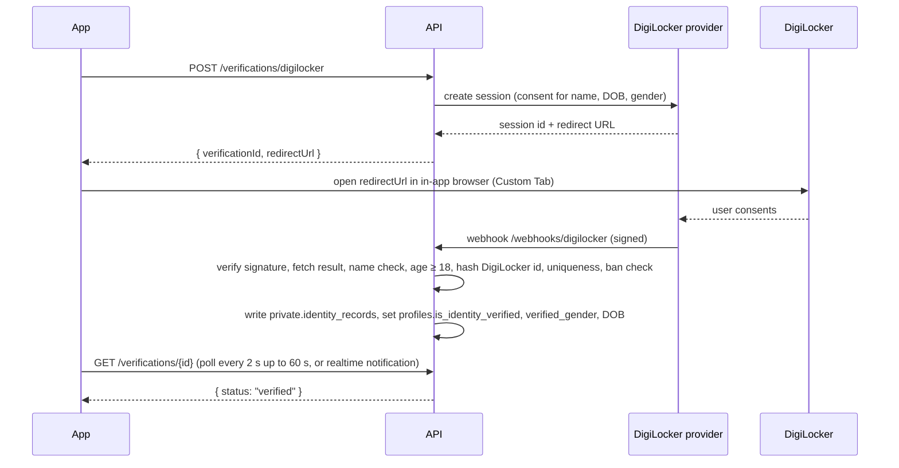

# Flatrimony — API Design Document

| Field | Value |
| --- | --- |
| Document version | 1.0 |
| Date | 12 Nov 2026 |
| API style | REST over HTTPS, JSON, OpenAPI 3.1 generated from Zod schemas |
| Base URLs | Production `https://api.flatrimony.in/v1` · Staging `https://api.staging.flatrimony.in/v1` · Local `http://localhost:8080/v1` (domains pending name clearance) |
| Owner | Aryan Garg |
| Related | `02-prd.md` (FR-IDs), `04-database-design.md` (tables), `03-technical-stack.md` (implementation) |

> **For the implementing agent.** Define every request and response schema in `packages/shared/src/api/*.ts` with Zod first; generate OpenAPI and the typed client (`packages/api-client`) from those schemas. Each endpoint below lists its FR-IDs; every endpoint needs integration tests for: unauthenticated (401), wrong user (403/404), invalid input (422), and the happy path.

---

## Table of contents

1. Conventions
2. Authentication and session model
3. Authorisation model
4. Errors
5. Pagination, filtering and sorting
6. Idempotency, concurrency and rate limits
7. Resource schemas (shared types)
8. Endpoints
   - 8.1 Health and config
   - 8.2 Me (account, Flat Biodata)
   - 8.3 Photos
   - 8.4 Verification
   - 8.5 Areas and commute
   - 8.6 Listings
   - 8.7 Discovery
   - 8.8 Swipes and likes
   - 8.9 Matches and decisions
   - 8.10 Messages
   - 8.11 Meet-ups (Pehli Mulaqat)
   - 8.12 Safety
   - 8.13 Reports and blocks
   - 8.14 Notifications and devices
   - 8.15 Privacy and consents
   - 8.16 Stays and Flatmate Passport (v1.1)
   - 8.17 Move-in log and deposit (v1.1)
   - 8.18 Replacement finder (v1.1)
   - 8.19 Payments (v1.1)
   - 8.20 Living together (v1.2)
   - 8.21 Admin
   - 8.22 Webhooks
9. Realtime channels
10. Push notification payloads
11. Versioning and deprecation
12. Security checklist per endpoint
13. Error code catalogue

---

## 1. Conventions

| Topic | Rule |
| --- | --- |
| Protocol | HTTPS only (TLS 1.2+). HTTP is redirected at the edge. |
| Format | `application/json; charset=utf-8` for requests and responses. Uploads go directly to storage with signed URLs, never through the API. |
| Naming | JSON fields in `camelCase`; URL paths in `kebab-case`, plural nouns (`/listings`, `/meetups`). Enum values in `snake_case` exactly as in the database (`women_only`, `have_room`). |
| IDs | UUID v4 strings. Reference data uses `slug` or short ids (`areas` use numeric `id` + `slug`). |
| Times | ISO 8601 in UTC with `Z` (`2026-11-12T08:30:00Z`). Dates without time as `YYYY-MM-DD`. Times of day as `HH:mm` (24 h). |
| Money | Listing prices as integer rupees with `Inr` suffix (`rentPerPersonInr`). Payments and bills as integer paise with `Paise` suffix. |
| Locations | `{ "lat": 28.4950, "lng": 77.0890 }`. Polygons as GeoJSON. |
| Language | `Accept-Language: en` or `hi` selects localised strings in responses (reference data labels, error messages). |
| Client info | Required headers: `X-App-Platform: android|ios|web`, `X-App-Version: 1.0.0`. Optional: `X-Request-Id` (echoed back). |
| CORS | Browsers may call the API only from origins listed in `CORS_ALLOWED_ORIGINS` (the web app, the admin app; locally also the Expo web preview). With the list empty, no cross-origin browser call is allowed. The Android app is not a browser and is unaffected. |
| Empty values | Omit unknown optional fields rather than sending `null`, except where `null` has meaning (e.g., clearing a field in PATCH). |
| PATCH | JSON Merge Patch semantics: fields present are updated; `null` clears nullable fields. |
| Successful status codes | `200` read/update, `201` create (with `Location` header), `202` accepted async, `204` no content. |

## 2. Authentication and session model

1. **Login** uses Supabase Auth directly from the client:
   - `supabase.auth.signInWithOtp({ phone: '+91XXXXXXXXXX' })`
   - `supabase.auth.verifyOtp({ phone, token, type: 'sms' })` → returns `access_token` (JWT, short-lived) and `refresh_token` (rotating).
   - Supabase's Send SMS hook calls our SMS provider (DLT-registered template). OTP rate limits are configured in Supabase Auth **and** enforced by `POST /v1/auth/otp-guard` (see below) for ban checks and device limits.
2. **API calls** send `Authorization: Bearer <access_token>`. The API verifies signature, issuer, audience (`authenticated`), expiry, that the session was established by phone OTP (`amr` contains `otp`; T2.2), and that the session is not revoked: the token's `session_id` must still have a row in `auth.sessions` for that user, not past its `not_after`, with at least one refresh token that is not revoked (sessions on Supabase's newer counter-based refresh tokens have none and are judged by the row alone). Signing out (this device or everywhere) deletes the row; refresh-token reuse makes Supabase Auth revoke all of the session's refresh tokens. Either way a token stops working within a minute instead of at its expiry; the API follows Supabase's own view of the session (if Auth later lets the newest refresh token renew it, it is live again). Answers are cached 60 s per session; a failed check is remembered 5 s and gives up after 2 s. Tokens without a `session_id` are refused. If the check cannot run (database unreachable or slow) the request is `503 upstream.unavailable` with `Retry-After: 5`, never `401`, so clients do not take an outage for a sign-out. Deleting an account is a soft delete (refused per route as `auth.account_deleted`); its sessions end when `auth.users` is purged. Supabase's timebox and inactivity limits (off today) are enforced by Auth only at refresh.
3. **Token storage:** mobile in `expo-secure-store`; web in an `HttpOnly`, `Secure`, `SameSite=Lax` cookie set by the Next.js server (web never stores tokens in `localStorage`).

   **Web session (apps/web):**
   - The browser calls `otp-guard`, Supabase `/auth/v1/otp` and `/auth/v1/verify` itself, so Supabase's per-IP limits apply to the user rather than to the web server. It then hands the tokens once to `POST /api/session` on the web app, which stores them in two HttpOnly cookies (`fl_at`, `fl_rt`; 30 days, renewed on every refresh). The page keeps no copy.
   - Every other API call goes to the web app's `/api/v1/<path>`, which forwards it to `API_URL/v1/<path>` with `Authorization: Bearer` from the cookie, `X-App-Platform: web` and `X-App-Version`. Only the roots the web app uses pass (`me`, `config`, `reference`, `places`, `commute`), as plain path segments; anything else is `404`. Bodies over 100 KB (the API's own limit) get `413` unread. Bodies, query strings, status codes, `ETag`, `Retry-After`, `Idempotency-Key`/`Idempotent-Replayed` and the `RateLimit-*` headers pass through unchanged.
   - The web server refreshes the access token at Supabase when it is within 60 s of expiry or unreadable, and once more after a 401, writing the rotated tokens back to the cookies. A refused refresh token clears them. If Supabase cannot be reached and the access token has already expired, the answer is `503 auth.unavailable` with the cookies kept (the page offers a retry; it is not a sign-out). A refresh token that a parallel request has just rotated ("already used") also keeps the cookies. The browser waits 30 s for `/api/v1`, longer than the server's own budget (two refreshes at 4 s, two API calls at 10 s), so a rotated cookie is never lost to a page that gave up.
   - State-changing calls (`POST`, `PUT`, `PATCH`, `DELETE`, and both `/api/session` methods) must carry an `Origin` from the web app's own host, or they get `403 forbidden`.
   - With `WEB_PROXY_SECRET` set on both sides, the web server sends `X-Flatrimony-Proxy-Secret` and `X-Flatrimony-Client-IP` (taken from its own trusted `X-Forwarded-For` entry), and the API's rate limits count that IP. Without the matching secret the header is ignored. The secret is redacted from the API's logs.
   - `DELETE /api/session` signs out: it renews an expired access token if needed, revokes the session at Supabase (`scope=local`) and clears the cookies. The page also forgets any unsaved onboarding answers, on sign-out and on every new sign-in.
4. **Bootstrap:** after the first OTP login, the client calls `POST /v1/me/bootstrap` once to create the profile row, record consents and register the device.
5. **Logout:** client calls `supabase.auth.signOut({ scope: 'local' | 'global' })` and `DELETE /v1/devices/current`.

### `POST /v1/auth/otp-guard` (public)

Called by the client **before** requesting an OTP. Checks bans and device/IP abuse, returns whether the client may proceed. FR-AUTH-02, FR-AUTH-08.

Request:

```json
{ "phone": "+919812345678", "deviceId": "b7c1…", "integrityToken": "eyJ…" }
```

Response `200`:

```json
{ "allowed": true }
```

Response `403` with code `auth.banned` or `429` with `auth.otp_rate_limited` (`retryAfterSeconds`). The phone number is hashed immediately and never logged.

Implementation notes (T2.3): phone and `deviceId` are HMAC-SHA-256'd with `HASH_PEPPER` (kind-separated; phones canonicalised to `+91…` first) before any use. Limits are **sliding** windows checked in the order IP (IPv6 by /64) → device → phone; nothing is recorded unless all three pass, so a caller over its own budget cannot burn a victim's per-phone quota, and a request over any limit gets `429` **before** any ban lookup (the limits bound ban probing). `integrityToken` is accepted but not yet verified (Play Integrity, T3.6). The client IP is the socket address unless `TRUST_PROXY_HOPS` is set (Cloud Run: 1). This endpoint is advisory, since a client can call Supabase's `/otp` directly, so the Send SMS hook (§8.22) re-applies the enforceable part: banned phones get no OTP, and at most 5 OTPs are sent per phone per 15 minutes, counting only successful sends; "banned" and "over the limit" get the same hook answer. Residual risk: anyone can hold one number's per-phone quota for 15 minutes with 5 requests from fresh IPs/devices (no SMS is sent); stronger client proof (OQ-08 c/d) mitigates it. Counters are per API instance until `private.rate_limits` (migration 0012).

## 3. Authorisation model

| Principal | How identified | Can do |
| --- | --- | --- |
| Anonymous | No token | Health, public config, reference data, `otp-guard`, public safety share page, webhooks (signature-verified) |
| User | Supabase JWT, `role = authenticated` | Own resources; resources of matches they belong to; discovery results the API chooses to return |
| Verified user | User + `profiles.is_identity_verified = true` | Everything a user can, plus send messages, propose meet-ups, share contact, create stays |
| Moderator | JWT with `app_metadata.role = "moderator"` + Cloudflare Access | Admin endpoints except configuration and bans by identity hash |
| Admin | JWT with `app_metadata.role = "admin"` + Cloudflare Access | All admin endpoints |
| System | Cloud Run OIDC token from `worker-sa` | `/internal/*` endpoints |

**Rules every handler follows**

1. Load the resource, then call the policy function (`policies/<resource>.ts`) with the caller and the resource. Return **404** (not 403) when a caller asks for a resource they are not allowed to know exists (other users' matches, messages, listings in draft, women-only resources).
2. Suspended users (`suspended_until > now`) get `403 account.suspended` on all write endpoints.
3. Deleted users get `401 auth.account_deleted`.
4. The women-only rule is applied in discovery SQL **and** in `GET /profiles/{id}` and `GET /listings/{id}`.

## 4. Errors

All errors use **RFC 9457 Problem Details** (`application/problem+json`):

```json
{
  "type": "https://docs.flatrimony.in/errors/verification.required",
  "title": "Verification required",
  "status": 403,
  "code": "verification.required",
  "detail": "Verify your identity with DigiLocker to start chatting.",
  "requestId": "req_01J…",
  "errors": [
    { "path": "body.budgetMaxInr", "code": "too_small", "message": "Must be at least 1000" }
  ]
}
```

| Status | When |
| --- | --- |
| 400 | Malformed JSON or headers |
| 401 | Missing/invalid/expired token |
| 403 | Authenticated but not allowed (suspended, not verified, entitlement missing) |
| 404 | Not found or not visible to caller |
| 409 | Conflict (duplicate, state transition not allowed) |
| 412 | Precondition failed (`If-Match` ETag mismatch) |
| 413 | Payload too large |
| 422 | Validation failed (`errors[]` lists fields) |
| 429 | Rate limited (`Retry-After` header) |
| 500 | Unexpected error (no internals in the body) |
| 502/503/504 | Upstream provider or dependency failure (retryable) |

The full list of `code` values is in section 13. Messages are localised by `Accept-Language`.

## 5. Pagination, filtering and sorting

- **Cursor pagination** on all lists: `?limit=20&cursor=<opaque>`; response:
  ```json
  { "data": [ … ], "page": { "nextCursor": "eyJ…", "hasMore": true } }
  ```
- `limit` default 20, max 50 (messages max 100).
- Cursors are opaque base64url of `{ sortKey, id }`; clients never build them.
- Sorting is fixed per endpoint (documented below); no arbitrary `sort` parameters at v1.

## 6. Idempotency, concurrency and rate limits

### 6.1 Idempotency

`Idempotency-Key: <uuid>` is **required** on: `POST /swipes`, `POST /matches/{id}/messages`, `POST /matches/{id}/decision`, `POST /payments/orders`, `POST /safety/sos`, `POST /reports`. The API stores the key with the response for 24 hours (per user); a retry with the same key returns the original response with header `Idempotent-Replayed: true`. Reusing a key with a different body returns `409 idempotency.key_reused`.

### 6.2 Optimistic concurrency

Mutable singletons (`/me`, `/me/preferences`, `/listings/{id}`) return an `ETag`. Clients send `If-Match` on `PATCH`/`PUT`; mismatch returns `412`.

### 6.3 Rate limits (initial values; remote-configurable)

| Scope | Limit |
| --- | --- |
| Global per IP | 300 requests / minute |
| Per user (default) | 120 requests / minute |
| `otp-guard` | 5 / 15 min per phone hash; 20 / hour per device; 50 / hour per IP |
| Swipes | 60 / minute; daily likes per `ref.app_config.daily_like_limit` (unlimited with Move Pass) |
| New conversations (first message in a match) | 10 / day for new accounts (FR-CHAT-04) |
| Messages | 30 / minute per user |
| Reports | 10 / day |
| Upload URL requests | 30 / hour |
| SOS | No limit (never blocked) |

Responses include `RateLimit-Limit`, `RateLimit-Remaining`, `RateLimit-Reset` headers. Exceeding returns `429 rate_limited` with `Retry-After`.

## 7. Resource schemas (shared types)

These are the canonical JSON shapes (TypeScript notation). Field names map 1:1 to database columns converted to camelCase.

```ts
type UUID = string;
type ISODateTime = string;   // 2026-11-12T08:30:00Z
type ISODate = string;       // 2026-11-12
type TimeOfDay = string;     // "23:00"
type LatLng = { lat: number; lng: number };

type Intent = 'have_room' | 'need_room' | 'pair_up';
type Category = 'professional' | 'student' | 'women_only' | 'relocating';
type GenderPreference = 'female_only' | 'male_only' | 'any';
type TravelMode = 'car' | 'two_wheeler' | 'metro_transit' | 'walk';
type Importance = 'dealbreaker' | 'matters' | 'dont_care';
type LifestyleAttribute = 'bedtime' | 'wake_time' | 'cleaning' | 'smoking' | 'pets' | 'food'
  | 'cooks_at_home' | 'drinking' | 'guests' | 'parties' | 'work_mode';

interface Badge { type: 'identity_verified' | 'female_verified' | 'work_verified' | 'student_verified'; }

interface Me {
  id: UUID;
  displayName: string;
  age: number | null;                // computed from DOB
  intent: Intent;
  category: Category;
  bio?: string;
  languages: string[];
  locale: 'en' | 'hi';
  collegeName?: string;              // student category only
  courseEndDate?: ISODate;           // student category only
  isIdentityVerified: boolean;
  badges: Badge[];
  isPaused: boolean;
  biodataCompletion: number;          // 0..100
  photos: Photo[];
  preferences?: Preferences;
  anchor?: Anchor;
  lifestyle?: Lifestyle;
  importance: Partial<Record<LifestyleAttribute, Importance>>;
  scenarioAnswers?: { questionId: string; optionId: string }[];   // FR-BIO-06 (T2.11)
  entitlements: { movePass: { active: boolean; validUntil?: ISODateTime } };
  createdAt: ISODateTime;
}

interface Photo { id: UUID; url: string; position: number; moderationStatus: 'pending' | 'approved' | 'rejected'; }

interface Preferences {
  budgetMinInr: number; budgetMaxInr: number;
  moveInFrom: ISODate; moveInTo: ISODate;
  leaseMonths: number;
  flatmateGenderPref: GenderPreference;
  areaIds: number[];                   // max 3
}

interface Anchor { kind: 'office' | 'college'; label: string; location: LatLng; travelMode: TravelMode; maxCommuteMin: number; }

interface Lifestyle {
  bedtime: TimeOfDay; wakeTime: TimeOfDay;
  cleaning: 'daily' | 'few_times_week' | 'weekly' | 'rarely';
  smoking: 'no' | 'outside_only' | 'yes';
  pets: 'have' | 'love' | 'ok' | 'no';
  food: 'veg' | 'eggetarian' | 'non_veg' | 'vegan';
  cooksAtHome?: boolean;
  drinking?: 'never' | 'rarely' | 'sometimes' | 'often';
  guests?: 'never' | 'rarely' | 'sometimes' | 'often';
  parties?: 'never' | 'rarely' | 'sometimes' | 'often';
  workMode?: 'office' | 'hybrid' | 'wfh' | 'night_shift' | 'student';
}

interface PublicProfile {            // what other users see
  id: UUID;
  displayName: string;               // first name only
  age: number | null;
  category: Category;                // 'women_only' shown only to eligible viewers
  intent: Intent;
  bio?: string;
  languages: string[];
  badges: Badge[];
  photos: { id: UUID; url: string }[];
  lifestyle: Lifestyle;
  budget: { minInr: number; maxInr: number };
  moveInFrom: ISODate;
  commuteSummary?: { minutes: number; travelMode: TravelMode; anchorLabel: string };  // from viewer's anchor perspective, when computable
  passport: PassportSummary;
}

interface ListingSummary {
  id: UUID;
  owner: PublicProfile;
  title: string;
  area: { id: number; slug: string; name: string };
  approxLocation: LatLng;            // rounded ~500 m
  bhk: number; roomType: 'private' | 'shared'; furnishing: 'unfurnished' | 'semi_furnished' | 'furnished';
  availableFrom: ISODate; minLeaseMonths: number;
  totalFlatmates: number; currentFlatmates: number;
  rentPerPersonInr: number; depositPerPersonInr: number;
  trueMonthlyPerPersonInr: number;    // rent + recurring costs
  rules: ListingRules;
  coverPhotoUrl: string;
  hasWalkthroughVideo: true;
  offersVideoTour: boolean;
  lastConfirmedAt: ISODateTime;
}

interface ListingRules {
  bachelorsAllowed: boolean; foodRule: 'any' | 'veg_only' | 'eggetarian_ok';
  guestsRule: 'allowed' | 'day_only' | 'not_allowed'; petsAllowed: boolean;
  smokingAllowed: boolean; genderRule: GenderPreference;
}

interface ListingCosts {
  maintenanceInr: number; electricityEstimateInr: number; wifiInr: number; helpInr: number;
  otherRecurringInr: number; oneTimeCosts: { label: string; amountInr: number }[];
}

interface RishtaReport {
  score: number;                                        // 0..100
  agreements: { attribute: LifestyleAttribute; label: string }[];   // top 3
  biggestGap?: { attribute: LifestyleAttribute; label: string; you: string; them: string };
  perAttribute: Partial<Record<LifestyleAttribute, number>>;       // 0..1 similarity
}

interface DeckCard {
  kind: 'person' | 'room';
  person: PublicProfile;
  listing?: ListingSummary;
  rishta: RishtaReport;
  sharedHabits: string[];                                // top 3 labels for the card
  boosted?: boolean;
  locked?: boolean;                                      // FR-DISC-12: gendered room shown to an unverified viewer; liking needs verification
}

interface Match {
  id: UUID;
  otherUser: PublicProfile;
  listing?: ListingSummary;
  rishta: RishtaReport;
  status: 'matched' | 'chatting' | 'met' | 'moving_in' | 'closed';
  canChat: boolean;                                      // both verified and not closed
  contactShared: { me: boolean; them: boolean; phone?: string };   // phone only when both shared
  addressShared: { me: boolean; them: boolean; address?: string }; // for room matches
  lastMessage?: Message;
  unreadCount: number;
  createdAt: ISODateTime;
}

interface Message {
  id: UUID; matchId: UUID; senderId: UUID | null;
  kind: 'text' | 'image' | 'system' | 'meetup' | 'contact_share';
  body?: string; metadata?: Record<string, unknown>;
  clientId: UUID;
  isFlagged: boolean;            // only true for the recipient's warning display
  createdAt: ISODateTime; deliveredAt?: ISODateTime; readAt?: ISODateTime;
}

interface Meetup {
  id: UUID; matchId: UUID; proposedBy: UUID;
  startsAt: ISODateTime; placeName: string; placeLocation?: LatLng; isFlatVisit: boolean;
  status: 'proposed' | 'accepted' | 'declined' | 'cancelled' | 'completed';
}

interface PassportSummary {
  identityVerified: boolean;
  memberSince: ISODate;
  badges: Badge[];
  habitConfirmations: { tagId: string; label: string; confirmedBy: number }[];   // v1.1
  pastStays: number;                                                              // v1.1
  hasReferences: boolean;                                                         // v1.1
}
```

## 8. Endpoints

Notation: **Auth** column — `public`, `user`, `verified`, `moderator`, `admin`, `system`. All paths are under `/v1` unless shown otherwise.

### 8.1 Health and config

| Method | Path | Auth | Description | FR |
| --- | --- | --- | --- | --- |
| GET | `/healthz` (no `/v1`) | public | Liveness | — |
| GET | `/readyz` (no `/v1`) | public | Readiness (DB reachable, migration version) | — |
| GET | `/config` | public | Public remote config: `{ dailyLikeLimit, features: { videoTours: false, houseAgreement: false }, minSupportedAppVersion: "1.0.0", legalVersions: { terms, privacy, … } }` | FR-ADM-07, FR-AUTH-09 |
| GET | `/reference` | public | Areas, habit tags, scenario questions, products (localised), with `ETag` for caching | FR-BIO-06 |

Clients compare `minSupportedAppVersion` and show a forced-update screen if needed. `legalVersions` gives the policy version a user must accept now for each consent purpose; it is empty until the legal documents are published (T0.15).

### 8.2 Me (account and Flat Biodata)

| Method | Path | Auth | Description | FR |
| --- | --- | --- | --- | --- |
| POST | `/me/bootstrap` | user | Create profile on first login (idempotent) | FR-AUTH-06, FR-AUTH-09 |
| GET | `/me` | user | Full `Me` object | FR-BIO-01 |
| PATCH | `/me` | user | Update display name, bio, languages, locale, intent, category, college fields, `isPaused` | FR-BIO-01, FR-BIO-08 |
| PUT | `/me/preferences` | user | Replace preferences (incl. `areaIds`) | FR-BIO-02 |
| PUT | `/me/anchor` | user | Set office/college anchor; enqueues `commute.compute` | FR-BIO-03 |
| DELETE | `/me/anchor` | user | Remove it with its commute zone and any waiting job; `409 conflict` without a preferred area (T2.8) | FR-BIO-03 |
| GET | `/me/commute-zone` | user | `{ status: none \| computing \| ready, zone: GeoJSON MultiPolygon \| null, approx, travelMode, maxCommuteMin, computedAt }` (T2.9) | FR-BIO-03 |
| PUT | `/me/lifestyle` | user | Replace lifestyle answers | FR-BIO-04 |
| PUT | `/me/importance` | user | Set importance per attribute | FR-BIO-05 |
| PUT | `/me/scenario-answers` | user | Upsert answers `[{ questionId, optionId }]` | FR-BIO-06 |
| GET | `/me/passport` | user | Own Passport (full detail, including references received) | FR-PASS-01 |

**`POST /me/bootstrap`** request:

```json
{
  "displayName": "Karan",
  "dateOfBirth": "2002-04-18",
  "intent": "need_room",
  "category": "professional",
  "locale": "en",
  "consents": [
    { "purpose": "terms", "version": "2026-11-01" },
    { "purpose": "privacy", "version": "2026-11-01" },
    { "purpose": "analytics", "version": "2026-11-01" }
  ],
  "device": { "deviceId": "b7c1…", "platform": "android", "appVersion": "1.0.0", "pushToken": "ExponentPushToken[…]", "integrityToken": "eyJ…" }
}
```

Response `201` → `Me` (with `Location: /v1/me`) when the profile is created, `200` → `Me` when it already existed (the profile fields are not changed; active consents keep their original time; the device is recorded again). Errors:

- `422 profile.underage`: under 18 on today's date in India.
- `422 validation.failed`: missing Terms/Privacy consent (`consent_required`), a version other than the current one (`consent_version_outdated`), a purpose not offered (`consent_not_offered`).
- `403 auth.banned`: banned phone or device hash (FR-AUTH-08). `403 account.suspended` (with `suspendedUntil`) for an existing, suspended profile.
- `401 auth.account_deleted`.
- `409 conflict`: the auth user has no verified phone, or the number is still on another account.
- `503 upstream.unavailable`: the legal documents are not published yet. Clients show "sign-up is not open yet" and must not retry automatically.

Rules:

- The phone hash comes from the number Supabase verified (`auth.users.phone`), never from the request. The device id is HMAC'd; the push token is stored; the Play Integrity token is not stored, and until Play Integrity is set up the device is recorded as `unverified`.
- `GET`/`PATCH /me` and the consent routes answer `409 profile.incomplete` before bootstrap.
- `PATCH /me` is strict (unknown fields are `422`). Date of birth and verified fields are not editable. `collegeName`/`courseEndDate` are for the `student` category only; leaving it clears them. Choosing `women_only` after verifying as non-female is `403 profile.category_not_allowed`.
- `GET /me` returns `ETag: W/"<version>"`; `PATCH /me` with `If-Match` answers `412 precondition.failed` when the profile changed since (without `If-Match` the last write wins).
- A suspended account (`account.suspended`, docs/05 §3) can still read its profile and withdraw consents; profile edits and new grants are refused.
- If the number is still on another account but that account has since moved to a new number, the stored hash is moved to its new number and this bootstrap continues.
- Biodata completion weights (initial, founder-adjustable; `BIODATA_WEIGHTS` in `packages/shared`): basics 10, preferences 10, anchor or areas 10, lifestyle 10 (the six onboarding steps give 40 %, FR-AUTH-06 AC), photos 20, bio 10, languages 5, importance 10, scenario answers 10, DigiLocker verified 5.
- `category: "women_only"` is accepted before verification (profile stays invisible to all until verified female). If verification later returns a non-female gender, the API switches the category to `professional` and notifies the user.
- `biodataCompletion` is recomputed on every write.

**`PUT /me/preferences`**:

```json
{
  "budgetMinInr": 15000, "budgetMaxInr": 20000,
  "moveInFrom": "2026-12-01", "moveInTo": "2026-12-20",
  "leaseMonths": 11, "flatmateGenderPref": "any",
  "areaIds": [12, 14]
}
```

**Biodata writes (`PUT /me/preferences`, `/me/anchor`, `/me/lifestyle`, `/me/importance`, `/me/scenario-answers`)** — T2.7:

- Each answers `200` with the updated `Me` and its new `ETag` (every write changes it), and recomputes `biodataCompletion`. Optional `If-Match` as for `PATCH /me` (`412 precondition.failed` when stale; without it the last write wins). Writes for one user run one after another.
- Order of checks: body schema, then `409 profile.incomplete` (before bootstrap) and `403 account.suspended`, then the checks below. The codes below are `errors[].code` values inside `422 validation.failed`.
- Bodies are strict. `PUT` replaces the part: the area set, the optional lifestyle answers and the importance map are replaced, not merged. Scenario answers are upserted per question.
- `preferences`: every `areaIds` entry must be an active area (`unknown_area`); the window may not have ended already on today's date in India (`in_the_past`); budget, lease and window rules as in §7.
- `anchor`: the point must lie in Delhi NCR (`outside_ncr`; an approximate bounding box, `LIMITS.ncrBounds`, to be confirmed by the founder); `maxCommuteMin` defaults to 45. A new point, travel mode or time drops the old commute zone and enqueues `commute.compute` (one pending job per user; a waiting one is pulled forward with fresh attempts). `GET /me/commute-zone` then answers `computing` until a zone that fits the anchor is stored (`ready`; it stays `ready` while the daily refresh redraws it); `none` without an anchor. `approx: true` marks the radius approximation (metro/transit until a transit source is decided, ADR-0008, or routing unavailable).
- `lifestyle`: the six core answers (bedtime, wake time, cleaning, smoking, pets, food) are required; times are `HH:mm`.
- `scenario-answers`: `[{ questionId, optionId }]` (up to 50), each question once; unknown or inactive questions `unknown_question` (at `body.<i>.questionId`), options a question does not have `invalid_option` (at `body.<i>.optionId`).

### 8.3 Photos

| Method | Path | Auth | Description | FR |
| --- | --- | --- | --- | --- |
| POST | `/me/photos/upload-url` | user | Body `{ contentType: "image/webp" | "image/jpeg", sizeBytes }` → `{ uploadUrl, storageKey, expiresAt }` (max 8 MB) | FR-BIO-07 |
| POST | `/me/photos` | user | Confirm `{ storageKey, position }` → `Photo` (`moderationStatus: pending`); enqueues `media.process` | FR-BIO-07 |
| PATCH | `/me/photos/order` | user | `{ photoIds: [uuid, …] }` reorders | FR-BIO-01 |
| DELETE | `/me/photos/{photoId}` | user | Delete photo (must keep ≥ 1) | FR-BIO-01 |

Implementation notes (T2.10):

- `upload-url` returns a staging key `<user_id>/uploads/<uuid>` and a Supabase signed upload URL (the client `PUT`s the file there). Supabase signed upload URLs are valid for **2 hours** (not configurable), so `expiresAt` is 2 h, not the 10 min of docs/04 §7.1. Limited to 30 per user per hour (`RATE_LIMITS.uploadUrls`). The bucket itself enforces 8 MB and JPEG/WebP.
- `upload-url` also deletes the caller's unconfirmed uploads older than 2 h (originals still carry EXIF/GPS).
- `POST /me/photos` (limited to 30 per user per hour) checks `If-Match` (`412`), the key and the position before any image work: the key must be the caller's staging key (`invalid_key`), the position the next free one or an existing one (photos always fill 0..n-1; `position_gap`), and the upload present (`upload_missing`). The original is deleted as soon as it has been read, whatever happens next (on a failure the app uploads again). It then processes the upload **in the request** until the job runner exists (`media.process`, T1.14), at most two at a time per instance, with only the JPEG and WebP decoders enabled: it must decode as a still JPEG or WebP (`unsupported_format`, `not_an_image`, `animated`, `too_large`); the EXIF orientation is applied and the image is re-encoded as WebP (longer side ≤ 1600 px), which removes all metadata including GPS; a 64-bit perceptual hash and the dimensions are stored; the result is saved as `<user_id>/<uuid>.webp` and the original is deleted. A photo already at that `position` is replaced (its object deleted). Answers `201 Photo` with a 1-hour signed URL and `Location: /v1/me`; `moderationStatus` is `pending`.
- Face and explicit-content checks need an image-moderation vendor (**Blocked**): `has_face` stays empty and every photo waits for human moderation.
- `PATCH /me/photos/order` must list each of the caller's photos exactly once (`mismatch`); positions become 0..n-1. `DELETE` closes the gap and returns the new `ETag`; removing the last photo is `409 conflict`. All photo writes accept `If-Match` and change the `ETag`; a refused write (`422`, `404`, `409`) changes nothing, not even the `ETag`; `Me.photos` carries 1-hour signed URLs in position order.
- Without Storage configured (`SUPABASE_URL` + `SUPABASE_SERVICE_ROLE_KEY`), the photo routes answer `503 upstream.unavailable` and `Me.photos` is empty.

### 8.4 Verification

| Method | Path | Auth | Description | FR |
| --- | --- | --- | --- | --- |
| POST | `/verifications/digilocker` | user | Start DigiLocker flow → `{ verificationId, redirectUrl, expiresAt }` | FR-VER-01 |
| GET | `/verifications/{verificationId}` | user | Poll status `{ status, failureCode? }` | FR-VER-01 |
| GET | `/verifications` | user | List own verifications and badges | FR-VER-08 |
| POST | `/verifications/selfie` | user | Start liveness session (P1) → provider session token | FR-VER-04 |
| POST | `/verifications/email` | user | `{ email, type: "work_email" | "college_email" }` → sends link | FR-VER-05 |
| POST | `/verifications/email/confirm` | public | `{ token }` (from link) → `{ status: "verified" }` | FR-VER-05 |

DigiLocker flow:



Failure codes: `name_mismatch`, `underage`, `identity_in_use` (DigiLocker identity already linked to another account), `banned`, `provider_error`, `user_cancelled`; an abandoned attempt becomes status `expired`.

Implementation notes (T3.1):

- **Start** `POST /verifications/digilocker` takes `{ consentVersion }`: the current `identity_verification` policy version (`ref.app_config` `legal.versions`), which is recorded as a consent (DigiLocker and provider terms require explicit consent). An older version is `422` (`body.consentVersion`, `outdated_version`); none published is `503`. Already verified is `409 conflict`; no profile `409 profile.incomplete`; deleted `401`, suspended `403 account.suspended`. A new start replaces an unfinished one (one pending attempt per user). 5 starts per hour per user (each is a paid provider session). `201 { verificationId, redirectUrl, expiresAt }`.
- **Webhook** `POST /webhooks/digilocker` uses Standard Webhooks signatures (`webhook-id`, `webhook-timestamp`, `webhook-signature`; secrets `DIGILOCKER_WEBHOOK_SECRETS`, 5-minute tolerance) over a body naming the provider reference `{ "providerRef": "…" }`. The API then fetches the result from the provider and never trusts the webhook body. Bad signature `401`; unknown or already decided references `200` (so the provider stops retrying); provider unreachable `503` (it retries).
- **Decision order** (so the answer reveals as little as possible): banned identity → under 18 on today's date in India → identity already on another account → first name does not match. First-name match (FR-VER-03): the display name's first word equals a word of the DigiLocker name, or one starts with the other with at least 3 letters ("Abhi" for "Abhishek"); case and Latin accents ignored, Devanagari compared as is.
- **Verified**: one transaction writes `private.identity_records` and sets `is_identity_verified`, `verified_gender` and `date_of_birth` (DigiLocker's), recomputes completion (+5) and bumps the profile version. A `women_only` profile with a non-female result becomes `professional`, and a `female_only` flatmate preference becomes `any` (FR-VER-06). Two accounts finishing with one identity at once: the second fails `identity_in_use`.
- **Status** `GET /verifications/{id}` (owner only, else `404`) and `GET /verifications` (newest first) return `{ id, type, status, failureCode, startedAt, completedAt, expiresAt }`, never identity data. A pending attempt past `expiresAt` reads as `expired`.
- **Mock provider** (`DIGILOCKER_PROVIDER=mock`, refused in production): `redirectUrl` is a test consent page on the API (`/dev/digilocker/:ref`) where a tester enters the name, DOB, gender and DigiLocker id DigiLocker would return, or denies; the page then sends a signed webhook like a provider. Notifications (`verification.completed` / `verification.failed`, §11) come with the notifications work.

### 8.5 Areas and commute

| Method | Path | Auth | Description | FR |
| --- | --- | --- | --- | --- |
| GET | `/areas?city=gurugram` | public | Area list (localised) | FR-BIO-02 |
| POST | `/commute/preview` | user | `{ location, travelMode, maxCommuteMin = 45 }` → `{ zone: GeoJSON MultiPolygon, approx }`. Routed by the routing service (4 s timeout); metro/transit, no road near the point, or routing slow/down give the radius approximation (`approx: true`). Cached per place (~100 m), mode and minutes for an hour (temporary routing failures are not cached). `outside_ncr` as for the anchor; 30 per user per minute (T2.9) | FR-BIO-03 |
| POST | `/places/autocomplete` | user | `{ q (2–100 chars), sessionToken (UUID) }` → `{ suggestions: [{ placeId, label, secondary }] }` (up to 5). A POST, not `GET ?q=`, so what the user types (their office) stays out of URLs and logs. Google Places (New) restricted to `LIMITS.ncrBounds` and India, with the session token; the key stays server-side. `mock` provider (local, CI) searches the seeded areas. Vendor down `503`; 60/min per user (T2.8) | FR-BIO-03 |
| POST | `/places/details` | user | `{ placeId, sessionToken }` → `{ placeId, label \| null, location }` (a POST: the chosen place is the user's office). `label` null for Google (location-only details; use the suggestion's name). `404` unknown, `422 outside_ncr`, `503` vendor down or misconfigured; ends the search session (T2.8) | FR-BIO-03 |

### 8.6 Listings

| Method | Path | Auth | Description | FR |
| --- | --- | --- | --- | --- |
| POST | `/listings` | user (`have_room`) | Create draft | FR-LST-01, 02 |
| GET | `/me/listings` | user | Own listings (all statuses) | FR-LST-09 |
| GET | `/listings/{listingId}` | user | Listing detail (owner sees everything; others see `ListingSummary` + photos + video URL; women-only rule applies) | FR-LST-06 |
| PATCH | `/listings/{listingId}` | owner | Update fields (`If-Match`); content edits on an active listing re-run checks | FR-LST-09 |
| PUT | `/listings/{listingId}/rules` | owner | Replace rules | FR-LST-04 |
| PUT | `/listings/{listingId}/costs` | owner | Replace costs (`brokerage` must be 0 — not even accepted as input) | FR-LST-03 |
| POST | `/listings/{listingId}/media/upload-url` | owner | `{ kind: "photo" | "walkthrough_video", contentType, sizeBytes }` → presigned URL (photo ≤ 8 MB → Supabase Storage; video ≤ 25 MB → R2) | FR-LST-05 |
| POST | `/listings/{listingId}/media` | owner | Confirm upload (see below) | FR-LST-05 |
| DELETE | `/listings/{listingId}/media/{mediaId}` | owner | Remove media | FR-LST-09 |
| POST | `/listings/{listingId}/submit` | owner | Validate completeness → `active` or `pending_review` | FR-LST-08 |
| POST | `/listings/{listingId}/confirm-available` | owner | One-tap 7-day confirmation; extends `expiresAt` | FR-LST-07 |
| POST | `/listings/{listingId}/pause` | owner | Pause | FR-LST-09 |
| POST | `/listings/{listingId}/resume` | owner | Resume (re-confirms availability) | FR-LST-07 |
| DELETE | `/listings/{listingId}` | owner | Soft delete | FR-LST-09 |
| POST | `/matches/{matchId}/address-share` | verified member | Owner shares the exact address with this match | FR-LST-06 |

**Create listing** `POST /listings`:

```json
{
  "title": "Sunny room in 3BHK near Cyber Hub",
  "description": "Two working professionals, quiet weeknights.",
  "areaId": 12,
  "location": { "lat": 28.4951, "lng": 77.0889 },
  "address": "Tower B, Flat 1203, …",
  "bhk": 3, "roomType": "private", "furnishing": "semi_furnished",
  "availableFrom": "2026-12-01", "minLeaseMonths": 11,
  "totalFlatmates": 3, "currentFlatmates": 2,
  "rentPerPersonInr": 18000, "depositPerPersonInr": 36000
}
```

Response `201` → listing (owner view), `status: "draft"`. `address` is encrypted at rest and returned only to the owner (and to a match after `address-share`).

**Confirm media** `POST /listings/{id}/media`:

```json
{
  "kind": "walkthrough_video",
  "storageKey": "walkthroughs/7f3c…/a1b2.mp4",
  "sha256": "9f86d081884c7d65…",
  "durationS": 64,
  "width": 1280, "height": 720,
  "capturedAt": "2026-11-12T07:55:10Z",
  "recordedInApp": true,
  "integrityToken": "eyJ…"
}
```

Server checks: object exists with matching size/hash; `durationS` 30–90; `recordedInApp = true`; Play Integrity verdict acceptable (web clients cannot upload walkthrough videos — must use the Android app); capture time within the last 24 h. A draft created on the web is finished on Android: the web client shows a QR code / link to `flatrimony://listings/{id}/video` (FR-LST-05). Errors: `listing.video_invalid`, `integrity.failed`.

**Submit** `POST /listings/{id}/submit` checks: rules and costs present; 3–12 photos; 1 walkthrough video; owner verified (identity) — **listings require DigiLocker verification of the owner**; automatic checks pass. Returns `{ status: "active" | "pending_review", expiresAt }`.

### 8.7 Discovery

| Method | Path | Auth | Description | FR |
| --- | --- | --- | --- | --- |
| GET | `/discover/deck?mode=rooms|people&limit=20&cursor=` | user | Ranked `DeckCard[]` for swiping | FR-DISC-01..10 |
| GET | `/discover/list?mode=rooms|people&limit=20&cursor=&areaId=&maxCommuteMin=&maxRentInr=` | user | Same ranking, list/map view with optional narrowing filters (cannot widen hard filters) | FR-DISC-01 |
| GET | `/discover/map?mode=rooms&bbox=minLng,minLat,maxLng,maxLat` | user | Approximate pins for the map (rounded locations, max 200) | FR-DISC-01 |
| GET | `/profiles/{userId}` | user | `PublicProfile` + `rishta` relative to the caller (404 if not visible) | FR-DISC-05 |
| GET | `/discover/empty-hints` | user | Suggestions when the deck is empty: `[{ code: "widen_commute", from: 20, to: 35, estimatedMore: 42 }]` | FR-DISC-11 |

`GET /discover/deck` response `200`:

```json
{
  "data": [
    {
      "kind": "room",
      "person": { "id": "…", "displayName": "Meera", "age": 28, "category": "professional", "intent": "have_room",
                  "badges": [{ "type": "identity_verified" }, { "type": "work_verified" }],
                  "photos": [{ "id": "…", "url": "https://…signed…" }],
                  "lifestyle": { "bedtime": "23:00", "wakeTime": "07:00", "cleaning": "daily", "smoking": "no", "pets": "love", "food": "veg" },
                  "budget": { "minInr": 15000, "maxInr": 20000 }, "moveInFrom": "2026-12-01",
                  "commuteSummary": { "minutes": 28, "travelMode": "metro_transit", "anchorLabel": "Your office" },
                  "passport": { "identityVerified": true, "memberSince": "2026-11-03", "badges": [], "habitConfirmations": [], "pastStays": 0, "hasReferences": false },
                  "languages": ["en", "hi"] },
      "listing": { "id": "…", "title": "Sunny room in 3BHK near Cyber Hub", "rentPerPersonInr": 18000, "trueMonthlyPerPersonInr": 21500, "…": "…" },
      "rishta": { "score": 94, "agreements": [ { "attribute": "bedtime", "label": "Both asleep by 11 PM" } ], "biggestGap": { "attribute": "pets", "label": "Pets", "you": "OK with pets", "them": "Loves dogs" }, "perAttribute": { "bedtime": 1, "cleaning": 1, "pets": 0.67 } },
      "sharedHabits": ["Asleep by 11 PM", "Cleans daily", "Non-smoker"]
    }
  ],
  "page": { "nextCursor": "eyJ…", "hasMore": true }
}
```

Behaviour:

- Deck is computed by the discovery service (candidate SQL → `packages/matching` scoring → ranking) and cached in `deck_cache` for 10 minutes; preference changes invalidate it.
- Signed photo URLs expire in 1 hour; clients refetch the deck page if a URL expires.
- `mode=rooms` is available to `need_room`; `mode=people` to all intents (owners browse seekers who liked them via likes, and can browse `need_room`/`pair_up` seekers).

### 8.8 Swipes and likes

| Method | Path | Auth | Description | FR |
| --- | --- | --- | --- | --- |
| POST | `/swipes` | user | Record like/pass/super_like; may create a match | FR-DISC-06, 08 |
| POST | `/swipes/rewind` | user + Move Pass | Undo the last swipe (within 10 minutes, if no match was created) | FR-PAY-01 |
| GET | `/likes/received?cursor=` | user + Move Pass | People who liked you (blurred preview without Move Pass via `GET /likes/received/count`) | FR-PAY-01 |
| GET | `/likes/received/count` | user | `{ count }` | FR-PAY-01 |

`POST /swipes` (header `Idempotency-Key`):

```json
{ "targetUserId": "…", "listingId": "…", "action": "like" }
```

Response `200`:

```json
{ "matched": true, "match": { "id": "…", "status": "matched", "rishta": { "score": 94, "…": "…" } }, "remainingLikesToday": 41 }
```

Swipes are per room: `listingId` is required for room cards, and a mutual like on a room creates a match tied to that listing (FR-DISC-06). Liking a `locked` room while unverified returns `403 verification.required` (passing is allowed).

Errors: `409 swipe.already_swiped`, `403 swipe.daily_limit_reached`, `403 verification.required`, `404` (target not visible), `403 entitlement.required` (super_like note without Move Pass).

### 8.9 Matches and decisions

| Method | Path | Auth | Description | FR |
| --- | --- | --- | --- | --- |
| GET | `/matches?status=active|closed&cursor=` | user | Match list sorted by `lastMessageAt desc`, then `createdAt desc` | FR-CHAT-01 |
| GET | `/matches/{matchId}` | member | Match detail | FR-DISC-05 |
| POST | `/matches/{matchId}/unmatch` | member | Close match (`closed_reason: unmatched`) | FR-CHAT-07 |
| POST | `/matches/{matchId}/contact-share` | verified member | Record "share my number"; numbers revealed when both shared | FR-CHAT-03 |
| POST | `/matches/{matchId}/decision` | verified member | `{ stillInterested: boolean }` after a completed meet-up | FR-MEET-03 |

Decision rules: allowed only after at least one meet-up with `status = completed` or `startsAt < now()` and `accepted`. When both answers are `true` → `status = moving_in` and both receive "Rishta pakka!" notifications. When either is `false` → `status = closed`, `closed_reason = not_interested`; the other user sees a neutral message. Answers are never shown to the other user.

### 8.10 Messages

| Method | Path | Auth | Description | FR |
| --- | --- | --- | --- | --- |
| GET | `/matches/{matchId}/messages?cursor=&limit=50` | member | Newest first; cursor on `(createdAt, id)` | FR-CHAT-02 |
| POST | `/matches/{matchId}/messages` | verified member (both verified) | Send message | FR-CHAT-01, 02, 04, 05 |
| POST | `/matches/{matchId}/read` | member | `{ upToMessageId }` marks read | FR-CHAT-02 |
| POST | `/matches/{matchId}/messages/image-upload-url` | verified member | P1 image messages | FR-CHAT-02 |

`POST /matches/{matchId}/messages` (header `Idempotency-Key`):

```json
{ "clientId": "5b0e…", "kind": "text", "body": "Hi Meera! Is the room still available for Dec 1?" }
```

Response `201` → `Message`. Server pipeline: authorise → both verified (`403 verification.required` / `verification.other_party_pending`) → match not closed → rate limits (new-conversation cap) → content checks (length, phone numbers/UPI IDs/URLs in first 5 messages are masked and flagged, scam keywords) → insert (unique `match_id, client_id`) → push notification to recipient. Realtime delivers the row to both clients.

### 8.11 Meet-ups (Pehli Mulaqat)

| Method | Path | Auth | Description | FR |
| --- | --- | --- | --- | --- |
| POST | `/matches/{matchId}/meetups` | verified member | Propose `{ startsAt, placeName, placeLocation?, isFlatVisit }` | FR-MEET-01 |
| GET | `/matches/{matchId}/meetups` | member | List | FR-MEET-01 |
| POST | `/meetups/{meetupId}/respond` | other member | `{ response: "accept" | "decline" }` | FR-MEET-01 |
| POST | `/meetups/{meetupId}/cancel` | member | Cancel | FR-MEET-01 |
| POST | `/meetups/{meetupId}/check-in` | member | v1.1 check-in | FR-SAFE-05 |
| GET | `/meetups/{meetupId}/suggested-spots` | member | v1.1 public places near the flat | FR-SAFE-05 |

Rules: `startsAt` must be at least 1 hour in the future and within 30 days; one active proposal per match at a time; system messages are posted in the chat for each state change.

### 8.12 Safety

| Method | Path | Auth | Description | FR |
| --- | --- | --- | --- | --- |
| GET | `/me/trusted-contacts` | user | List (phone shown as last 4 digits) | FR-SAFE-01 |
| POST | `/me/trusted-contacts` | user | Add `{ name, phone }` (max 3) | FR-SAFE-01 |
| DELETE | `/me/trusted-contacts/{contactId}` | user | Remove | FR-SAFE-01 |
| POST | `/safety/sessions` | user | Start `{ type: "visit", meetupId?, durationMin ≤ 180 }` → `{ sessionId, shareUrl, expiresAt }`; API sends SMS/WhatsApp links to trusted contacts | FR-SAFE-02 |
| POST | `/safety/sessions/{sessionId}/locations` | owner | Batch `[{ recordedAt, lat, lng, accuracyM }]` (max 20 per call) | FR-SAFE-02 |
| POST | `/safety/sessions/{sessionId}/end` | owner | "I'm safe" → ends session; location points purged | FR-SAFE-02 |
| POST | `/safety/sos` | user | One-shot SOS `{ location, meetupId? }` → alerts trusted contacts; response includes `{ emergencyNumber: "112" }`; also alerts ops | FR-SAFE-03 |
| GET | `/public/safety/{token}` | public (token) | Minimal page data for trusted contacts: first name, latest location, meet-up place and time, session status. Returns 410 after end/expiry | FR-SAFE-02 |

Safety endpoints are never rate limited in a way that blocks SOS; failures to notify contacts are retried by the worker and surfaced to the user ("We couldn't reach Priya — call 112 if you need help").

### 8.13 Reports and blocks

| Method | Path | Auth | Description | FR |
| --- | --- | --- | --- | --- |
| POST | `/reports` | user | `{ targetType, targetId, reason, details? }` → `201 { reportId }`. `harassment` and `threat_safety` set priority 1 | FR-CHAT-06, FR-ADM-05 |
| GET | `/me/reports` | user | Own reports with status (no details about the action taken against others beyond "We took action") | FR-NOTIF-01 |
| POST | `/blocks` | user | `{ userId }` → hides both users from each other and closes any match (`closed_reason: blocked`) | FR-CHAT-06 |
| DELETE | `/blocks/{userId}` | user | Unblock (does not restore the match) | FR-CHAT-06 |
| GET | `/me/blocks` | user | Blocked users list | FR-CHAT-06 |
| POST | `/me/appeals` | user | Appeal a moderation action `{ actionId, message }` | Section 9 PRD |

### 8.14 Notifications and devices

| Method | Path | Auth | Description | FR |
| --- | --- | --- | --- | --- |
| PUT | `/devices/current` | user | Upsert `{ deviceId, platform, appVersion, pushToken?, integrityToken? }` | FR-NOTIF-01 |
| DELETE | `/devices/current` | user | Remove push token on logout | FR-AUTH-04 |
| GET | `/notifications?cursor=` | user | In-app notifications | FR-NOTIF-02 |
| POST | `/notifications/read` | user | `{ ids: [] }` or `{ all: true }` | FR-NOTIF-02 |
| GET | `/me/notification-settings` | user | Per-type toggles + quiet hours | FR-NOTIF-03 |
| PUT | `/me/notification-settings` | user | Update | FR-NOTIF-03 |

### 8.15 Privacy and consents

| Method | Path | Auth | Description | FR |
| --- | --- | --- | --- | --- |
| GET | `/me/consents` | user | `{ consents: [{ purpose, version, grantedAt, withdrawnAt? }], currentVersions }`, newest first (history kept) | FR-AUTH-09 |
| POST | `/me/consents` | user | Grant `{ purpose, version }` → `201` (`200` when the same grant is already active); the version must be the current one (`422 consent_version_outdated`). Consents are append-only: granting after a withdrawal adds a record | FR-AUTH-09 |
| DELETE | `/me/consents/{purpose}` | user | Withdraw (`204`). `terms`/`privacy` cannot be withdrawn here: `409 conflict`, use the account deletion flow | FR-PRIV-03 |
| POST | `/me/data-export` | user | `202 { requestId }`; email/notification with a download link when ready (≤ 7 days, link valid 24 h) | FR-PRIV-01 |
| POST | `/me/deletion` | user | `202`; requires re-OTP within the last 5 minutes (`auth.recent_login_required`) | FR-PRIV-02 |

### 8.16 Stays and Flatmate Passport (v1.1)

| Method | Path | Auth | Description | FR |
| --- | --- | --- | --- | --- |
| POST | `/stays` | verified | `{ matchId, startedOn }` (match must be `moving_in`) → stay `pending_confirmation`; other member confirms | FR-PASS-02 |
| POST | `/stays/{stayId}/confirm` | member | Confirm membership → `active` when all confirmed | FR-PASS-02 |
| GET | `/stays/current` | user | Active stay with members | FR-PASS-02 |
| POST | `/stays/{stayId}/members/me/leave` | member | `{ leftOn }` | FR-REPL-03 |
| GET | `/stays/{stayId}/review-round` | member | Open round with prompts: members × habit tags | FR-PASS-03 |
| POST | `/review-rounds/{roundId}/habit-confirmations` | member | `[{ toUserId, tagId, verdict }]` | FR-PASS-03 |
| POST | `/review-rounds/{roundId}/references` | member | `{ toUserId, body }` | FR-PASS-03 |
| GET | `/profiles/{userId}/passport` | user (matched for references) | `PassportSummary` (+ revealed references if the caller is matched with the user) | FR-PASS-05 |
| POST | `/passport/items/{itemId}/flag` | subject user | Flag an unfair confirmation/reference | FR-PASS-06 |

### 8.17 Move-in log and deposit (v1.1)

| Method | Path | Auth | Description | FR |
| --- | --- | --- | --- | --- |
| POST | `/stays/{stayId}/move-in-log` | member | Create log → `{ logId }` | FR-MOVE-01 |
| POST | `/move-in-logs/{logId}/items/upload-url` | member | Signed upload URL | FR-MOVE-01 |
| POST | `/move-in-logs/{logId}/items` | member | Confirm `{ storageKey, sha256, roomLabel, note?, takenAt, location? }` | FR-MOVE-01 |
| POST | `/move-in-logs/{logId}/sign` | member | Sign; when all members signed → locked with `contentHash` | FR-MOVE-02 |
| GET | `/move-in-logs/{logId}` | member | Log with items and signatures | FR-MOVE-01 |
| GET | `/move-in-logs/{logId}/pdf` | member | P1 export (`202` then link) | FR-MOVE-04 |
| PUT | `/stays/{stayId}/deposit-shares` | member | `[{ userId, amountInr, paidTo }]` (all members must acknowledge) | FR-MOVE-03 |

### 8.18 Replacement finder (v1.1)

| Method | Path | Auth | Description | FR |
| --- | --- | --- | --- | --- |
| POST | `/stays/{stayId}/replacements` | member | `{ moveOutOn }` → creates request + pre-filled draft listing | FR-REPL-01 |
| GET | `/replacements/{requestId}/candidates` | stay member | Candidates who liked the listing, with Rishta reports relative to each remaining member | FR-REPL-02 |
| POST | `/replacements/{requestId}/approvals` | remaining member | `{ candidateId, verdict }` | FR-REPL-02 |
| POST | `/replacements/{requestId}/cancel` | leaving member | Cancel | FR-REPL-01 |

### 8.19 Payments (v1.1)

| Method | Path | Auth | Description | FR |
| --- | --- | --- | --- | --- |
| GET | `/products` | user | Active products with localised names and prices | FR-PAY-01 |
| POST | `/payments/orders` | user | `{ product: "move_pass_30d" | "listing_boost_7d", listingId? }` (listingId required for boosts) + `Idempotency-Key` → `{ purchaseId, razorpayOrderId, amountPaise, currency, keyId }` | FR-PAY-02 |
| GET | `/payments/purchases` | user | Purchase history | FR-PAY-03 |
| GET | `/me/entitlements` | user | `{ movePass: { active, validUntil }, boosts: [{ listingId, validUntil }] }` | FR-PAY-01 |

Client opens Razorpay Checkout with `razorpayOrderId`. Entitlements are granted **only** by the webhook (`payment.captured` / `order.paid`), never by the client callback. The client polls `/me/entitlements` (or receives a realtime notification).

### 8.20 Living together (v1.2)

| Method | Path | Auth | Description | FR |
| --- | --- | --- | --- | --- |
| GET/POST | `/stays/{stayId}/agreements` | member | List / create new version `{ terms }` | FR-HOME-04 |
| POST | `/agreements/{agreementId}/sign` | member | Sign | FR-HOME-04 |
| GET/POST | `/stays/{stayId}/chores` | member | List / create `{ title, recurrence, rotation[], nextDueOn }` | FR-HOME-01 |
| PATCH/DELETE | `/chores/{choreId}` | member | Update / deactivate | FR-HOME-01 |
| POST | `/chores/{choreId}/complete` | assignee | `{ dueOn }` | FR-HOME-01 |
| POST | `/chores/{choreId}/skip` | assignee | Moves assignee to end of rotation | FR-HOME-01 |
| GET/POST | `/stays/{stayId}/bills` | member | List / create `{ title, amountPaise, paidBy, dueOn?, split: "equal" | [{ userId, amountPaise }] }` | FR-HOME-02 |
| GET | `/bill-shares/{shareId}/upi-link` | debtor | `{ upiUri: "upi://pay?pa=…&am=…&tn=…" }` (payee VPA from payer's settings) | FR-HOME-02 |
| POST | `/bill-shares/{shareId}/settle` | debtor or payer | Mark settled | FR-HOME-02 |
| POST | `/stays/{stayId}/nudges` | member | `{ template }` (max 3/day per member; anonymous) | FR-HOME-03 |

### 8.21 Admin (served under `/v1/admin`, requires moderator/admin role + Cloudflare Access)

| Method | Path | Role | Description | FR |
| --- | --- | --- | --- | --- |
| GET | `/admin/reports?status=open&priority=1&cursor=` | moderator | Queue | FR-ADM-02 |
| GET | `/admin/reports/{reportId}` | moderator | Detail with context (recent messages around a reported message; no phone/address) | FR-ADM-02, 04 |
| POST | `/admin/reports/{reportId}/actions` | moderator | `{ action, reason, suspendDays? }` | FR-ADM-03 |
| GET | `/admin/listings/review-queue` | moderator | Pending listings with risk signals | FR-ADM-02 |
| POST | `/admin/listings/{listingId}/approve` · `/reject` | moderator | With reason | FR-ADM-03 |
| GET | `/admin/users/{userId}` | moderator | Profile, verifications summary, reports, signals, actions | FR-ADM-02 |
| POST | `/admin/users/{userId}/pii-access` | admin | `{ field: "phone" | "address", reason }` → value; logged in audit log | FR-ADM-04 |
| POST | `/admin/users/{userId}/ban` | admin | Bans by phone/device/DigiLocker hashes | FR-ADM-03 |
| GET | `/admin/broker-signals?cursor=` | moderator | Signals feed | FR-ADM-02 |
| GET/PUT | `/admin/config/{key}` | admin | Remote config | FR-ADM-07 |
| GET | `/admin/audit-log?cursor=` | admin | Audit trail | FR-ADM-03 |
| GET | `/admin/metrics/daily` | moderator | Dashboard numbers | FR-ADM-06 |
| POST | `/admin/purchases/{purchaseId}/refund` | admin | Razorpay refund | FR-PAY-04 |

### 8.22 Webhooks (public, signature-verified)

| Method | Path | Source | Verification | Behaviour |
| --- | --- | --- | --- | --- |
| POST | `/webhooks/digilocker` | DigiLocker provider | HMAC signature header with `DIGILOCKER_WEBHOOK_SECRET`; timestamp tolerance 5 min | Fetch result server-to-server; complete verification |
| POST | `/webhooks/auth/send-sms` | Supabase Auth (Send SMS hook) | Standard Webhooks: `webhook-id`, `webhook-timestamp`, `webhook-signature` (HMAC-SHA256 of `id.timestamp.raw body`) with `SEND_SMS_HOOK_SECRETS`; timestamp tolerance 5 min; replayed `webhook-id`s are no-ops per instance (cross-instance dedupe with migration 0012) | Synchronous (Auth waits ≤ 5 s): Indian mobiles only (a Postgres `before_user_created` hook also refuses other numbers before Auth creates a user), send the OTP via the SMS provider (DLT; mock until T0.6) with a 2 s abortable timeout, reply `200 {}` or `{ "error": { "http_code", "message" } }`; provider failure or in-flight duplicate → `503` + `retry-after: 1`. Never logs phone or OTP. Exempt from the per-IP request limit (all calls come from Auth); failed signature checks are capped per IP. T2.2 |
| POST | `/webhooks/razorpay` | Razorpay | `X-Razorpay-Signature` HMAC-SHA256 of raw body with webhook secret | Store in `private.payment_events` (unique `event_id`), process idempotently, grant entitlement |
| POST | `/internal/jobs/run` | Cloud Scheduler / worker | Google OIDC token, audience = service URL, service account allow-list | Optional HTTP trigger for maintenance tasks |

Webhook handlers respond `200` quickly after durable storage and process asynchronously; they never trust payload fields without re-fetching from the provider where the provider supports it.

## 9. Realtime channels

Clients subscribe with the Supabase client using the same access token. RLS restricts rows.

| Channel / table | Filter | Events | Used for |
| --- | --- | --- | --- |
| `public.messages` | `match_id=eq.<matchId>` | INSERT, UPDATE (read receipts) | Live chat |
| `public.matches` | (RLS: own) | INSERT, UPDATE | New match, status changes |
| `public.meetups` | `match_id=eq.<matchId>` | INSERT, UPDATE | Meet-up proposals/responses |
| `public.notifications` | `user_id=eq.<me>` | INSERT | Badge counts, in-app toasts |
| Broadcast `typing:<matchId>` | — | `typing` | Typing indicator (ephemeral; not stored) |

Clients must handle reconnects: on resubscribe, fetch missed messages with `GET /matches/{id}/messages?after=<lastSeenCreatedAt>`.

## 10. Push notification payloads

Sent through Expo Push. Payloads carry **no sensitive content**.

```json
{
  "to": "ExponentPushToken[…]",
  "title": "It's a Rishta! 🎉",
  "body": "You and Meera matched. Say hi!",
  "data": { "type": "match.created", "matchId": "…", "deepLink": "flatrimony://matches/…" },
  "channelId": "matches",
  "priority": "high"
}
```

| Type | Title (EN) | Android channel |
| --- | --- | --- |
| `match.created` | "It's a Rishta!" | `matches` |
| `message.received` | "New message from {firstName}" (no body text) | `messages` |
| `meetup.proposed` / `meetup.accepted` / `meetup.reminder` | "Pehli Mulaqat …" | `meetups` |
| `decision.prompt` | "Still interested in living with {firstName}?" | `meetups` |
| `match.moving_in` | "Rishta pakka! 🏠" | `matches` |
| `verification.completed` / `verification.failed` | "You're verified" / "Verification didn't go through" | `account` |
| `listing.expiring` | "Is your room still available?" | `listings` |
| `safety.session_started` (to self) | "Safety sharing is on" | `safety` (high importance, bypasses quiet hours) |
| `report.update` | "Update on your report" | `account` |

Deep links: `flatrimony://` scheme on Android and `https://flatrimony.in/…` universal/app links (verified with `assetlinks.json`).

## 11. Versioning and deprecation

- Path versioning: `/v1`. Additive changes (new optional fields, new endpoints, new enum values the client can ignore) are non-breaking. Clients must ignore unknown fields and unknown enum values (render a safe default).
- Breaking changes → new version for the affected resources, announced via `Deprecation` and `Sunset` headers on old endpoints, with ≥ 90 days of overlap.
- `GET /config.minSupportedAppVersion` forces updates when a security fix requires it.
- OpenAPI diff in CI blocks accidental breaking changes (see tech stack doc).

## 12. Security checklist per endpoint

Every endpoint implementation must satisfy:

- [ ] Zod validation on params, query and body; unknown fields stripped.
- [ ] Authentication plugin applied (unless explicitly public) and role checked.
- [ ] Object-level authorisation via a policy function; 404 for invisible resources.
- [ ] Women-only and block rules applied to any response containing other users.
- [ ] No sensitive fields in responses (exact location, address, phone, verified name, DOB of others, identity hashes).
- [ ] Rate limit bucket assigned.
- [ ] Idempotency for create-style endpoints listed in 6.1.
- [ ] Audit log entry for admin actions and PII access.
- [ ] Logging without PII.
- [ ] Integration tests: 401, 403/404 (cross-user), 422, happy path, and rate-limit behaviour where relevant.

## 13. Error code catalogue

| Code | Status | Meaning |
| --- | --- | --- |
| `auth.unauthenticated` | 401 | Missing or invalid token |
| `auth.account_deleted` | 401 | Account deleted |
| `auth.banned` | 403 | Identity banned |
| `auth.otp_rate_limited` | 429 | Too many OTP requests |
| `auth.recent_login_required` | 403 | Re-verify OTP for sensitive action |
| `account.suspended` | 403 | Temporarily suspended (`suspendedUntil` in body) |
| `profile.underage` | 422 | Under 18 |
| `profile.incomplete` | 409 | Required biodata missing for this action |
| `profile.category_not_allowed` | 403 | Women-only requires verified female identity |
| `verification.required` | 403 | Caller must verify identity |
| `verification.other_party_pending` | 403 | The other user has not verified yet |
| `verification.failed` | 422 | Provider returned failure (`failureCode`) |
| `verification.identity_in_use` | 409 | DigiLocker identity linked to another account |
| `listing.not_allowed_for_intent` | 403 | Only `have_room` users can list |
| `listing.incomplete` | 409 | Missing rules/costs/media for submit |
| `listing.video_invalid` | 422 | Video failed checks |
| `listing.brokerage_not_allowed` | 422 | Brokerage present in text or costs |
| `integrity.failed` | 403 | Play Integrity verdict not acceptable |
| `swipe.already_swiped` | 409 | Duplicate swipe |
| `swipe.daily_limit_reached` | 403 | Free daily likes used |
| `match.closed` | 409 | Action on a closed match |
| `match.decision_not_open` | 409 | No completed meet-up yet |
| `message.too_long` | 422 | Over 2,000 characters |
| `message.new_conversation_limit` | 429 | New-account conversation cap |
| `meetup.invalid_time` | 422 | Outside allowed window |
| `meetup.active_exists` | 409 | Another proposal is open |
| `safety.contacts_required` | 409 | Add a trusted contact first |
| `entitlement.required` | 403 | Feature needs Move Pass/boost |
| `payment.provider_error` | 502 | Razorpay error |
| `idempotency.key_reused` | 409 | Same key, different request |
| `limit_exceeded` | 409 | Max items reached (areas, contacts, photos) |
| `rate_limited` | 429 | Generic rate limit |
| `validation.failed` | 422 | Input validation errors (`errors[]`) |
| `not_found` | 404 | Not found or not visible |
| `conflict` | 409 | Generic state conflict |
| `internal` | 500 | Unexpected error |
| `bad_request` | 400 | Body is not valid JSON |
| `precondition.failed` | 412 | `If-Match` does not match the current version (§6.2) |
| `payload_too_large` | 413 | Body over 100 KB |
| `unsupported_media_type` | 415 | Not `application/json` |
| `upstream.unavailable` | 503 | A dependency or a founder-published input (e.g. the legal versions) is missing |
