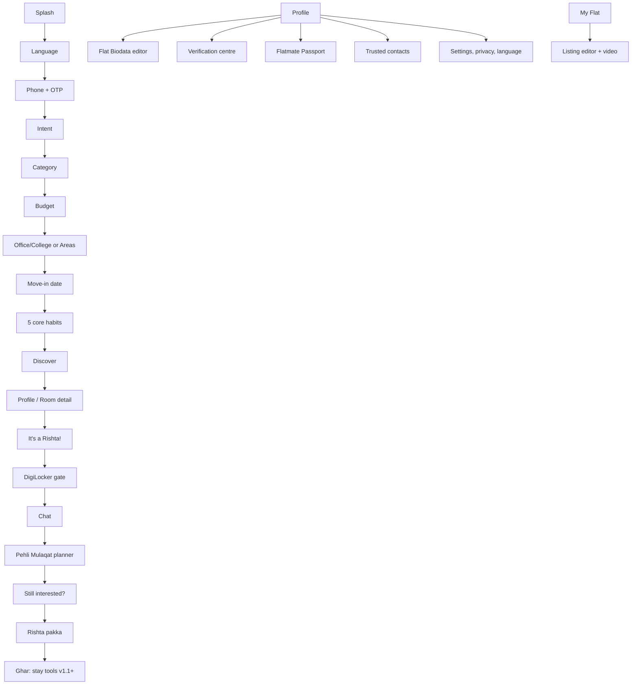

# Flatrimony — UI/UX Design Standards

| Field | Value |
| --- | --- |
| Document version | 1.0 |
| Date | 12 Nov 2026 |
| Visual direction | Playful but light — warm "matcha milk" base, Jamun purple + Matcha lime accents, immersive photo cards with frosted glass (see §3.1); desi matchmaking theme; serious where trust and money are involved |
| Platforms | Android (React Native/Expo) first, responsive web (Next.js), admin web; iOS from v1.2 |
| Owner | Aryan Garg |
| Related | `02-prd.md`, `05-api-design.md`, `01-product-spec.md` (section 4) |

> **For the implementing agent.** Implement design tokens exactly as defined here in `packages/design-tokens` and consume them through Tailwind (web) and NativeWind (mobile). Never hard-code colours, font sizes, spacing or radii in components. Every screen must implement the four states in section 9 and pass the accessibility checklist in section 12.

---

## Table of contents

1. Design principles
2. Brand foundations and voice
3. Design tokens
4. Layout, grids and breakpoints
5. Navigation and information architecture
6. Component library
7. Modern interaction patterns (concepts and where we use them)
8. Screen specifications (with wireframes)
9. States: loading, empty, error, success
10. Motion and haptics
11. Content, microcopy and the Flatrimony glossary (EN/HI)
12. Accessibility standards
13. Localisation and Hindi typography
14. Trust and safety UX rules
15. Performance UX
16. Dark mode (prepared for later)
17. Design workflow, handoff and QA

---

## 1. Design principles

| # | Principle | What it means in practice |
| --- | --- | --- |
| 1 | **Trust is visible** | Verification state is on every card, chat header and listing. Unverified things look unverified. Nothing important is hidden behind taps. |
| 2 | **Fun on the surface, serious underneath** | Playful copy and colour for matching moments; calm, plain language for ID, money, safety and reports. Never joke on those screens. |
| 3 | **One decision per screen** | Onboarding and critical flows ask one thing at a time with a clear primary action. |
| 4 | **Show, don't make them read** | Compare habits side by side ("You vs Meera"), show true monthly cost as a number, show commute minutes — not paragraphs. |
| 5 | **Fast feels safe** | Instant feedback (optimistic UI), skeletons not spinners, prefetching so the deck never waits. |
| 6 | **Inclusive by default** | Hindi and English everywhere, large touch targets, screen-reader labels, works on mid-range Android and slow 4G. |
| 7 | **Respectful matching** | No public ratings, no shaming; rejections are silent and neutral; "not interested" never reveals who said it. |

## 2. Brand foundations and voice

### 2.1 Name and idea

**Flatrimony** = flat + matrimony. India's matchmaking rituals (biodata, rishta, pehli mulaqat) applied to choosing a flatmate for the next 11 months. Tagline (to test): **"Rishta pakka, rent split."**

"Flatmates, not dating" appears on the first screen, in the store listing and in onboarding.

### 2.2 Logo and icon (v1, 13 Nov 2026)

Files: `assets/logo/flatrimony-mark.svg` (app icon / avatar), `flatrimony-logo-horizontal-light.svg` (on light backgrounds), `flatrimony-logo-horizontal-dark.svg` (on purple or photos).

- **Mark:** a Matcha-lime house on a Jamun-purple rounded square (radius ≈ 29 % of size), with two interlocked purple rings in the house (the "rishta") and a small white sparkle top-right. Must read at 48 px; drop the sparkle below 32 px.
- **Wordmark:** "Flatrimony" in Plus Jakarta Sans **ExtraBold 800**, letter-spacing −3 %, ink `#17141F` on light / white on dark. Tagline "Rishta pakka, rent split." in SemiBold 600 at 34 % of the wordmark size.
- **Size:** wordmark at least 28 px tall in app headers and 40–56 px on the web home hero and splash — big, bold and the first thing seen.
- **Lockup:** mark left, wordmark right, gap = 25 % of mark size, both vertically centred.
- **Clear space** = half the mark's width on all sides. Never recolour, stretch, outline or put the wordmark on a busy photo without the dark glass.
- The SVG wordmark uses live text; outline it (convert to paths) in Figma before using it in print or the store listing.

### 2.3 Voice and tone

| Context | Tone | Example (EN) |
| --- | --- | --- |
| Match moments | Warm, cheeky, celebratory | "It's a Rishta! You and Meera both sleep by 11." |
| Onboarding | Friendly, brief | "What's your budget per month?" |
| Verification | Clear, reassuring, factual | "Verify with DigiLocker to start chatting. We only keep your name, age and gender — never your documents." |
| Safety | Calm, direct, no humour | "Share your live location with Priya during this visit?" |
| Money | Precise | "₹21,500 per month including maintenance, electricity and Wi-Fi." |
| Errors | Honest, helpful, no blame | "We couldn't load matches. Check your connection and try again." |
| Rejections | Neutral, kind | "This Rishta didn't work out. Your perfect flatmate is still out there." |

Rules: second person ("you"), sentence case, contractions allowed, no exclamation marks outside celebrations, no slang in safety/legal screens, emoji only in celebrations and push titles (max one).

## 3. Design tokens

Tokens live in `packages/design-tokens/tokens.json` (W3C Design Tokens format) and are transformed with Style Dictionary into Tailwind theme, NativeWind theme, and CSS variables.

Naming: `category.role.variant` (e.g., `color.text.primary`, `space.4`, `radius.lg`).

### 3.1 Colour

**Visual direction (v1.1 of this section, 13 Nov 2026).** A blend of two references: the *Matcha* dating app (Korsa) for photo-first immersive cards, frosted-glass controls and a calm, earthy base, and the *Mobile UI Kit for Dating App* (Ronas IT) for deep purple + neon lime, pill chips, sticker-like badges and bento tiles. Applied within the founder's "playful but light" decision:

- **Light screens** (onboarding, forms, lists, chat, settings, listing editor, admin): warm "matcha milk" background, white cards, purple pill buttons, lime selection, bento tiles.
- **Immersive screens** (Discover cards, profile/room detail header, It's a Rishta!, Rishta pakka): full-bleed photo, dark gradient scrim, frosted-glass chips and a glass action dock.
- **Serious screens** (verification, safety, SOS, report, payments, Passport) stay light, plain and calm: no lime stickers, no sparkles, no glass.

These are inspirations for a look, not copies: no layouts, illustrations, icons or assets are taken from either shot.

**Base palette**

| Token | Hex | Use |
| --- | --- | --- |
| `color.brand.primary` | `#4A2FBD` | "Jamun purple": primary buttons, active tab, links on light, brand moments |
| `color.brand.primaryPressed` | `#3A2496` | Pressed/hover state of primary |
| `color.brand.primarySubtle` | `#ECE6FF` | Tinted backgrounds, info tiles, sent chat bubbles |
| `color.brand.lavender` | `#B9A4FF` | Decorative bento tiles and illustration fills (dark text only, never white text) |
| `color.accent.lime` | `#D7F26B` | "Matcha lime": selected chips, match % pill, active dock icon, highlights. **Fill only** with dark or purple text; never as text or thin lines on light backgrounds (1.25:1) |
| `color.match.likePink` | `#C2185B` | "Rishta pink": Like/heart button and heart icons only |
| `color.match.likeSubtle` | `#FDE7EF` | Like confirmation backgrounds |
| `color.accent.green` | `#1B7F4B` | Verified, confirmed, success |
| `color.accent.greenText` | `#166B40` | Green text on tinted green backgrounds |
| `color.accent.greenSubtle` | `#E6F5EC` | Verified/confirmed chip background |
| `color.accent.yellow` | `#FFC53D` | Highlights, pending, Move Pass (always with dark text) |
| `color.accent.yellowText` | `#8A5A00` | Warning text |
| `color.accent.yellowSubtle` | `#FFF4D6` | Warning backgrounds |
| `color.accent.blue` | `#2459C7` | Links, info, commute |
| `color.accent.blueSubtle` | `#E8EFFC` | Info backgrounds |
| `color.danger` | `#C62828` | Destructive actions, SOS, errors |
| `color.dangerSubtle` | `#FDECEC` | Error backgrounds |
| `color.bg.app` | `#F5F2EA` | App background ("matcha milk", warm off-white) |
| `color.bg.surface` | `#FFFFFF` | Cards, sheets, inputs |
| `color.bg.immersive` | `#17131F` | Behind photos, immersive screens, dock on dark |
| `color.text.primary` | `#17141F` | Body and headings |
| `color.text.secondary` | `#5E584A` | Secondary text (warm grey) |
| `color.text.disabled` | `#8A8577` | Disabled text and placeholders (≥ 18 px or non-essential only) |
| `color.border.default` | `#E4DFD2` | Dividers, card borders (decorative) |
| `color.border.strong` | `#8C8676` | Input borders, outlined chips |
| `color.focus` | `#4A2FBD` | 2 px focus ring + 2 px offset |

**Glass and scrim (immersive screens only)**

| Token | Value | Use |
| --- | --- | --- |
| `glass.dark` | fill `rgba(23,19,31,0.45)`, backdrop blur 24, border 1 px `rgba(255,255,255,0.18)` | Chips, dock and icon buttons over photos |
| `glass.light` | fill `rgba(255,255,255,0.72)`, backdrop blur 20, border 1 px `rgba(255,255,255,0.6)` | Floating bottom tab dock on light screens |
| `scrim.photo` | linear gradient bottom 50%: transparent → `rgba(23,19,31,0.85)` | Under any text on a photo |

White text on photos is allowed only on `scrim.photo` or `glass.dark`; check the worst-case photo at ≥ 4.5:1 (white on the scrim's 60% point measures about 8:1). Where blur is unsupported (low-end Android), fall back to a solid `rgba(23,19,31,0.70)`.

**Measured contrast (WCAG 2.x ratios)** — normal text needs ≥ 4.5:1, large text and UI components ≥ 3:1.

| Pair | Ratio | Passes |
| --- | --- | --- |
| text.primary on bg.app | 16.23 | AA/AAA |
| text.secondary on bg.surface | 7.07 | AA |
| text.secondary on bg.app | 6.32 | AA |
| text.disabled on bg.surface | 3.68 | Large text / non-essential only |
| white on brand.primary | 8.63 | AAA |
| brand.primary on bg.surface | 8.63 | AAA |
| brand.primary on brand.primarySubtle | 7.12 | AAA |
| text.primary on accent.lime | 14.53 | AAA |
| brand.primary on accent.lime | 6.91 | AA |
| accent.lime on bg.immersive | 14.62 | AAA |
| text.primary on brand.lavender | 8.49 | AAA |
| white on brand.lavender | 2.14 | **Fails — never use** |
| accent.lime on bg.surface | 1.25 | **Fails — lime is never text or a thin line on light** |
| white on match.likePink | 5.87 | AA |
| white on bg.immersive | 18.27 | AAA |
| border.strong on bg.surface | 3.63 | UI component (≥ 3:1) |
| white on accent.green | 5.02 | AA |
| accent.greenText on accent.greenSubtle | 5.80 | AA |
| text.primary on accent.yellow | 10.75 | AAA |
| accent.yellowText on accent.yellowSubtle | 5.41 | AA |
| white on danger | 5.62 | AA |
| danger on dangerSubtle | 4.92 | AA |
| accent.blue on accent.blueSubtle | 5.46 | AA |
| border.strong on bg.surface | 3.43 | UI component (≥ 3:1) |

**Semantic tokens (use these in components)**

| Semantic token | Maps to |
| --- | --- |
| `color.action.primary.bg` / `.fg` | brand.primary / white |
| `color.action.secondary.bg` / `.fg` / `.border` | bg.surface / text.primary / border.strong |
| `color.action.destructive.bg` / `.fg` | danger / white |
| `color.status.verified.bg` / `.fg` | accent.greenSubtle / accent.greenText |
| `color.status.pending.bg` / `.fg` | accent.yellowSubtle / accent.yellowText |
| `color.status.error.bg` / `.fg` | dangerSubtle / danger |
| `color.status.info.bg` / `.fg` | accent.blueSubtle / accent.blue |
| `color.selection.bg` / `.fg` | accent.lime / text.primary (selected chips, toggles, active dock icon) |
| `color.match.score.bg` / `.fg` | accent.lime / text.primary (the "94%" pill) |
| `color.match.like` | match.likePink |
| `color.match.pass` | text.secondary (on light) / white on glass.dark (on photos) |
| `color.match.superLike` | accent.yellow (dark icon) |
| `color.tile.bento` | brand.primary (white/lime content) or brand.lavender (dark content) |

Colour is never the only signal: every status also has an icon and a label.

### 3.2 Typography

| Role | Font | Why |
| --- | --- | --- |
**Changed 13 Nov 2026 (v2):** Poppins + Noto Sans looked generic and mixed two personalities. One modern family now does everything in Latin script, paired with a matching Devanagari family.

| Role | Font | Why |
| --- | --- | --- |
| Everything Latin (wordmark, headings, body, UI) | **Plus Jakarta Sans** (Google Fonts, SIL OFL, weights 400–800) | Modern, friendly-premium geometric sans with open counters; reads well at 12 px and looks confident at 40 px ExtraBold; one family keeps every screen consistent |
| Hindi (Devanagari) | **Noto Sans Devanagari** (weights 400–700) | Matches Plus Jakarta's x-height and stroke contrast closely; full conjunct support |
| Numbers (prices, %, times) | Plus Jakarta Sans with tabular figures (`font-variant-numeric: tabular-nums`) | Prices and scores line up in lists and cards |

Rules: headings use tight letter-spacing (−0.5 % to −2 %), body uses 0. Never more than **3 weights on one screen** (Regular 400, SemiBold 600, ExtraBold 800). Names on photo cards: "**Meera** 28" = name in ExtraBold, age in Regular at 80 % opacity. Subset fonts to Latin + Devanagari for size. Both families are SIL Open Font License — verify before shipping.

**Type scale (mobile; web uses the same tokens with `clamp()` for headings)**

| Token | Size / line height | Weight | Letter-spacing | Use |
| --- | --- | --- | --- | --- |
| `font.hero` | 40 / 44 | ExtraBold 800 | −2 % | Web home hero, wordmark lockups |
| `font.display` | 32 / 38 | ExtraBold 800 | −1.5 % | Match celebration, onboarding titles, name on immersive cards |
| `font.h1` | 26 / 32 | Bold 700 | −1 % | Screen titles |
| `font.h2` | 20 / 26 | Bold 700 | −0.5 % | Section titles, card names |
| `font.h3` | 17 / 24 | SemiBold 600 | 0 | Sub-sections, list titles |
| `font.bodyLg` | 16 / 24 | Regular 400 | 0 | Long text, chat bubbles |
| `font.body` | 15 / 22 | Regular 400 | 0 | Default UI text |
| `font.label` | 14 / 20 | SemiBold 600 | 0 | Buttons, chips, form labels |
| `font.caption` | 13 / 18 | Medium 500 | 0 | Meta text, timestamps |
| `font.micro` | 12 / 16 | SemiBold 600 | +2 % | Badges and overlines only (never body text) |

Devanagari needs extra vertical room: Hindi line height = size × 1.6 minimum (handled by a locale-aware text component).

Support dynamic type / browser zoom up to 200% without clipping; long labels wrap instead of truncating where possible.

### 3.3 Spacing (4-point grid)

| Token | Value |
| --- | --- |
| `space.0` | 0 |
| `space.1` | 4 |
| `space.2` | 8 |
| `space.3` | 12 |
| `space.4` | 16 (default screen padding on mobile) |
| `space.5` | 20 |
| `space.6` | 24 (section gap) |
| `space.8` | 32 |
| `space.10` | 40 |
| `space.12` | 48 |
| `space.16` | 64 |

**Spacing rules (v2, 13 Nov 2026 — every screen must follow these)**

| Where | Value |
| --- | --- |
| Screen side padding (mobile) | **20** (`space.5`); web content max 1200 with 32 side padding |
| Top of screen → title | 16 below the status/top bar |
| Title → its subtitle | 8 |
| Subtitle/intro → first component | 24 |
| Between sections | **32** |
| Between cards in a list/grid | 12 (mobile), 24 (web) |
| Card inner padding | **20** (16 only for compact list rows) |
| Inside a card: heading → content | 12 |
| Label → input / control | 8 |
| Between form fields | 20 |
| Icon → text inside a button or chip | 8 |
| Chip gap (wrap) | 8 horizontal, 8 vertical |
| Text → container edge | never less than 16 |
| Primary button | full-width, 56 high on mobile; 20 above the bottom safe area or dock |
| Content above a floating dock | reserve 96 bottom space so nothing hides under it |

Use only token values (4-point grid). No two different gaps between the same kind of element on one screen.

**Layout and alignment rules**

- One left edge: titles, text, cards and inputs all align to the 20 px screen margin; nothing floats off-grid.
- Text is left-aligned everywhere except celebration screens and empty states (centred).
- Mobile uses a 4-column grid (gutter 12); web a 12-column grid (gutter 24, max 1200).
- In rows, vertically centre icons, text and trailing actions on one axis; trailing values (price, %, time) right-aligned in a fixed column.
- Equal-height cards in the same row; buttons in a pair are equal width.
- Never more than one primary (purple) button per screen.

**Image rules**

| Image | Ratio | Treatment |
| --- | --- | --- |
| Immersive deck card photo | 4:5 | `object-fit: cover`, focus on the subject's face or the room's centre, radius 32, bottom scrim |
| Room photos in grids | 4:3 | cover, radius 16, equal size in a grid |
| Detail-page hero | 4:3 (mobile), 16:9 (web) | full-bleed, no radius at screen edges |
| Avatars | 1:1 | circle, face centred, 2 px white ring (green ring when verified) |
| Illustrations | inside a tile with 24 padding | never touch the tile edge |

Photos never stretch, never sit edge-to-edge with text, and never mix ratios within one row.

### 3.4 Radius, borders, elevation

| Token | Value | Use |
| --- | --- | --- |
| `radius.sm` | 12 | Inputs |
| `radius.md` | 16 | List cards, small tiles |
| `radius.lg` | 24 | Bento tiles, bottom sheets (top corners) |
| `radius.xl` | 32 | Immersive deck cards, phone-width photo cards |
| `radius.full` | 9999 | **All buttons**, chips, dock, avatars, FAB, score pill |
| `border.width.default` | 1 | Cards, inputs |
| `border.width.focus` | 2 | Focus ring |
| `elevation.0` | none | Flat surfaces |
| `elevation.1` | `0 1 2 rgba(28,27,41,0.06)` | Cards on bg.app |
| `elevation.2` | `0 4 12 rgba(28,27,41,0.10)` | Deck card, sticky bars |
| `elevation.3` | `0 12 32 rgba(28,27,41,0.16)` | Bottom sheets, dialogs |

### 3.5 Sizing

| Token | Value |
| --- | --- |
| `size.touch.min` | 48 dp (Android) / 44 pt (iOS) / 44 px (web) |
| `size.icon.sm/md/lg` | 16 / 20 / 24 |
| `size.avatar.sm/md/lg/xl` | 32 / 40 / 56 / 96 |
| `size.button.height` | 48 (primary), 40 (compact) |
| `size.deckCard.aspect` | 3:4.4 (fits 360 dp wide screens with action bar visible) |

### 3.6 Iconography and illustration

- Icons (v2, 13 Nov 2026): **Phosphor Icons** (MIT licence; `@phosphor-icons/react` for web, `phosphor-react-native` for mobile). Softer, friendlier and more polished than Lucide, with six weights from one set:
  - **Regular** weight (1.5 px stroke at 24 px) for all UI icons;
  - **Fill** weight for the active tab, selected state and the Like heart;
  - **Duotone** weight (second tone = 20 % brand colour) for feature tiles, empty states and onboarding option cards.
  Icons always sit in a 24 px box; feature icons sit centred in a 44 px circle tinted with `brand.primarySubtle` or `brand.lavender`.
- Logo: see §2.2 and `assets/logo/`.
- Navigation: a **floating pill dock** (Matcha-style) instead of a flat tab bar: `glass.light` on light screens, `glass.dark` on immersive screens, 64 px high, 16 px from the bottom edge, round icon buttons with labels; the active tab is a lime circle with a dark icon.
- Playful accents (Ronas-style): 4-point sparkle stars, sticker-like rotated photo frames and lime "94%" pills — only on match moments, onboarding and the landing page; never on serious screens.
- Custom icons needed: Rishta (two houses joined), Pehli Mulaqat (chai cups), Flat Biodata (folded card), Passport (stamp).
- Illustration style: flat, rounded shapes, brand colours, simple Indian home details (jaali patterns, chai, rangoli dots) for empty states and onboarding. No stock photos of people.

## 4. Layout, grids and breakpoints

| Breakpoint | Width | Layout |
| --- | --- | --- |
| `xs` (mobile) | < 600 | Single column; 16 px margins; bottom tab bar |
| `sm` (large phone / small tablet) | 600–839 | Single column, max content width 560 |
| `md` (tablet / small laptop) | 840–1199 | Two panes (list + detail); navigation rail |
| `lg` (desktop) | ≥ 1200 | Three regions: left nav, main (max 720), right context panel (map, Rishta report); 12-column grid, 24 px gutters |

Web Discover on `lg`: list of cards on the left, map on the right (sticky), detail in a side sheet. Chat on `md+`: two-pane inbox.

Safe areas: respect device insets (notches, gesture bars); sticky action bars sit above the gesture area.

## 5. Navigation and information architecture

### 5.1 Mobile tab bar (v1.0)

| Tab | Icon | Contents |
| --- | --- | --- |
| **Discover** | Compass | Deck / list toggle, filters sheet, empty hints |
| **Rishtas** | Two houses | Matches list, chats, likes received (Move Pass), meet-ups |
| **My Flat** (`have_room`) or **Saved** (seekers) | House | Listing management / saved cards |
| **Profile** | User | Flat Biodata, verification, Passport, settings, safety contacts |

From v1.1, **Ghar** (Home) appears when the user has an active stay: move-in log, deposits, (v1.2) chores, bills, agreement. It replaces "Saved"/"My Flat" placement by moving those into Profile.

A floating **Safety** button appears on meet-up days (and always for `women_only` users during an active safety session).

### 5.2 Web navigation

Left rail (md+): Discover, Rishtas, My Flat, Profile, Help. Top bar: language switch, notifications, avatar menu. Public pages (logged out): home, how it works, safety, area pages (`/rooms-in/gurugram/cyber-city`) for SEO, blog, legal pages.

### 5.3 Information architecture map



## 6. Component library

Build components once per platform with identical props and token usage. Web components extend shadcn/ui (Radix) for accessibility; mobile components wrap React Native primitives with NativeWind classes.

| Component | Variants / props | Notes |
| --- | --- | --- |
| `Button` | `primary`, `secondary`, `ghost`, `destructive`; `size: md | sm`; `loading`; `icon` | Min 48 high; loading keeps width; disabled has reason tooltip/helper text |
| `IconButton` | `like`, `pass`, `superLike`, `rewind`, generic | Deck actions are 64 px circles; always labelled for screen readers |
| `Input`, `TextArea` | label, helper, error, counter | Labels always visible (no placeholder-only fields) |
| `Select` / `Sheet Select` | single / multi | On mobile opens a bottom sheet |
| `RangeSlider` | budget (₹), commute minutes | Shows formatted values; keyboard and screen-reader adjustable |
| `TimePicker` | bedtime, wake time | 15-minute steps |
| `Chip` | `habit`, `filter`, `status`, `selected` | Habit chips show icon + text |
| `Badge` | `verified`, `femaleVerified`, `work`, `student`, `pending`, `boosted` | Icon + label; never colour-only |
| `Avatar` | sizes; `verified` ring | Green ring = identity verified |
| `DeckCard` | person, room | See 8.4 |
| `RishtaReportCard` | compact, full | Score ring + top 3 agreements + biggest gap |
| `CompareRow` ("You vs them") | attribute, you, them, similarity | Direct visual lift from the reel's comparison cards |
| `ScoreRing` | 0–100 | Animated fill on first view only |
| `CostBreakdown` | items, total | Rent + recurring = true monthly cost; one-time costs separate |
| `RulesList` | listing rules | Icons for veg-only, no guests, etc. |
| `ChatBubble` | sent, received, system, warning | Warning bubble for scam keywords |
| `MeetupCard` | proposed, accepted, past | Actions inline |
| `StepTimeline` | Chat → Verify → Meet | From the reel's "Before you sign anything" |
| `BottomSheet` | snap points | Filters, verification gate, confirmations |
| `Dialog` | confirm, destructive | Used sparingly; prefer sheets on mobile |
| `Toast` / `Snackbar` | info, success, error, undo | 4 s default; "Undo" for reversible actions |
| `EmptyState` | illustration, title, body, action | Every list/deck |
| `Skeleton` | card, list row, chat | Matches final layout to avoid shift |
| `ProgressRing` | biodata completion | On Profile tab icon and Profile header |
| `SafetyButton` | idle, active session, SOS hold | Long-press 2 s for SOS with progress fill and haptic |
| `MapView` | pins (approximate), commute zone overlay | MapLibre; attribution visible |
| `VideoRecorder` | countdown, timer 30–90 s, retake | In-app only; shows guidance overlay ("Show every room") |
| `ConsentRow` | purpose, required/optional, toggle | Used in onboarding and settings |

## 7. Modern interaction patterns (concepts and where we use them)

| Concept | What it is | Where in Flatrimony |
| --- | --- | --- |
| **Design tokens** | Single source of design values shared by all platforms | All UI; Style Dictionary pipeline |
| **Atomic design** | Atoms → molecules → organisms → templates → pages | Component library structure (`Button` → `DeckCard` → `DiscoverScreen`) |
| **Card stack with gesture physics** | Swipeable cards with spring animations and velocity-based decisions | Discover deck (Reanimated + Gesture Handler on the UI thread) |
| **Progressive disclosure** | Ask the minimum now, the rest later | 3-minute onboarding; biodata completion ring prompts the rest |
| **Bottom sheets** | Contextual panels that keep the user in place | Filters, verification gate, meet-up planner, report flow |
| **Optimistic UI** | Update the screen before the server confirms; reconcile after | Swipes, sending messages, marking read, chores |
| **Skeleton screens** | Grey placeholders matching the final layout | Deck, match list, chat history |
| **Glanceable data** | Numbers and icons over text | Match %, commute minutes, true monthly cost, habit chips |
| **Comparison views** | Side-by-side "you vs them" | Rishta report, profile detail |
| **Bento layout (web)** | Modular tiles of different sizes for overview pages | Web profile and listing detail: photos tile, cost tile, rules tile, map tile, Rishta tile |
| **Adaptive layouts** | Different structure per size class, not just scaling | Single column (phone) → two-pane (tablet) → three-region (desktop) |
| **Haptic feedback** | Subtle vibrations confirming actions | Like, match, SOS hold, errors |
| **Micro-interactions** | Small animations that explain state | Score ring fill, verification tick, "Rishta pakka" confetti (once) |
| **Inline validation** | Errors shown as soon as a field is left | All forms |
| **Undo over confirm** | Let people reverse instead of asking "Are you sure?" | Pass (with Move Pass rewind), delete photo, mark settled |
| **Empty-state coaching** | Empty screens explain and offer the next step | Deck empty, no matches, no listings |
| **Trust indicators** | Badges, verification states and provenance shown inline | Cards, chat header, listing ("Video recorded 3 days ago") |
| **Privacy by design UI** | Sensitive data revealed only by mutual consent with clear state | Phone/address share toggles showing "You shared · Waiting for Meera" |
| **Offline-first lists** | Cached data visible without network; queued actions | Matches and chat |
| **Accessible gestures** | Every gesture has a button alternative | Deck buttons below the card |

## 8. Screen specifications

Each spec lists purpose, layout, key components, states and FR-IDs. Wireframes are low fidelity (mobile, 360 dp wide).

### 8.1 Welcome and language (FR-AUTH-05, FR-AUTH-07)

```text
┌──────────────────────────────┐
│        [Flatrimony logo]     │
│   Rishta pakka, rent split.  │
│  [illustration: two houses]  │
│                              │
│  Flatmates, not dating.      │
│  Verified people. Real rooms.│
│                              │
│  [ English ]   [ हिन्दी ]      │
│                              │
│  By continuing you agree to  │
│  Terms · Privacy             │
└──────────────────────────────┘
```

### 8.2 Phone and OTP (FR-AUTH-01, 02)

- Phone field with fixed `+91` prefix, numeric keyboard, auto-format `98123 45678`.
- OTP screen: 6 boxes, SMS auto-read (Android SMS Retriever API), resend timer 30 s, "Wrong number?" link.
- Errors: rate-limited ("Too many attempts. Try again in 12 minutes."), banned (neutral message + support link).

### 8.3 Onboarding (FR-AUTH-06, FR-BIO-01..06)

One question per screen with a progress bar (6 steps). Big tappable options with icons.

```text
┌──────────────────────────────┐
│ ←   ■■■□□□                   │
│                              │
│ What are you looking for?    │
│                              │
│ ┌──────────────────────────┐ │
│ │ 🏠 I have a room to fill │ │
│ └──────────────────────────┘ │
│ ┌──────────────────────────┐ │
│ │ 🔑 I need a room         │ │
│ └──────────────────────────┘ │
│ ┌──────────────────────────┐ │
│ │ 🤝 Find a flatmate first │ │
│ └──────────────────────────┘ │
│                              │
│              [ Continue ]    │
└──────────────────────────────┘
```

Steps: intent → category (with Women-only explained: "Only verified women can see you") → budget (range slider, ₹ formatted) → office/college (search + map pin + travel mode + max minutes with live commute zone preview) or areas (for those without an anchor) → move-in date → **Your habits**: all 5 habit questions (bedtime, cleaning, smoking, pets, food) on one screen as rows of icon chips → Discover.

```text
┌──────────────────────────────┐
│ ←   ■■■■■■   Step 6 of 6     │
│ Your habits                  │
│ Bedtime  [10PM][11PM][12][1+]│
│ Cleaning [Daily][Few/wk]     │
│          [Weekly][Rarely]    │
│ Smoking  [No][Outside][Yes]  │
│ Pets     [Have][Love][OK][No]│
│ Food     [Veg][Egg][Non-veg] │
│          [Vegan]             │
│            [ Start swiping ] │
└──────────────────────────────┘
```

The button stays disabled until all five rows have an answer; each row is a labelled radio group for screen readers.

Skippable: none of the six core steps; everything else (photos, bio, scenario questions, importance) is prompted later via the completion ring.

### 8.4 Discover — deck (FR-DISC-01..11)

```text
┌──────────────────────────────┐
│ Discover   [Deck|List]  ⚙︎    │
│ ┌──────────────────────────┐ │
│ │ [photo carousel   1/5]   │ │
│ │                    94%◔  │ │
│ │                          │ │
│ │ Meera, 28  ✔ Verified    │ │
│ │ 🏠 Room in 3BHK · Cyber C │ │
│ │ ₹21,500/mo all-in        │ │
│ │ 🚇 28 min to your office  │ │
│ │ [🌙 By 11] [🧹 Daily] [🚭] │ │
│ └──────────────────────────┘ │
│    (✕)      (★)      (♥)     │
│   Pass   Super like   Like   │
└──────────────────────────────┘
```

- Swipe right = like, left = pass, up = super like (Move Pass). Buttons always visible below the card.
- Tap card → detail (photos, video walkthrough for rooms, full habits, Rishta report, rules, cost breakdown, map with approximate pin).
- Card rotates slightly with drag; LIKE/PASS stamps fade in by drag distance; release beyond 35% width or with velocity > 800 px/s commits.
- Prefetch next 5 cards' images; never show a spinner between cards.
- Room cards are per room: an owner with two listings appears as two cards.
- Unverified viewer + `female_only`/`male_only` room: the card shows a lock chip "Verify to like this room" (icon + label, `color.status.pending`); the Like button opens the verification gate instead of liking (FR-DISC-12).
- Daily like limit reached → bottom sheet: "You've used today's 50 likes" + Move Pass upsell (v1.1) + "Come back tomorrow".
- Empty deck → coaching from `/discover/empty-hints`: "Only 3 rooms within 20 min. Widen to 35 min to see ~42 more." [Widen] button.

### 8.5 Discover — list and map (web default)

- Mobile list: compact rows (photo, name, %, cost, commute, top habit chips).
- Web `lg`: list (left) + sticky map (right) with approximate circles (not exact pins) and commute zone overlay; hovering a card highlights its circle.
- Filters (bottom sheet / side panel) can only **narrow** hard filters: area, max rent, max commute, room type, furnishing, "remote-ready".

### 8.6 Profile / room detail and Rishta report (FR-DISC-05)

Sections in order: photos (and video for rooms) → name, age, badges → Rishta report (score ring, top 3 agreements, biggest gap in a neutral tone: "Different on pets — you're OK with pets, Meera loves dogs") → "You vs Meera" compare rows for all habits → room details, rules, cost breakdown → about/bio → languages → Passport summary → report/block (overflow menu).

### 8.7 It's a Rishta! (FR-DISC-06)

Full-screen celebration: both photos meeting in the middle, score ring, confetti once (respect reduce motion), primary "Say hi" and secondary "Keep swiping". For a room match, a small room chip (cover photo, title, all-in monthly cost) shows which room it is. If the user is not verified: the primary button reads "Verify to say hi".

### 8.8 Verification gate (FR-VER-01, 02, 07)

Bottom sheet:

```text
┌──────────────────────────────┐
│ ─────                        │
│ 🔒 Verify to start chatting   │
│                              │
│ Everyone you chat with is    │
│ verified with DigiLocker.    │
│                              │
│ ✔ Takes about a minute       │
│ ✔ We keep only name, age,    │
│   gender — never documents   │
│ ✔ Unlocks the Verified badge │
│                              │
│ [ Verify with DigiLocker ]   │
│   Not now                    │
└──────────────────────────────┘
```

After return from DigiLocker: progress state ("Checking…") → success (green tick animation, badge appears) or failure with the specific reason and next step (e.g., name mismatch → "Update your display name to match your ID" with an edit field).

### 8.9 Rishtas (matches) and chat (FR-CHAT-01..08)

- Rishtas tab: sections "New Rishtas" (horizontal avatars), "Chats" (list), "Likes you" (Move Pass, blurred count otherwise), "Upcoming Pehli Mulaqat".
- Chat header: avatar with verified ring, name, match %, status chip (Chatting / Met / Rishta pakka), overflow (view profile, share number, share address (owner), report, block, unmatch).
- Top banner (first time): StepTimeline "Chat → Verify ✔ → Meet first".
- Composer: text field, send, "Plan Pehli Mulaqat" shortcut, icebreaker suggestions (P1).
- Warning bubble (FR-CHAT-05): yellow, icon, "Never pay a token or deposit before visiting the flat. Report if someone asks."
- Contact share chip states: "Share my number" → "You shared · waiting for Karan" → "Numbers shared" (tap to call/copy).
- Screens with chat or profiles set `FLAG_SECURE` (screenshots blocked on Android) — show a one-time explanation.

### 8.10 Pehli Mulaqat planner and decision (FR-MEET-01..03, FR-SAFE-01..03)

- Planner sheet: date, time (15-min steps), place (search; "the flat" option for room matches; v1.1 suggested public spots), toggle "Turn on live location for this visit" (default on for women-only).
- Meet-up card in chat with Accept / Decline / Suggest another time.
- After the meet-up time: decision card for each user privately: "Still interested in living with Meera?" [Yes, let's do it] [No, not for me]. Copy reassures: "Meera won't see your answer."
- Both yes → "Rishta pakka! 🏠" celebration with next steps (v1.1: set up Ghar).

### 8.11 Safety (FR-SAFE-01..04)

- Trusted contacts screen (max 3), with a test message option.
- Active safety session: persistent banner at top of the app ("Sharing live location with Priya · ends 7:45 PM · [I'm safe]"), floating SafetyButton.
- SOS: long-press 2 s with progress ring and haptics; result screen shows "Alert sent to Priya and Rahul" and a large "Call 112" button.
- The public share page (web) for trusted contacts: first name, last location on a map, meet-up time/place, session status; no app install needed.

### 8.12 Listing creation (FR-LST-01..08)

Stepper (save as draft at each step): Basics (area, location pin, BHK, room type, furnishing) → Money (rent, deposit, recurring costs with live true-monthly-cost total; brokerage not offered) → Rules (toggle cards with icons) → Photos (3–12, reorder by drag) → Video walkthrough (in-app recorder with guidance: "Show the room, kitchen, bathroom and balcony", 30–90 s, retake, preview) → Review & submit.

On web (and iPhone browsers until v1.2) the Video step is a **Continue on your phone** screen: a QR code and "Send link to my phone", the steps already done ticked, and a note that the video must be recorded in the Android app so seekers know it's real. The draft is saved; scanning opens the same draft at the Video step in the app.

Listing management (My Flat): status chip (Active · expires in 4 days), one-tap "Still available" button, stats (views, likes), edit, pause.

### 8.13 Profile, Flat Biodata and Passport (FR-BIO, FR-PASS)

- Header: avatar with progress ring (biodata completion), name, badges, "Preview as others see me".
- Biodata sections as editable cards: Basics, Budget & dates, Office/college & commute, Habits, What matters most (importance), Scenario questions, Photos.
- Passport page: identity status, badges, member since; v1.1 habit confirmations as chips with counts ("Tidy · 3"), references (visible only to matches), past stays count.
- Settings: language, notifications (quiet hours), privacy (pause, hide age), blocked users, consents, download my data, delete account, help, legal.

### 8.14 Ghar — stay tools (v1.1/v1.2)

- Overview tiles: members, move-in log status, deposits, (v1.2) next chore, bills due, agreement status.
- Move-in log: camera-first capture per room with labels; review grid; "Sign log" (all members) → locked badge with date.
- Bills: list with who owes whom; "Pay ₹1,250 via UPI" opens the UPI app; "Mark settled".
- Chores: rotating list with today's assignee; complete/skip.
- Nudges: template picker; sent anonymously (copy says so).

### 8.15 Admin app (FR-ADM)

Dense, desktop-first, light theme, same tokens. Queues with keyboard shortcuts (J/K to move, A to action), detail panes with context, action dialogs requiring a reason, audit trail visible per user. PII is masked by default with a "Reveal (reason required)" control.

## 9. States: loading, empty, error, success

Every screen and data component implements all four:

| State | Standard |
| --- | --- |
| Loading | Skeleton matching final layout; no layout shift; show cached data first if available |
| Empty | Illustration + one-line explanation + one primary action |
| Error | What happened + what to do + Retry; preserve user input; offline banner when no network |
| Success | Inline confirmation (toast/snackbar or state change); celebrations only for match, Rishta pakka, verification |

Also design: **partial** (some items failed), **permission denied** (camera/location with "Open settings"), **rate limited**, **suspended account**, **forced update**.

## 10. Motion and haptics

| Token | Duration | Easing | Use |
| --- | --- | --- | --- |
| `motion.fast` | 120 ms | standard (0.2, 0, 0, 1) | Press states, chips |
| `motion.base` | 200 ms | standard | Sheets, toasts, page transitions |
| `motion.slow` | 320 ms | emphasized (0.2, 0, 0, 1) | Match screen entrance |
| `motion.spring.card` | spring (damping 18, stiffness 180) | — | Deck card release |

Haptics: light impact on like/pass, success notification on match and verification, heavy impact pattern on SOS hold completion, error notification on failed actions. Respect system settings; with reduce motion, replace movement with fades and disable confetti.

## 11. Content, microcopy and the Flatrimony glossary

### 11.1 Glossary (use exactly these terms)

| Concept | English UI | Hindi UI | Where |
| --- | --- | --- | --- |
| Profile | Flat Biodata | फ़्लैट बायोडाटा | Profile, onboarding |
| Match | Rishta | रिश्ता | Tab name, match screen |
| Match screen | It's a Rishta! | रिश्ता मिल गया! | Celebration |
| Match breakdown | Rishta report | रिश्ता रिपोर्ट | Detail screens |
| First meet-up | Pehli Mulaqat | पहली मुलाक़ात | Planner, chat |
| Moving in confirmed | Rishta pakka | रिश्ता पक्का | Status, celebration |
| Reputation record | Flatmate Passport | फ़्लैटमेट पासपोर्ट | Profile |
| Stay tools | Ghar | घर | Tab (v1.1+) |
| Verification | Verify with DigiLocker | DigiLocker से वेरिफ़ाई करें | Gate, settings |
| True monthly cost | All-in monthly cost | कुल मासिक ख़र्च | Cards, listing |
| Commute | min to your office | आपके ऑफ़िस तक मिनट | Cards |

Hindi strings must be reviewed by a fluent Hindi speaker before launch; the column above is a starting point.

### 11.2 Formatting rules

- Currency: `₹21,500` (Indian grouping: `₹1,50,000`); "/mo" in compact UI, "per month" in full text.
- Dates: "12 Nov" (same year), "12 Nov 2026" (other years); relative for recent ("2 hours ago").
- Time: "11:00 PM".
- Ages: "28" next to name; never date of birth.
- Names: first name only on cards and chat.

### 11.3 Notification copy

Short, no sensitive content, consistent with `05-api-design.md` section 10.

## 12. Accessibility standards (WCAG 2.2 AA)

- [ ] Contrast: text ≥ 4.5:1, large text/UI ≥ 3:1 (token pairs in 3.1 already pass).
- [ ] Touch targets ≥ 48 dp (Android) / 44 px (web); spacing ≥ 8 between targets.
- [ ] Every interactive element has an accessible name (`accessibilityLabel` / `aria-label`), role and state.
- [ ] Deck: each card announces "Meera, 28, verified, 94 percent match, room in Cyber City, 21,500 rupees per month, 28 minutes to your office". Like/Pass buttons available; custom accessibility actions on the card ("Like", "Pass", "Open profile").
- [ ] Focus order logical; visible focus ring (`color.focus`, 2 px + 2 px offset) on web and keyboard navigation in admin.
- [ ] Dynamic type up to 200% without loss of content; no text in images.
- [ ] Do not rely on colour alone (icons + labels for status).
- [ ] Captions/description for the walkthrough video: owners add room labels; the player shows them.
- [ ] Time limits (OTP resend, SOS hold) are adjustable or explained; SOS also available via a menu item without long-press.
- [ ] Forms: labels, instructions, error messages linked to fields; errors announced.
- [ ] Reduce motion respected.
- [ ] Test with TalkBack (Android), VoiceOver (web Safari), keyboard-only (web), and axe automated checks.

## 13. Localisation and Hindi typography

- All strings in `packages/i18n/{en,hi}.json` with ICU message format for plurals and variables.
- No string concatenation; full sentences with placeholders.
- Allow 40% expansion; buttons grow in height (wrap) rather than truncating.
- Devanagari: use Noto Sans Devanagari for all Hindi text (headings in Bold 700); line height ≥ 1.6×; avoid all-caps styling (not applicable to Devanagari).
- Numerals: Western digits (0–9) in both languages for prices and times (common usage); revisit with user research.
- Language switch available on the first screen and in settings; changes take effect immediately without restart.

## 14. Trust and safety UX rules

1. Verification state is shown on every person-related surface.
2. Phone numbers and exact addresses are hidden by default and revealed only after mutual consent; UI shows exactly who has shared what.
3. Payment warnings appear in chat when risky patterns are detected and always on the meet-up planner ("Never pay before visiting").
4. Report and block are reachable in ≤ 2 taps from any profile, chat and listing.
5. Rejection is silent: "not interested" never notifies the other person with a reason.
6. Women-only space is explained clearly at category selection and shown as a badge only to eligible viewers.
7. Safety features are discoverable before they are needed (onboarding tip for women-only, meet-up planner toggle).
8. Moderation outcomes are communicated respectfully ("We reviewed your report and took action") without exposing details about others.

## 15. Performance UX

- Deck: next 5 card images prefetched; card render under 16 ms; no blocking work in gesture handlers.
- Perceived speed: optimistic swipe and message send; skeletons; cached last deck shown instantly on app open.
- Images: progressive loading with blur placeholders (BlurHash computed server-side).
- Video walkthrough: poster frame first, stream on tap; respect data saver (don't autoplay on cellular).
- Web: server-render public pages; hydrate interactive islands only.

## 16. Dark mode (prepared for later)

Not in v1.0, but tokens are semantic so a dark theme can be added by mapping semantic tokens to a dark palette (e.g., `bg.app` → `#14131F`, `bg.surface` → `#1E1D2B`, `text.primary` → `#F4F2F8`, brand primary lightened for contrast). All new components must use semantic tokens so dark mode needs no component changes.

## 17. Design workflow, handoff and QA

### 17.1 Workflow

1. **Discovery:** problem, user stories (from PRD), constraints.
2. **Low-fidelity flows:** wireframes for all states (this document's wireframes are the starting point).
3. **High-fidelity design:** in Figma (or coded prototypes) using the token library; components mirror the code library names.
4. **Prototype and test:** 5-user usability test per major flow (onboarding, listing creation, verification gate, safety) with NCR renters; include Hindi-first users.
5. **Handoff:** link designs in the ticket; specify tokens, states, copy keys, analytics events, accessibility notes.
6. **Build:** components first (Storybook for web components; a mobile component gallery screen in the dev build).
7. **Design QA:** compare build vs design on the reference Android device and on web breakpoints.

### 17.2 Figma structure (if used)

`00 Foundations` (tokens, type, icons) · `01 Components` · `02 Patterns` · `03 Flows` (onboarding, discover, chat, meet, listing, safety, stay) · `04 Admin` · `99 Archive`.

### 17.3 Design QA checklist (per screen)

- [ ] Uses tokens only (no raw hex/px).
- [ ] Loading, empty, error, success states implemented.
- [ ] English and Hindi checked for overflow.
- [ ] Accessibility checklist (section 12) passed.
- [ ] Touch targets and spacing verified on a 360 dp wide device.
- [ ] Motion respects reduce-motion.
- [ ] Trust rules (section 14) satisfied where applicable.
- [ ] Analytics events fire once with correct properties.
