# Flatrimony — Project Progress Document

| Field | Value |
| --- | --- |
| Document version | 1.1 |
| Baseline date | 12 Nov 2026 |
| Owner | Aryan Garg (founder, solo developer) |
| Update cadence | At the end of every working week, and whenever a milestone changes status |
| Related | All documents in `docs/` |

> **For the implementing agent.** This is the living tracker. Update it as part of every pull request that changes a task's status (tick the box, set the status, add the PR link). Do not change scope here — scope changes go to `02-prd.md` first, then reflect here. Status values: `Not started`, `In progress`, `In review`, `On staging`, `Done`, `Blocked`, `Deferred`.

---

## 1. Current status at a glance

| Item | Status |
| --- | --- |
| Overall phase | **M3 — Verification + Listings** started: T3.1 DigiLocker verification API in review (mock provider until T0.7). M1 and M2 code merged, including web sign-in and onboarding (#36); staging blocked on founder accounts |
| Overall health | 🟢 On track (M1 and M2 code merged to `main` with CI green, including E2E journey 1 on web and Android; staging blocked on founder accounts) |
| Next milestone | M3 — Verification + Listings: T3.2 verification screens next, then listings (T3.4–T3.9); the real DigiLocker provider waits on T0.7 |
| Biggest risk right now | External dependencies with lead time: DLT SMS registration, DigiLocker provider onboarding, Razorpay KYC, Play developer account |
| Decisions pending | ADR-0007 (custom domains), ADR-0008 (metro/transit commute data), ADR-0012 (Android billing), name clearance, Google Places key and map tile host (T2.8), commute approximation speeds (T2.9) |

## 2. Phases and milestones

```mermaid
flowchart LR
  P0[Phase 0\nValidate + set up] --> M1[M1 Foundations]
  M1 --> M2[M2 Onboarding + Biodata]
  M2 --> M3[M3 Verification + Listings]
  M3 --> M4[M4 Discovery + Matching]
  M4 --> M5[M5 Chat + Meet + Safety]
  M5 --> M6[M6 Admin + Hardening]
  M6 --> L1[v1.0 Closed testing]
  L1 --> L2[v1.0 Public launch NCR]
  L2 --> V11[v1.1 Trust after match]
  V11 --> V12[v1.2 Living together + iOS]
```



| ID | Milestone | Exit criteria | Status | Target date |
| --- | --- | --- | --- | --- |
| P0 | Validation + setup | Landing page live (EN/HI); waitlist target set by founder reached; vendor sign-ups started | In progress | Founder to set |
| M1 | Foundations | Monorepo, CI, staging deploy pipeline green; Supabase + GCP staging; design tokens package; ADRs written | In progress | Founder to set |
| M2 | Onboarding + Flat Biodata | FR-AUTH-*, FR-BIO-* P0 done on Android + web; E2E journey 1 passing | Done in code (T2.1–T2.12, web sign-in and onboarding #36; E2E journey 1 on web and Android); staging blocked on founder accounts | — |
| M3 | Verification + Listings | FR-VER-* P0, FR-LST-* P0 done; video walkthrough upload; E2E journey 2 passing | In progress (T3.1 DigiLocker verification API in review, mock provider) | — |
| M4 | Discovery + Matching | FR-DISC-* P0; commute zones; deck p95 within budget | Not started | — |
| M5 | Chat + Meet + Safety | FR-CHAT-*, FR-MEET-*, FR-SAFE-* P0; E2E journeys 3–6 passing | Not started | — |
| M6 | Admin + Hardening | FR-ADM-* P0; security checklist; load test; privacy flows | Not started | — |
| L1 | Closed testing | Play closed testing running with required testers/time; Sev-1/2 bugs zero | Not started | — |
| L2 | Public launch (NCR) | PRD section 14 release criteria met | Not started | — |
| V11 | v1.1 | Stays, Passport reviews, move-in log, deposits, replacement, payments, video tours | Not started | — |
| V12 | v1.2 | Chores, bills, nudges, house agreement, iOS | Not started | — |

> Dates are intentionally blank: the founder sets them after M1, once real velocity is known. Estimate in story points per ticket; track velocity weekly.

## 3. Work breakdown (epics and tasks)

Ticket IDs (`FLT-n`) are assigned when GitHub Issues are created; until then tasks are referenced by the IDs below (e.g., `T1.4`).

### Phase 0 — Validation and external setup

| ID | Task | Status | Notes |
| --- | --- | --- | --- |
| T0.1 | Product spec v0.3 | Done | `01-product-spec.md` |
| T0.2 | PRD, tech stack, DB, API, UI/UX, progress docs | Done | This document set |
| T0.3 | Name clearance: trademark search, domains, social handles for "Flatrimony" | Not started | Pending (founder) |
| T0.4 | Landing page + waitlist (EN/HI) with category, budget, office area questions | Not started | Static page; PostHog funnel |
| T0.5 | Set validation target and channel plan (NCR flat groups, colleges, offices) | Not started | Founder |
| T0.6 | SMS provider + DLT registration (sender ID, OTP template) | Not started | Long lead time |
| T0.7 | DigiLocker provider selection, sandbox access, pricing | Not started | OQ-02 |
| T0.8 | Google Play developer account; check Play billing policy for Move Pass | Not started | OQ-04 |
| T0.9 | Decide timing of company registration (DigiLocker direct, Razorpay, funding) | Not started | OQ-06 |
| T0.10 | Lawyer review plan: Terms, Privacy (DPDP), community rules, refund policy | Not started | Before L1 |
| T0.11 | Generate v1.0 screen designs in Google Stitch (38 Android + 6 web) | Done | 15 Nov 2026: 38 Android + 10 web screens, English + Hindi (95 total), fully reviewed; exported to `docs/designs/`. Remaining items are founder tasks T0.12–T0.15 |
| T0.12 | Hindi copy review of the Stitch Hindi screens by a fluent Hindi speaker (UI doc §11.1) | Blocked | Founder to arrange a reviewer; screens are named "… (Hindi)" in both Stitch projects |
| T0.13 | Licences for photos used in designs: web Home hero and the generated portrait/room images | Blocked | Founder: buy/licence or replace before anything is published (review issue 5) |
| T0.14 | Decide whether the 1091 women's helpline shows next to 112 on the SOS screens | Blocked | Founder decision; designs currently show 112 only on SOS Sent and Safety share page |
| T0.15 | Legal review of the 4 web legal pages (Terms, Privacy, Community Standards, Tenancy Guidelines); fill grievance-officer details and date placeholders | Blocked | Part of T0.10. Translate to Hindi only after legal sign-off. **On the web app (the legal-pages PR):** `/<locale>/terms`, `/privacy`, `/community-standards` and `/tenancy-guidelines` show only the title, "being prepared, published after legal review" and the 112 note (founder decision, 24 Nov 2026), so the sign-in consent links no longer 404. Sign-up stays closed until the policy versions are published (the API refuses bootstrap without them). **The design drafts are kept, unpublished,** in `apps/web/content/legal/` (generated by `apps/web/scripts/extract-legal.py`; invented company name, street address and `@flatrimony.in` emails already replaced by placeholders, a "DPDP 2023 Compliant" badge dropped). **The review must settle these invented or wrong items before publishing:** statistics ("more than 90% of scams" in Hindi Community Standards, "25% to 40%" in Tenancy, "single most common" fraud/conflict claims, a "94% lifestyle sync" example in Privacy); certifications and partners ("MeitY-licensed DigiLocker partner gateway", "ISO-27001 certified" logging providers, "certified, audited verification partners"); security promises (TLS 1.3 + HSTS, AES-256 column encryption, FIDO2 keys for staff); support hours and response times, which also disagree between pages and languages ("within 120 minutes", "9:00 AM to 11:00 PM IST", 24 h / 24–48 business hours acknowledgement, 15 working days to resolve, 72 h appeal reviews, prorated credits within 7 business days); a rent price table (₹60,000–₹79,200) in Tenancy; statements that contradict the product (Privacy: "WhatsApp ID used for OTP sign-ins" — sign-in is SMS OTP; location collected "solely on an explicit, one-time manual basis" — FR-SAFE-02 shares live location); invented operations (SOS "alert to local support desks", referrals to consumer dispute authorities, Hindi: reporting to the cyber cell); landlord wording (Hindi Community Standards bars only *non-resident* landlords, implying resident landlords may join — founder rule: no landlords or brokers; Tenancy assumes an agent is present); and a "safety session session" typo in Privacy §1 |

### M1 — Foundations (E0)

| ID | Task | FR / doc ref | Status |
| --- | --- | --- | --- |
| T1.1 | Create repo, branch protection, Dependabot, issue/PR templates, Projects board | Tech §7 | In progress — repo pushed; PR template, issue forms (task/bug/idea) and Dependabot merged ([#2](https://github.com/code08-ind/flatrimony/pull/2)). **Blocked (founder):** branch protection with required checks, Projects board — need the repo owner in GitHub settings |
| T1.2 | Scaffold monorepo (pnpm, Turborepo, shared configs, commitlint, husky, lint-staged) | Tech §3 | Done — `f45de98`; pnpm hardening in [#1](https://github.com/code08-ind/flatrimony/pull/1): `minimumReleaseAge` 7 days, `trustPolicy: no-downgrade`, `blockExoticSubdeps` |
| T1.3 | `packages/shared` skeleton: enums, error codes, Zod base schemas | API §7, §13 | Done — `f45de98`; 21 tests |
| T1.4 | `packages/design-tokens` + Style Dictionary → Tailwind/NativeWind | UI §3 | Done — `f45de98`; in-repo TS generator instead of Style Dictionary (ADR-0013, Proposed) with contrast checks; prototype-pollution guard added in [#1](https://github.com/code08-ind/flatrimony/pull/1); NativeWind wiring follows the first real screens; 40 tests |
| T1.5 | `packages/i18n` with EN/HI files and formatters (INR, dates) | UI §13 | Done — `f45de98`; Hindi strings await T0.12 review; 38 tests |
| T1.6 | Supabase local + staging project (Mumbai); migrations 0001–0003 (extensions, enums, ref tables + seed) | DB §15 | In progress — local config, migrations 0001–0003, dev seed and pgTAP tests done and **passing in CI** (`db` job, [#1](https://github.com/code08-ind/flatrimony/pull/1)). **Blocked (founder):** Supabase staging project (Mumbai). Seed area data is placeholder |
| T1.7 | Fastify API skeleton: plugins (auth, errors, request-id, rate limit, idempotency), `/healthz`, `/readyz`, `/v1/config`, `/v1/reference` | API §8.1 | In review — errors + request-id plugins and routes (`f45de98`); auth plugin (Supabase JWT via JWKS/HS256, `requireUser`/`requireRole`) [#13](https://github.com/code08-ind/flatrimony/pull/13); rate-limit + idempotency plugins (in-memory stores until migration 0012) [#14](https://github.com/code08-ind/flatrimony/pull/14); Postgres-backed `/readyz`, `/v1/config`, `/v1/reference` with generated Kysely types and CI integration tests [#15](https://github.com/code08-ind/flatrimony/pull/15). Remaining after merge: session-revocation and suspended/deleted checks (need Supabase project + profiles, T2.2/T2.5) |
| T1.8 | Expo app skeleton with Expo Router, tabs, theme, i18n, Sentry, PostHog | Tech §2 | Done (merged; staging verification pending T1.12) — [#4](https://github.com/code08-ind/flatrimony/pull/4): Expo SDK 58 + Expo Router tabs (Discover, Rishtas, My Flat, Profile), token theme, fonts, i18next EN/HI, `app.config.ts`, `eas.json` profiles; Android bundle exported in CI (`mobile-bundle`). **Blocked (founder):** Sentry, PostHog, EAS project; Android package id pending name clearance (T0.3) |
| T1.9 | Next.js web + admin skeletons with tokens, i18n, Sentry | Tech §2 | Done (merged; staging verification pending T1.12) — web (`f45de98`) and admin ([#3](https://github.com/code08-ind/flatrimony/pull/3)) with tokens, i18n (web) and security headers; Dockerfiles for both ([#3](https://github.com/code08-ind/flatrimony/pull/3), [#6](https://github.com/code08-ind/flatrimony/pull/6)); CI builds all apps and images. **Blocked (founder):** Sentry projects |
| T1.10 | Terraform: GCP staging (WIF, Artifact Registry, Cloud Run services, Secret Manager, Scheduler, budgets) | Tech §4, §10 | Blocked — config merged in [#6](https://github.com/code08-ind/flatrimony/pull/6): `infra/terraform/envs/staging` (APIs, Artifact Registry, service accounts, WIF, Secret Manager, Cloud Run, worker job, schedulers, budget alerts); `terraform validate` runs in CI. Needs the founder's GCP project, billing account and state bucket; not applied |
| T1.11 | CI workflow (`ci.yml`) with all required checks | Tech §9 | Done — [#1](https://github.com/code08-ind/flatrimony/pull/1), extended in [#3](https://github.com/code08-ind/flatrimony/pull/3), [#4](https://github.com/code08-ind/flatrimony/pull/4), [#6](https://github.com/code08-ind/flatrimony/pull/6): `setup-and-static` (build, typecheck, lint, tests), `db` (migrations + pgTAP), `security` (gitleaks, Semgrep, audit), `mobile-bundle`, `infra`, `build-images` (api, web, admin); Actions pinned by SHA; green on `main`. API integration tests, OpenAPI diff and web E2E smoke join with their tasks. Required-check enforcement waits on branch protection (T1.1) |
| T1.12 | Staging CD (`deploy-staging.yml`) + smoke tests + EAS staging channel | Tech §10.2 | Blocked — config merged in [#6](https://github.com/code08-ind/flatrimony/pull/6): `deploy-staging.yml` (migrate → images → Cloud Run → smoke tests → EAS Update) and `scripts/smoke.mjs`; skipped until `STAGING_ENABLED`. Needs Supabase staging, GCP, Expo accounts and the GitHub `staging` environment secrets; smoke `/readyz` also needs the Supabase-backed repository (T1.7) |
| T1.13 | Write ADRs 0001–0012 | Tech §18 | Done — [#5](https://github.com/code08-ind/flatrimony/pull/5): ADRs 0001–0006, 0009–0011 Accepted; 0007, 0008, 0012 Proposed (founder); 0013 (token generator) Proposed |
| T1.14 | Worker skeleton (job claim loop, tick, daily) + Cloud Run Job + Scheduler | DB §11 | Done — [#29](https://github.com/code08-ind/flatrimony/pull/29): `apps/worker`: one run releases locks older than 15 min, runs the scheduled tasks of its mode (`tick` every 5 min, `daily` 02:30 IST, `drain`), then claims ready jobs with `FOR UPDATE SKIP LOCKED` (5 at a time) and runs them for up to 8 min, each for at most 5 min; on SIGTERM or when time is up, unstarted jobs go back with their attempt returned; failures back off 2^attempts minutes (capped at a day); an invalid payload is dead at once, an unknown kind is retried (deploys and rollbacks); jobs out of attempts stay undone and raise a `jobs.dead` log alert on every run, and every run logs the backlog (ready jobs, oldest wait). JSON logs for Cloud Logging, no personal data; invalid configuration exits 2 with the setting names only. First task: the daily **photo upload sweep** (staged uploads older than 2 h, found in `storage.objects`, removed through the Storage API) — the T2.10 launch gate. `private.jobs` is pulled forward from 0012 into migration file 0009 (docs/04 §15.4; 14 pgTAP tests). Docker image (built in CI), CD already rolls it out; Terraform passes the job its database URL and service-role key from Secret Manager, limits the worker to those secrets, and gives the scheduler `roles/run.jobsExecutorWithOverrides` (starting the job with `tick`/`daily` needs it). Outside local the worker refuses to start without Supabase Storage settings, so the launch-gate sweep cannot be off silently (Terraform `supabase_url`). Runbook: docs/runbooks/worker.md. **Later:** job kinds arrive with their tasks (`media.process` to move photo processing off the request path, `commute.compute` T2.9, listing expiry T3.10, reminders and purges M5/M6); `/internal/jobs/run` (optional HTTP trigger) is not built. **Blocked:** running on staging needs the GCP project and secrets (T1.10/T1.12); the log-based alerts (`jobs.dead`, backlog older than 30 min, docs/03 §13) are created with staging monitoring (T6.9); set `supabase_url` in the staging tfvars. **Founder/ops:** the production database role for the worker needs `SELECT` on `storage.objects` |

### M2 — Onboarding and Flat Biodata (E1, E2)

| ID | Task | FR | Status |
| --- | --- | --- | --- |
| T2.1 | Migrations 0004–0005 (profiles, preferences, anchors, lifestyle, verification tables) + RLS | DB §6.2–6.3 | Done — [#17](https://github.com/code08-ind/flatrimony/pull/17): migrations 0004–0005 with grants/RLS, profile ↔ DigiLocker identity triggers, 135 pgTAP tests; Zod limits aligned to the DB with a per-table contract test; Code Reviewer + Manual QA findings addressed (see PR). Deviations recorded in docs/04 §15.1 |
| T2.2 | Supabase Auth phone OTP + Send SMS hook to provider | FR-AUTH-01 | Done — [#18](https://github.com/code08-ind/flatrimony/pull/18): phone OTP is the only sign-in: signed Send SMS hook `POST /webhooks/auth/send-sms` (mock provider), Postgres hooks refusing non-Indian numbers and every password attempt, phone confirmations on, email off, API requires `amr: otp`; 7 E2E tests against local Supabase Auth. **Blocked (founder):** DLT SMS provider (T0.6 / OQ-03); hosted Auth settings in `docs/runbooks/supabase-auth-settings.md` (OTP expiry ≤ 5 min cannot be set locally) |
| T2.3 | `POST /auth/otp-guard` with bans and rate limits | FR-AUTH-02, 08 | Done — [#19](https://github.com/code08-ind/flatrimony/pull/19): `POST /v1/auth/otp-guard`: HMAC'd phone/device, sliding-window limits 5/15 min per phone, 20/h per device, 50/h per IP (IPv6 /64), 429 before any ban lookup, bans → 403 `auth.banned`; the Send SMS hook enforces bans + 5 sends/15 min per phone server-side; `private.banned_identities` pulled forward (migration 0007); proxy trust off by default. **Blocked (founder):** "lock after 5 failed OTP attempts" (FR-AUTH-02) cannot be counted with direct Supabase verification, see OQ-08 in docs/02 §17 |
| T2.4 | Mobile: welcome, language, phone, OTP (SMS Retriever) | FR-AUTH-01, 05 | Done — [#20](https://github.com/code08-ind/flatrimony/pull/20): M01 welcome with English/Hindi choice (saved, applied before the splash hides), M02 phone entry on an in-app keypad (+91, 10 digits starting 6–9, early start-digit check), M03 OTP (6 boxes, auto-verify on the 6th digit, 30 s resend, same number within 30 s reuses the sent code); `otp-guard` → `signInWithOtp` → `verifyOtp` with typed, translated errors; session in SecureStore; 15 s request timeout; no phone number in any URL (in-memory pending sign-in); API gains CORS for browser origins (docs/05 §1). Verified end to end in the Expo web preview against the local stack. **Blocked:** SMS Retriever zero-tap auto-read needs the DLT-registered template carrying the app hash (T0.6) and a native build, so the screen does not claim auto-read; tapping the boxes opens the system keyboard, whose code suggestion can fill them. Testing on a real Android device needs the Expo/EAS account (founder). The banned-number message has no support link until the support contact exists (T0.15); Terms/Privacy links point at web routes that ship with the legal text (T0.15). The welcome photo tile is replaced by a second tile until a licensed photo exists (T0.13). Hindi drafts await founder review (T0.12) |
| T2.5 | `POST /me/bootstrap`, `GET/PATCH /me`, consents | FR-AUTH-06, 09 | Done — [#21](https://github.com/code08-ind/flatrimony/pull/21): bootstrap creates the profile once (201, then 200), records the Terms/Privacy consents at the published version and registers the device; the verified phone and the device id are HMAC'd and checked against `private.banned_identities` (FR-AUTH-08, the T2.3 note); 18+ on the Indian date; `GET/PATCH /me` with strict input, student-only college fields and the women-only rule; `GET/POST/DELETE /me/consents` (Terms/Privacy only via account deletion); biodata completion recomputed on every write (onboarding = 40 %). Migration 0008 pulls `consents` and `devices` forward from 0011 (docs/04 §15.3). `/v1/config` now returns `legalVersions`. **Blocked:** real policy versions come with the published legal documents (T0.15); until then production bootstrap answers 503 (local/CI use `dev-draft` from seed.sql). Play Integrity needs the Play Console project, so devices are recorded as `unverified`. Photo URLs in `Me` arrive with T2.10. **Founder sign-off:** biodata completion weights (docs/05 §8.2; initial values). **Deferred to T3.1:** re-checking the DigiLocker id hash against `private.banned_identities` happens when verification lands (the T2.3 note) |
| T2.6 | Onboarding screens (6 steps) mobile + web | FR-AUTH-06 | Done — [#23](https://github.com/code08-ind/flatrimony/pull/23): Android (Expo) onboarding: "About you" (first name, date of birth, 18+ on the India date) → 1 intent → 2 category (women-only explained) → account created (`POST /me/bootstrap` with the published Terms/Privacy versions) → 3 budget → 4 areas (up to 3) → 5 move-in window + lease → `PUT /me/preferences` → 6 habits incl. wake time → `PUT /me/lifestyle` → Discover; tabs send unfinished profiles to onboarding and it resumes at the first unanswered step; onboarding reaches 40 % completion. Founder decisions of 2026-11-17 applied (About you screen, wake-time row, mobile only). **Blocked:** office/college search with the commute map (design M07) needs the Places proxy (T2.8, vendor key) and routing (T2.9), so step 4 is the design's "pick areas" path for now (office search added in T2.8, #32); testing on a real Android device needs the Expo/EAS account. **Founder check:** move-in presets (ASAP = next 14 days, Flexible = next 90 days), bedtime/wake chips as times (by 10/11/12, after 1 → 22:00/23:00/00:00/01:00; wake 06–09:00), women-only members saved with flatmate preference `female_only` (others `any`), budget as −/+ steppers instead of the designed slider. **Web sign-in and onboarding ([#36](https://github.com/code08-ind/flatrimony/pull/36)):** the Next.js app (`apps/web`) has phone sign-in (`/<locale>/sign-in`: number, then the code on the same page, so the number never goes in a URL) and the same six steps (`/<locale>/onboarding/<step>`), ending on a saved page with sign-out until web Discover (W02) exists. Shared logic moved from the Android app into `packages/client` (`@flatrimony/client`: phone input, OTP flow, onboarding steps and request bodies, commute zone drawing), so both apps run the same code and tests. Session per docs/05 §2: tokens only in HttpOnly cookies set by the web server (`/api/session`); API calls go through `/api/v1/*`, which adds the token, refreshes it, and refuses cross-site writes. The API gained `WEB_PROXY_SECRET`: without it every web user would share the web server's IP for the API's 300/min per-IP limit. Native radios and checkboxes, labelled fields, a focused title and a page title per step; axe (WCAG 2.1 A/AA, serious and critical) runs on four screens. Playwright journey on the web app in `web-e2e-smoke` (sign-in with a wrong then right code, all steps, database rows, token refresh, cross-site write refused, sign-out). **Deviations:** there are no web designs for sign-in or onboarding (W01–W10 do not include them), so the Android designs M02–M09 are laid out as one column (docs/06 §4 `sm`, max 560 px); plain CSS on design tokens (as the existing web app) instead of Tailwind + shadcn/ui (docs/03); the OTP is one field (`autocomplete=one-time-code`) rather than six boxes; the Terms/Privacy links pointed at `/<locale>/terms` and `/privacy`, which did not exist yet (now live as "being prepared" pages until the legal review: W07–W10, the legal-pages PR; see T0.15). **Open after review and QA (#36):** ~~the API does not check whether a session was revoked~~ fixed in the session-revocation PR: the API now checks `auth.sessions` (cached 60 s), so a signed-out token stops working within a minute, on Android too; anyone can hold one number's otp-guard quota for 15 minutes without sending an SMS (the residual risk already in docs/05 §2, OQ-08); the name rules accept markup-like or support-like names, and the date of birth accepts 1900 (shared with the API; a product decision). **Blocked (staging):** the web service's `API_URL`, `SUPABASE_URL`, `SUPABASE_ANON_KEY` and the `WEB_PROXY_SECRET` values (secret added to Terraform; the API's secrets are not wired as env yet either) |
| T2.7 | Preferences, anchor, lifestyle, importance, scenario endpoints | FR-BIO-02..06 | Done — [#22](https://github.com/code08-ind/flatrimony/pull/22): `PUT /v1/me/preferences`, `/anchor`, `/lifestyle`, `/importance`, `/scenario-answers` (docs/05 §8.2): strict bodies, replace semantics, active areas only, move-in window not over (India date), anchors inside Delhi NCR, scenario options checked by the database; each write returns the new `Me` + ETag and recomputes completion (onboarding through the API reaches 40 %). **Blocked:** `commute.compute` is not enqueued until the job runner exists (T1.14) and routing lands (T2.9). **Founder check:** the approximate NCR bounding box (`LIMITS.ncrBounds`, lat 27.5–29.5, lng 76.0–78.5) |
| T2.8 | Places autocomplete proxy + anchor map picker | FR-BIO-03 | Done — [#32](https://github.com/code08-ind/flatrimony/pull/32): **API** `/v1/places`: `POST /places/autocomplete` and `POST /places/details` (search text and the chosen place in the body, never in URLs or logs; one session token per search, replaced after every details call; 60/min per user; `422 outside_ncr`; a vendor error such as a bad key is a `503`, never "no results"). `DELETE /me/anchor` removes the office or college when the user has at least one area (`409` otherwise). Providers: Google Places API (New), restricted to the NCR rectangle and India, key server-side, details asked for the location only (cheapest tier; the name comes from the suggestion); and `mock`, which searches the seeded NCR areas (local and CI; refused in production). **Mobile** office/college picker (design M07): Office/College, debounced place search, travel mode, longest commute (15–90 min), and a live commute zone preview (`POST /commute/preview`) drawn to scale with the NCR areas roughly within the commute, how it is estimated (roads at up to 30 km/h, no live traffic, or the approximation) and the OpenStreetMap credit; labels keep the locality ("DLF Cyber City, Gurugram"). It is the default onboarding commute step ("No office? Pick areas instead" keeps the areas path) and a new "Office or college" card + editor in the Flat Biodata editor; saving redraws the zone (T2.9). Journey 1 (Playwright and Maestro) now takes the office path. **Deviations:** autocomplete and details are `POST`s (docs/05 had `GET ?q=` and `GET /places/{id}`), so an office never lands in a URL; Office/College and the minutes are chips (the design shows a segmented control and a slider) and the "Rooms and people within your commute" badge comes with discovery; "areas within your commute" is based on area centres. **Blocked:** Google Places needs the founder's Google Cloud project and an API key (`GOOGLE_PLACES_API_KEY`: the Secret Manager secret exists in Terraform; passing secrets to the API service is part of T1.10; restrict the key to the Places API) — until then search covers the seeded areas only. **Founder decision:** the basemap tile host for MapLibre (docs/03 §2: OpenStreetMap-based tiles; e.g. a hosted tile service or self-hosted tiles) — until then the zone is drawn on a plain background with area names and there is no draggable map pin. Hindi strings are a draft (T0.12) |
| T2.9 | Routing service (Valhalla NCR build) + `commute.compute` job + preview endpoint | FR-BIO-03 | Done — [#30](https://github.com/code08-ind/flatrimony/pull/30), 30 km/h cap [#31](https://github.com/code08-ind/flatrimony/pull/31): **Routing service** `apps/routing`: Valhalla 3.9.1 (pinned by digest) with NCR tiles built from Geofabrik's India Northern + Central Zones (MD5-checked, merged, cut to `LIMITS.ncrBounds`); `routing-build.yml` rebuilds monthly, smoke-tests a real isochrone and deploys when staging exists; PRs that change it build and smoke-test. **`@flatrimony/routing`**: Valhalla client (car → `auto`, two-wheeler → `motorcycle`, walk → `pedestrian`), radius approximation, Google ID tokens for the private Cloud Run service. **Worker** `commute.compute`: draws the zone and stores it in `commute_zones` (`valhalla` or `fallback_radius`); stores only if the anchor still matches (a moved pin is redrawn; a re-run requested while the job runs makes it run once more); a routed zone that does not reach the pin (Valhalla snaps points to roads kilometres away) or has no area is replaced by the approximation; routing down → the approximation, redrawn by the daily `commute.refresh` (missing, older than 30 days, road-mode approximations; 500/day). **API**: `PUT /me/anchor` enqueues the job in the same transaction (one pending job per user); `GET /me/commute-zone` (`none`/`computing`/`ready`, `approx`; a matching zone stays `ready` while it is redrawn); `POST /commute/preview` (4 s routing timeout, approximation fallback, 1-hour cache per ~100 m within 16 MB, 30/min per user). Zones are simplified to 120 m (a 45-minute car zone is ~20–45 KB). **Infra**: Terraform `routing` service (2 vCPU, 4 GiB, 0–2 instances, concurrency 4 for Valhalla's 2 threads, own service account, invokable only by the API and the worker) and `ROUTING_URL` for both. Runbook: docs/runbooks/routing.md. **Deviations:** routing ingress is "all" with IAM as the gate (docs/03 asked for internal ingress, which needs Direct VPC egress on both callers); the API also calls routing (previews), not only the worker; the metro/transit approximation is a circle around the office, not ADR-0008's radius around stations (needs station data). **Founder decisions:** metro/transit source (ADR-0008: Delhi Metro GTFS licence and accuracy) — until then metro/transit zones are the radius approximation; the approximation speeds (`FALLBACK_SPEED_KMH`: 20 km/h road and transit, 4 km/h walking) are assumptions to review; **traffic:** Valhalla has no traffic data, so uncapped road zones assumed free-flowing roads (45 min by car from Cyber City: 3,700 km², ~53 km, Connaught Place to Faridabad). **Decided 2026-11-22: car and two-wheeler zones are capped at 30 km/h** (`ROAD_TOP_SPEED_KMH`): 45 min by car ≈ 710 km² (~19 km: Hauz Khas and Dwarka in, Connaught Place and Noida out), 30 min ≈ 290 km², 90 min ≈ 3,300 km²; about the size of the fallback circle, so previews do not jump when routing is down. **Legal:** OpenStreetMap (ODbL) must be credited wherever a zone is shown ("© OpenStreetMap contributors", T2.8 picker; T0.10). **Blocked:** deploying needs the staging GCP project (T1.10/T1.12). The anchor map picker and place search are T2.8 |
| T2.10 | Photos: upload URL, confirm, media.process (EXIF strip, face check, phash) | FR-BIO-07 | Done — [#24](https://github.com/code08-ind/flatrimony/pull/24): `POST /me/photos/upload-url` (signed Supabase upload to a staging key), `POST /me/photos` (decode, EXIF orientation, WebP re-encode without any metadata incl. GPS, 64-bit perceptual hash, stored as `<user>/<uuid>.webp`, original deleted, replaces the photo at that position), `PATCH /me/photos/order`, `DELETE /me/photos/{id}` (keeps ≥ 1); `Me.photos` with 1-hour signed URLs; photos add 20 % completion. Private bucket `profile-photos` (8 MB, JPEG/WebP) in `supabase/config.toml`; production steps in docs/runbooks/supabase-storage.md. **Deviations:** processing runs in the request until the job runner exists (T1.14); Supabase signed upload URLs last 2 h (docs/04 §7.1 says 10 min). **Blocked:** face-present and explicit-content checks need an image-moderation vendor (founder choice), so every photo stays `pending` for human moderation (T6.x); duplicate-photo matching across users (Hamming distance on the stored hashes) comes with broker signals (M6); unconfirmed uploads older than 2 h are removed when the user next asks for an upload URL, and by the worker's daily sweep for everyone else (T1.14). The photo-picking UI comes with the Profile tab (T2.11) |
| T2.11 | Profile tab: biodata editor, completion ring, pause | FR-BIO-01, 08 | Done — [#25](https://github.com/code08-ind/flatrimony/pull/25): mobile Profile tab (M34): completion ring around the avatar (main photo or initials), name and age, category, the scenario "match accelerator" (until a scenario is answered), Flat Biodata and Verification tiles, Pause (PATCH `/me` `isPaused`). Flat Biodata editor (M35) with cards for Basics (name, bio ≤ 300, languages), Budget & dates, Areas, Habits (core six plus guests, parties, drinking, cooking and work mode), What matters most (importance per habit, saved from the editor), Scenario questions and Photos (add from the system photo picker, scaled to 1600 px and uploaded with the T2.10 signed URL; make main; remove with confirmation; at least one stays). The onboarding budget, areas, move-in and habit pickers are shared components now. `Me` gains `scenarioAnswers` (docs/05). en + hi strings. **Out of scope / later:** "Preview as others see me" (needs the profile detail view, T4.4/T4.6), the Settings screen (M38: notification settings T5.7, data export and account deletion T6.5), the My Flat tile (T3.9), DigiLocker verification (T3.1/T3.2; the tile says it is coming soon), office/college anchor and commute (T2.8/T2.9). Every profile edit sends `If-Match` with the profile's ETag; on 412 the app loads the latest profile and asks the user to check and save again. Leaving an editor with unsaved changes asks first. Code review and manual QA fixes: the language list stops at 10, importance is saved with explicit levels for the six habits (so keeping "Matters" everywhere still counts) and is no longer reset by other saves, Areas points to Budget & dates once the move-in window has ended, photo errors are specific to add/reorder/remove, a failed reload after a photo change keeps the screen, and the importance buttons are 48 dp and fit Hindi on a 360 dp phone. **Founder decisions:** editing the flatmate gender preference (FR-BIO-02; onboarding sets it from the category, and the women-only rules apply), editing intent and category (FR-BIO-01), importance for the optional habits (FR-BIO-05 says every attribute; the editor shows the six core ones), the student fields (FR-BIO-09), and the M36 layout (one scenario per screen; this build lists them on one screen). **Founder sign-off:** Hindi copy is a draft (T0.12). **Blocked:** photo moderation vendor (see T2.10), so new photos show "Under review" |
| T2.12 | E2E journey 1 (Playwright + Maestro) | docs/03 §8.2 | Done — [#26](https://github.com/code08-ind/flatrimony/pull/26), Android fix in this PR: journey 1 (sign up with OTP → onboarding → Discover) runs against the real local stack: Supabase Auth with the Send SMS hook → the API (mock provider, dev outbox) → bootstrap and the onboarding writes. Checked on the way: a wrong code is refused with "didn't match", the real code signs in, every onboarding screen appears only after the previous save, the session survives a reload, and the Profile tab shows the name, the age and 40 % (computed by the API from the database). **Web:** Playwright (`apps/mobile/e2e/web`) on the app's web export; new CI job `web-e2e-smoke` on every PR (passes locally against the dev server and in CI mode); each run uses a new number and deletes that user. With one journey the nightly "full" web run would be the same as the smoke run, so it starts when journey 2 lands. **Android:** Maestro flow (`apps/mobile/e2e/maestro`) on an emulator, workflow `mobile-e2e`: nightly, on demand, and on PRs that change the flows. It builds a debug-signed release APK for the local stack (only `APP_ENV=local` allows plain HTTP to the emulator host, guarded by a unit test), so no EAS account is needed. **Passing:** journey 1 passes on an API 34 emulator in about 2 minutes (run 44796090841); CI hides Android's "isn't responding" dialogs, which a slow emulator showed over the app. Keypad keys and the About you inputs have test IDs. **Deviations:** the web journey runs on the mobile app's web build because web sign-in and onboarding are deferred (founder decision 2026-11-17). Discover is still the placeholder, so the FR-AUTH-06 check "a deck of at least one card, or a helpful empty state" and the under-3-minutes target are asserted when the deck lands (T4.6). English only; a Hindi run, resending a code, and the lockout after 5 wrong codes (OQ-08) come later. The axe accessibility check (docs/03 §8.1) comes with the web app's own screens. **Founder actions:** make `web-e2e-smoke` a required check on `main` (branch protection, docs/03 §9); GitHub Actions artifact storage for this account is at its quota, so failure evidence is printed to the job log instead of uploaded (free old artifacts or raise the limit to get Playwright traces and Maestro screenshots back) |

### M3 — Verification and Listings (E3, E4)

| ID | Task | FR | Status |
| --- | --- | --- | --- |
| T3.1 | DigiLocker provider integration: start, webhook, result handling, identity records, uniqueness | FR-VER-01..03, 06, 07 | In review — **API**: `POST /v1/verifications/digilocker` (with the current `identity_verification` consent version, recorded; 5 starts/hour; a new start replaces an unfinished one), `GET /v1/verifications/:id` and `GET /v1/verifications` (status and failure code only), `POST /webhooks/digilocker` (Standard Webhooks signature; the result is fetched from the provider, never taken from the webhook). Checks in order: banned identity → under 18 (India date) → identity on another account → first-name match (FR-VER-03: a word of the DigiLocker name, or a ≥3-letter short form; case/accents ignored). Verified: `private.identity_records` (name AES-256-GCM with `FIELD_ENCRYPTION_KEY`, DOB, gender, DigiLocker id HMAC) and the profile's verified flag, gender and DigiLocker DOB in one transaction; women-only with a non-female result moves to professional and any flatmate (FR-VER-06); completion +5. Migration 0010 allows the `banned` failure code. **Mock provider** with a test consent page (`/dev/digilocker/:ref`) that sends a real signed webhook; checked on the local stack (sign-in → profile → start → approve → verified; a second start is 409; nothing identifying in the logs). Tests: 31 unit, 8 Postgres integration, pgTAP for 0010. **Blocked:** the real provider (T0.7, OQ-02: provider, sandbox, price) — the interface (`start`, `result`) and webhook are ready for it; staging needs `FIELD_ENCRYPTION_KEY` and `DIGILOCKER_WEBHOOK_SECRETS` values (secrets in Terraform). **Later:** the app screens (T3.2), notifications on completion (with the notifications work), selfie liveness (FR-VER-04, P1) |
| T3.2 | Verification gate UI + status polling + failure states | FR-VER-01, 07, 08 | Not started |
| T3.3 | Work/college email verification | FR-VER-05 | Not started |
| T3.4 | Migration 0006 (listings, rules, costs, media) + triggers | DB §6.4 | Not started |
| T3.5 | Listing endpoints (create, patch, rules, costs, submit, confirm, pause, delete) | FR-LST-01..09 | Not started |
| T3.6 | R2 bucket + presigned uploads; Play Integrity verification | FR-LST-05 | Not started |
| T3.7 | In-app video recorder (vision-camera), compression, upload | FR-LST-05 | Not started |
| T3.8 | Automatic listing checks (dup phash, keywords, phone numbers, price anomaly) | FR-LST-08 | Not started |
| T3.9 | Listing editor stepper + My Flat management UI | FR-LST-* | Not started |
| T3.10 | Listing expiry + reminders (worker) | FR-LST-07 | Not started |
| T3.11 | E2E journey 2 | PRD §8.2 | Not started |

### M4 — Discovery and Matching (E5)

| ID | Task | FR | Status |
| --- | --- | --- | --- |
| T4.1 | `packages/matching`: similarity functions, weights, score, Rishta report (100% unit tested) | FR-DISC-03 | Not started |
| T4.2 | Migration 0007 (swipes, matches, decisions, contact shares, deck cache, blocks) | DB §6.5 | Not started |
| T4.3 | Candidate SQL (rooms + people modes) with women-only and block rules + pgTAP tests | FR-DISC-02, FR-SAFE-04 | Not started |
| T4.4 | Deck, list, map, profile detail, empty-hints endpoints | FR-DISC-01, 04, 05, 11 | Not started |
| T4.5 | Swipes endpoint with match creation, daily limit, push | FR-DISC-06, 08 | Not started |
| T4.6 | Deck UI (gestures, buttons, prefetch, stamps), list/map UI, detail, match celebration | FR-DISC-01, 04..06 | Not started |
| T4.7 | Performance: seed 50k profiles in staging copy; query p95; deck p95 | NFR-PERF-02 | Not started |

### M5 — Chat, Pehli Mulaqat and Safety (E6, E7, E9)

| ID | Task | FR | Status |
| --- | --- | --- | --- |
| T5.1 | Migrations 0008–0009 (messages, meetups, safety) + realtime publication | DB §6.6–6.7 | Not started |
| T5.2 | Messages endpoints + content checks + new-conversation cap | FR-CHAT-01..05 | Not started |
| T5.3 | Chat UI with realtime, receipts, warning bubbles, FLAG_SECURE | FR-CHAT-02, 05, 08 | Not started |
| T5.4 | Contact and address share flows | FR-CHAT-03, FR-LST-06 | Not started |
| T5.5 | Meet-ups endpoints + planner UI + reminders + decisions | FR-MEET-01..03 | Not started |
| T5.6 | Trusted contacts, safety sessions, location batching, public share page, SOS | FR-SAFE-01..03 | Not started |
| T5.7 | Notifications: devices, Expo push, in-app centre, settings | FR-NOTIF-01..04 | Not started |
| T5.8 | Report and block flows | FR-CHAT-06 | Not started |
| T5.9 | E2E journeys 3–6 | PRD §8.2 | Not started |

### M6 — Admin, privacy and hardening (E8, E10)

| ID | Task | FR | Status |
| --- | --- | --- | --- |
| T6.1 | Migrations 0010–0013 (moderation, bans, signals, devices, consents, audit, rate limits, roles, RLS) | DB §6.9, §7 | Not started |
| T6.2 | Admin app: queues, user view, actions, PII reveal with reason, audit log | FR-ADM-01..05 | Not started |
| T6.3 | Cloudflare Access for admin; admin roles in JWT | FR-ADM-01 | Not started |
| T6.4 | Broker signal pipeline + risk score + auto-pause | PRD §9 | Not started |
| T6.5 | Data export, account deletion, retention jobs | FR-PRIV-01..03 | Not started |
| T6.6 | Security checklist (spec §7.7), ZAP baseline, RLS test coverage review | NFR-SEC-* | Not started |
| T6.7 | Load test with k6 at 5× expected peak | NFR-PERF-* | Not started |
| T6.8 | Production environment via Terraform; prod CD with approval + canary | Tech §10.3 | Not started |
| T6.9 | Monitoring dashboards and alerts | Tech §13 | Not started |
| T6.10 | Backup restore drill | NFR-REL-02 | Not started |
| T6.11 | Legal pages live (after lawyer review) | PRD §13 | Not started |

### L1/L2 — Launch

| ID | Task | Status |
| --- | --- | --- |
| T7.1 | Play Console listing (EN/HI), data safety form, content rating, screenshots | Not started |
| T7.2 | Closed testing with required testers and duration | Not started |
| T7.3 | Seed supply: onboard first room owners in 2–3 NCR hubs | Not started |
| T7.4 | Launch content: reel-style video, Instagram handle, waitlist email | Not started |
| T7.5 | Go/no-go review against PRD §14 | Not started |
| T7.6 | Production launch with staged rollout | Not started |

### v1.1 and v1.2 (summary — expand into tasks after L2)

| Epic | Scope | Status |
| --- | --- | --- |
| E11 Stays + Passport | Stays, review rounds, habit confirmations, references, double-blind reveal, flags | Deferred to v1.1 |
| E12 Move-in log + deposit | Capture, sign, lock, PDF export, deposit shares | Deferred to v1.1 |
| E13 Replacement finder | Requests, candidate approvals | Deferred to v1.1 |
| E14 Payments | Products, Razorpay/Play Billing, webhooks, entitlements, refunds | Deferred to v1.1 |
| Video tours + meet-up spots + check-in | FR-SAFE-05, 06 | Deferred to v1.1 |
| E15 Living together | Chores, bills + UPI links, nudges, house agreement | Deferred to v1.2 |
| iOS | EAS iOS builds, App Store review, DigiLocker/Integrity equivalents (App Attest) | Deferred to v1.2 |

## 4. Definitions

### 4.1 Definition of Ready (ticket)

Linked FR-ID and acceptance criteria · UI states defined · API contract defined · DB changes identified · test plan · analytics events · estimate ≤ 8 points.

### 4.2 Definition of Done (ticket)

- [ ] Code merged to `main` via reviewed PR with green CI.
- [ ] Unit/integration/E2E tests added as per test plan.
- [ ] Deployed to staging and verified against acceptance criteria.
- [ ] EN and HI strings present; accessibility checklist passed for UI.
- [ ] Docs updated (API/DB/PRD if changed) and this progress document updated.
- [ ] No new Sentry errors on staging from the change.

## 5. Risk register

| ID | Risk | Probability | Impact | Mitigation | Owner | Status |
| --- | --- | --- | --- | --- | --- | --- |
| R1 | Vendor onboarding delays (DLT SMS, DigiLocker provider, Razorpay) | High | High | Start in Phase 0; mock providers in dev/CI | Founder | Open |
| R2 | Cold start: empty decks at launch | High | High | Supply-first in 2–3 hubs; commute matching; waitlist | Founder | Open |
| R3 | Solo bandwidth; scope creep | High | High | Strict release scopes; P1/P2 deferral; managed services | Founder | Open |
| R4 | Safety incident | Low | Very high | Women-only controls, SOS, moderation SLAs, guidelines | Founder | Open |
| R5 | Brokers/scams | Medium | High | Video-only listings, signals, warnings, bans | Founder | Open |
| R6 | Play billing policy conflict | Medium | Medium | Check early (T0.8); ADR-0012 | Founder | Open |
| R7 | Commute accuracy for metro | Medium | Medium | ADR-0008; radius fallback; user feedback | Founder | Open |
| R8 | Name/trademark conflict | Medium | Medium | T0.3 before brand spend | Founder | Open |
| R9 | Costs exceed ₹5,000/month | Low | Medium | Budget alerts; scale-to-zero; review monthly | Founder | Open |
| R10 | Legal non-compliance (DPDP, CERT-In) | Medium | High | Lawyer review (T0.10, T6.11) | Founder | Open |

## 6. Decision log

| Date | Decision | Reference |
| --- | --- | --- |
| 11 Nov 2026 | Build a flatmate matching product inspired by the "Tinder for flatmates" reel; compete on trust | Spec §2 |
| 11 Nov 2026 | Solo build; seek funding after traction | Spec §2.1 |
| 11 Nov 2026 | Launch across all Delhi NCR with commute-time matching | Spec §2.1 |
| 11 Nov 2026 | Users choose categories: professional, student, women-only, relocating | Spec §3.8 |
| 11 Nov 2026 | Android + web first; iOS in v1.2 | Spec §2.1 |
| 11 Nov 2026 | DigiLocker (via provider) required before chatting | Spec §2.1 |
| 11 Nov 2026 | Reviews: habit confirmations + private references, double-blind, no stars | Spec §3.9 |
| 11 Nov 2026 | Monetisation: free core + Move Pass; free listing + paid boost; no landlords | Spec §6.1 |
| 11 Nov 2026 | Budget under ₹5,000/month; cheap-first architecture | Spec §5.3 |
| 11 Nov 2026 | Name: Flatrimony (clearance pending) | Spec §4.3 |
| 12 Nov 2026 | Stack: Supabase (Mumbai) + Cloud Run (Mumbai) + Expo + Next.js + Fastify; GitHub Actions + EAS | Tech §2 |
| 13 Nov 2026 | Onboarding = 6 steps, habits on one screen; unverified users see gendered rooms locked; web drafts listings, video on Android; swipes/matches per room; PostHog cloud with pseudonymous events | PRD §17.1 |
| 13 Nov 2026 | Screens designed in Google Stitch before build | — |
| 13 Nov 2026 | Visual direction: light base + immersive photo cards; Jamun purple primary, Matcha lime selection, Rishta pink for likes only; Poppins headings; glass dock (inspired by Matcha / Ronas IT Dribbble shots) | UI §3 |
| 13 Nov 2026 | Design polish v2: Plus Jakarta Sans (+ Noto Sans Devanagari) replaces Poppins/Noto Sans; Phosphor Icons replace Lucide; spacing, layout and image rules added; logo mark + wordmark created (`assets/logo/`) | UI §2.2, §3 |
| 15 Nov 2026 | Design tokens built with an in-repo tested generator instead of Style Dictionary (founder to confirm) | ADR-0013 |
| 15 Nov 2026 | Supply-chain policy: dependencies must be ≥ 7 days old (pnpm `minimumReleaseAge`, Dependabot cooldown); trust downgrades blocked; GitHub Actions pinned by SHA | ADR-0001, Tech §14 |
| 15 Nov 2026 | One React version (19.3.0, as shipped by Expo SDK 58) across web, admin and mobile via pnpm overrides | — |

## 7. Weekly status report template

Copy this block into section 8 each week (newest first).

```markdown
### Week of <date>

**Summary:** <one or two sentences>

**Done this week**
- <task id> <title> (PR #)

**In progress**
- <task id> <title> — <% / blocker>

**Next week**
- <task id> <title>

**Metrics**
- Velocity: <points done> (rolling 3-week average: <n>)
- CI health: <% green on main>
- Open bugs: Sev-1 <n>, Sev-2 <n>, Sev-3 <n>
- Staging uptime: <%>
- (after launch) Sign-ups <n>, verified <n>, matches <n>, Rishta pakka <n>, reports <n>

**Risks / decisions needed**
- <item>
```

## 8. Status log

### Week of 9 Nov 2026 (15 Nov, M1 pull requests)

**Summary:** CI is live and green on `main`. Six M1 pull requests were merged in order on 15 Nov. Everything that needs a vendor account is merged as config and marked Blocked.

**Done this week**
- [#1](https://github.com/code08-ind/flatrimony/pull/1) T1.11 CI workflow (Semgrep fixes, Actions pinned by SHA, pnpm hardening)
- [#2](https://github.com/code08-ind/flatrimony/pull/2) T1.1 PR template, issue forms, Dependabot
- [#3](https://github.com/code08-ind/flatrimony/pull/3) T1.9 admin skeleton + Dockerfile; dependencies kept ≥ 7 days old
- [#4](https://github.com/code08-ind/flatrimony/pull/4) T1.8 Expo mobile skeleton; Android bundle job in CI
- [#5](https://github.com/code08-ind/flatrimony/pull/5) T1.13 ADRs 0001–0013
- [#6](https://github.com/code08-ind/flatrimony/pull/6) T1.10 + T1.12 Terraform for GCP staging, staging deploy workflow, smoke tests, web Dockerfile (config only; Blocked)

**Next**
- T1.7 remainder: auth (Supabase JWT), rate-limit and idempotency plugins; Supabase-backed system repository (unblocks `/readyz` in staging smoke tests)
- T1.14 worker skeleton (decision needed on the jobs table, see task row)

**Metrics**
- Tests: 129 passing (shared 21, design-tokens 40, i18n 44, api 15, web 2, admin 3, mobile 4)
- CI: green on `main` after every merge

**Blocked on the founder**
- GitHub: branch protection + required checks, Projects board
- Accounts: Supabase staging (Mumbai), GCP project + billing + state bucket, Expo/EAS, Sentry, PostHog
- Decisions: ADR-0007, ADR-0008, ADR-0012, ADR-0013; name clearance (T0.3) for the Android package id
- T0.12–T0.15 unchanged

### Week of 9 Nov 2026 (continued, to 15 Nov)

**Summary:** Stitch designs finished and exported. M1 started: monorepo scaffold, shared packages, API and web skeletons and the first three migrations landed in the initial commit (`f45de98`, pushed to `main`).

**Done this week**
- T0.11 Stitch screen designs (95 screens, EN + HI) exported to `docs/designs/`
- T1.2 Monorepo scaffold
- T1.3 `packages/shared`
- T1.4 `packages/design-tokens`
- T1.5 `packages/i18n`

**In progress**
- T1.1 Repo setup — repo pushed; protection, Dependabot, templates pending
- T1.6 Supabase — local + migrations 0001–0003 done; staging project pending
- T1.7 API skeleton — routes, errors, request-id done; auth, rate limit, idempotency pending
- T1.9 Web skeleton — web done; admin + Sentry pending
- T1.11 CI workflow — `ci.yml` written; first run on GitHub pending

**Next week**
- T1.13 ADRs 0001–0012
- T1.8 Expo app skeleton
- T1.14 Worker skeleton

**Metrics**
- Tests: 115 passing (shared 21, design-tokens 39, i18n 38, api 15, web 2); `pnpm test`, `typecheck`, `lint` and `format:check` green from the root (26 files reformatted with Prettier on 15 Nov)
- CI health: `ci.yml` added; no runs yet

**Risks / decisions needed**
- Founder tasks T0.12–T0.15 blocked on reviewer, licences, helpline decision and legal review.


### Week of 9 Nov 2026

**Summary:** Ideation and specification completed. Product named Flatrimony (name checks pending). Full document set prepared for implementation.

**Done this week**
- T0.1 Product spec v0.3
- T0.2 PRD, technical stack and delivery, database design, API design, UI/UX standards, and this progress document

**Next week**
- T0.3 Name clearance
- T0.4 Landing page and waitlist
- T0.6–T0.8 Vendor sign-ups (long lead time)
- T1.1–T1.3 Repository and monorepo scaffold

**Risks / decisions needed**
- Set Phase 0 validation target and milestone dates.
- Confirm Play billing policy for Move Pass.

## 9. Bug severity definitions

| Severity | Definition | Response |
| --- | --- | --- |
| Sev-1 | Safety, security or data exposure issue; app unusable for most users | Fix immediately; hotfix |
| Sev-2 | Core journey broken for some users (cannot verify, match, chat, list) | Fix within 2 days |
| Sev-3 | Non-core feature broken or poor UX with a workaround | Next release |
| Sev-4 | Cosmetic | Backlog |

## 10. Changelog of this document

| Version | Date | Change |
| --- | --- | --- |
| 1.0 | 12 Nov 2026 | Baseline created |
| 1.1 | 15 Nov 2026 | M1 statuses updated to match the initial commit; status log for week of 9 Nov extended |
| 1.2 | 15 Nov 2026 | M1 statuses updated after merging PRs #1–#6; founder blockers listed; three decision-log entries |
| 1.3 | 15 Nov 2026 | T1.7 linked to PRs #13–#15 |
